# Event-driven e-commerce

A realistic online shop built on the real [Olist Brazilian E-Commerce dataset](https://www.kaggle.com/datasets/olistbr/brazilian-ecommerce)
(about 100,000 orders; the dev seed imports a 2,000-order sample), and built around a **transactional outbox and Redis Streams**: every order,
payment and stock change is committed in Postgres together with a domain event, and independent,
idempotent consumers turn those events into stats, cache refreshes, emails, live order tracking,
an audit log and analytics. A Stripe-like fake payment provider sends signed, late, duplicated and
out-of-order webhooks, and a replay re-enacts historical orders through the real services, so the
whole pipeline can be watched working. Django + DRF, Next.js, PostgreSQL, Redis, Docker Compose.

## Screenshots

| | | |
|---|---|---|
| [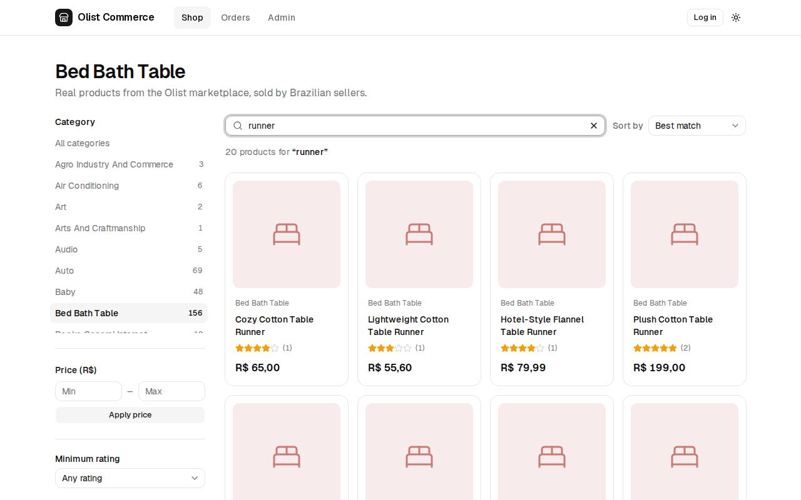](docs/images/shop.png)<br>**Shop**: category filter + full-text search | [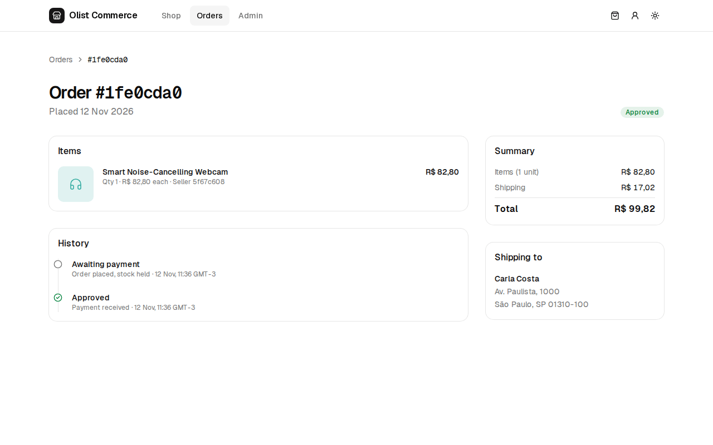](docs/images/order-approved.png)<br>**Order**: approved, updated live over SSE | [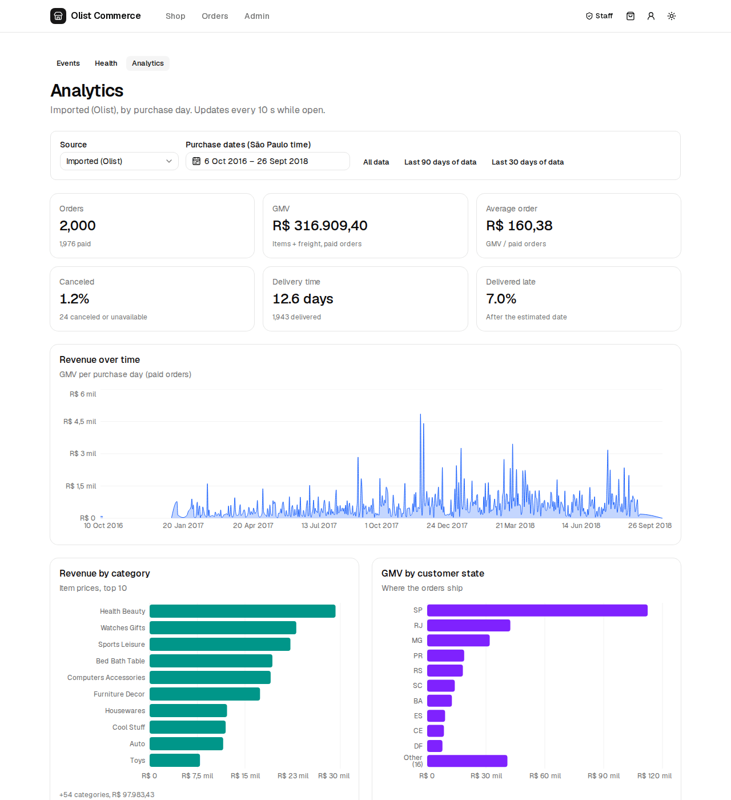](docs/images/staff-analytics.png)<br>**Staff**: analytics dashboard |

<details>
<summary>More screenshots</summary>

| | | |
|---|---|---|
| [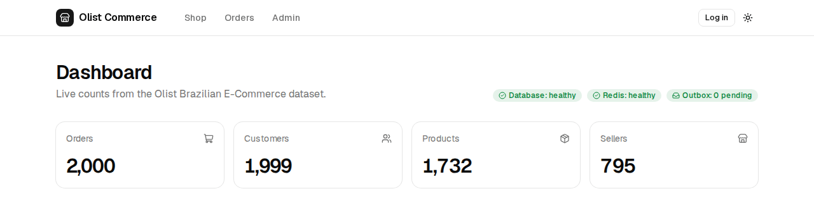](docs/images/home.png)<br>**Home**: live counts and health | [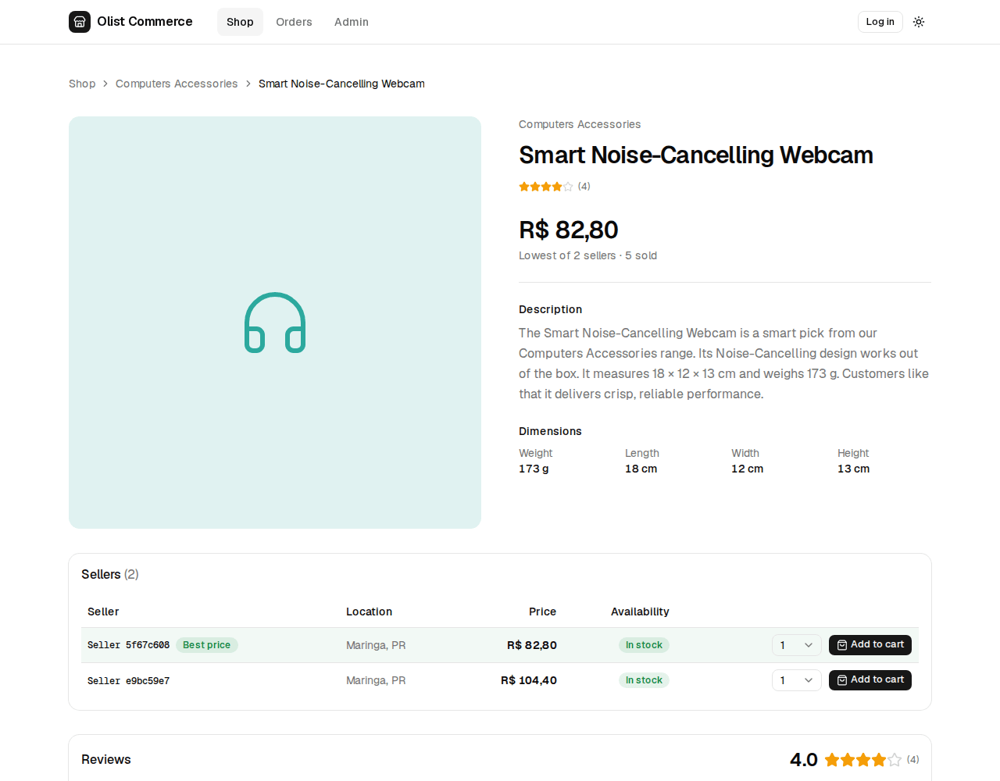](docs/images/product.png)<br>**Product**: one seller's offer per row | [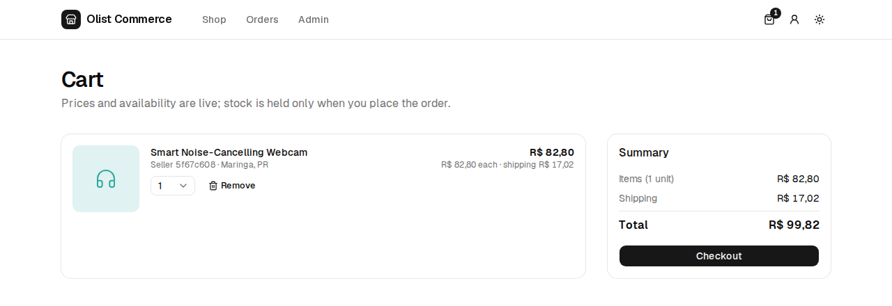](docs/images/cart.png)<br>**Cart**: never reserves stock |
| [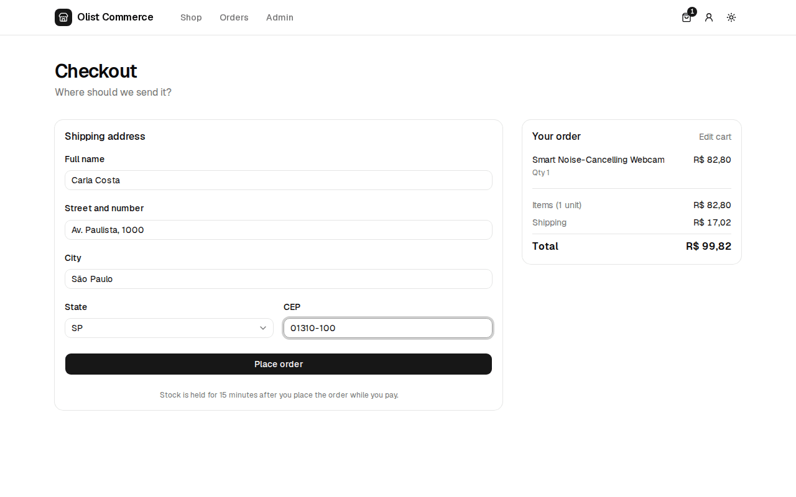](docs/images/checkout.png)<br>**Checkout**: address, then place order | [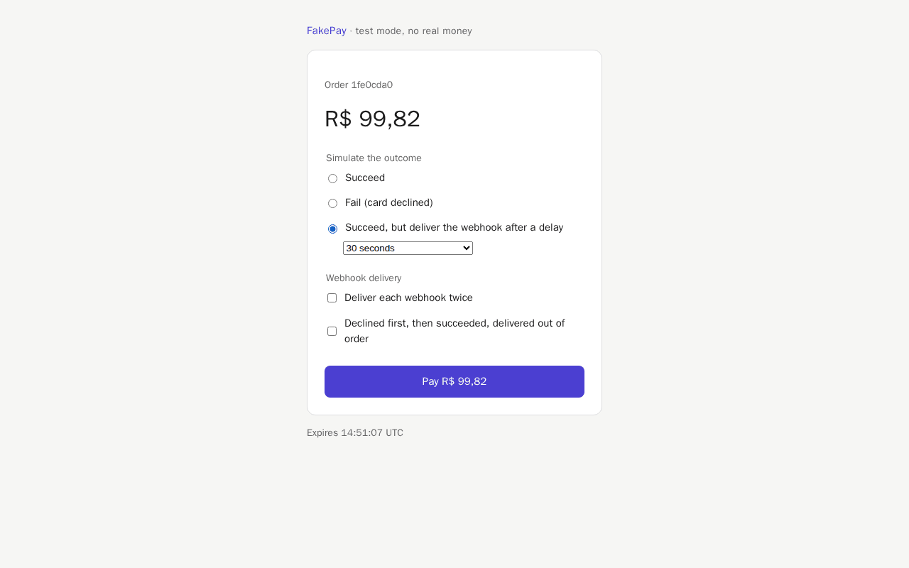](docs/images/payment-page.png)<br>**Fake provider**: succeed, fail or delay | [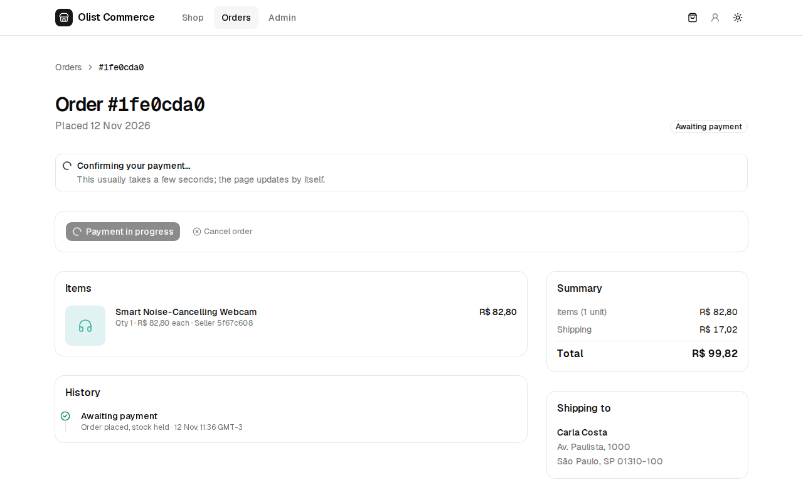](docs/images/order-processing.png)<br>**Order**: payment in progress |
| [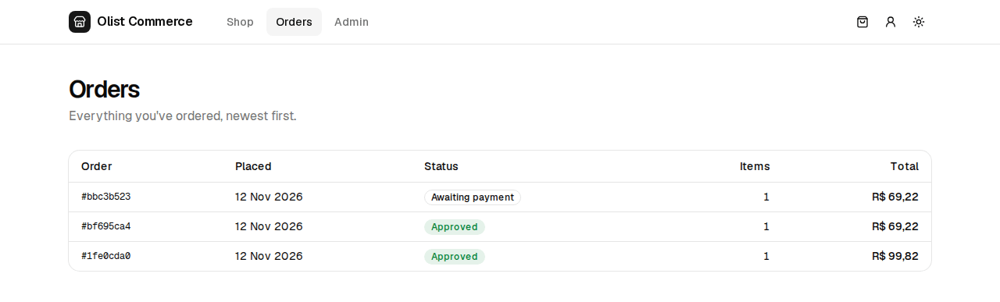](docs/images/orders-list.png)<br>**Orders**: the customer's history | [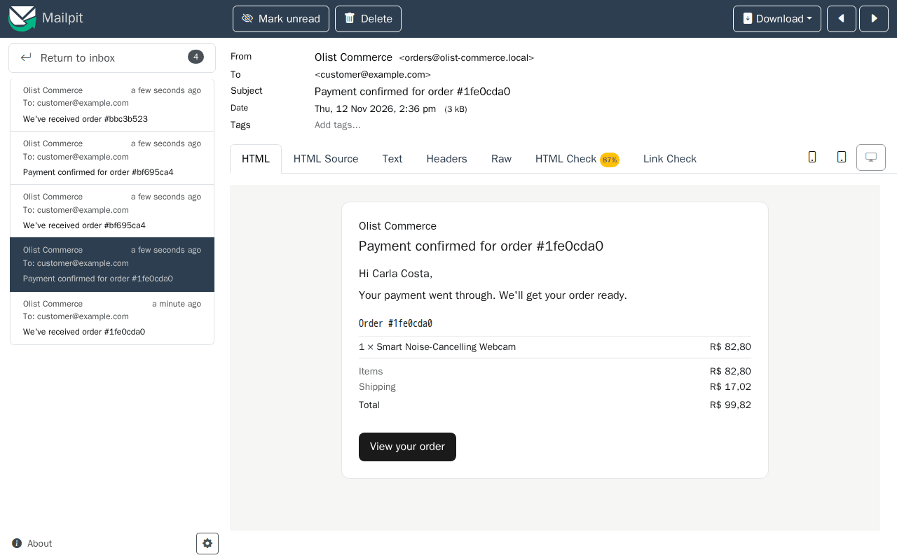](docs/images/email.png)<br>**Email**: payment confirmation in Mailpit | [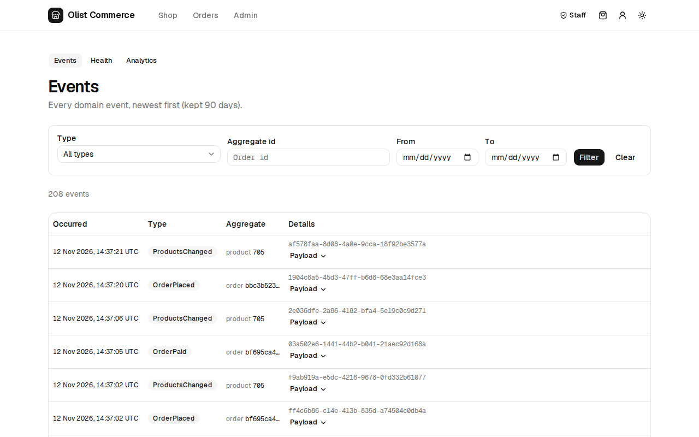](docs/images/staff-events.png)<br>**Staff**: every domain event |
| [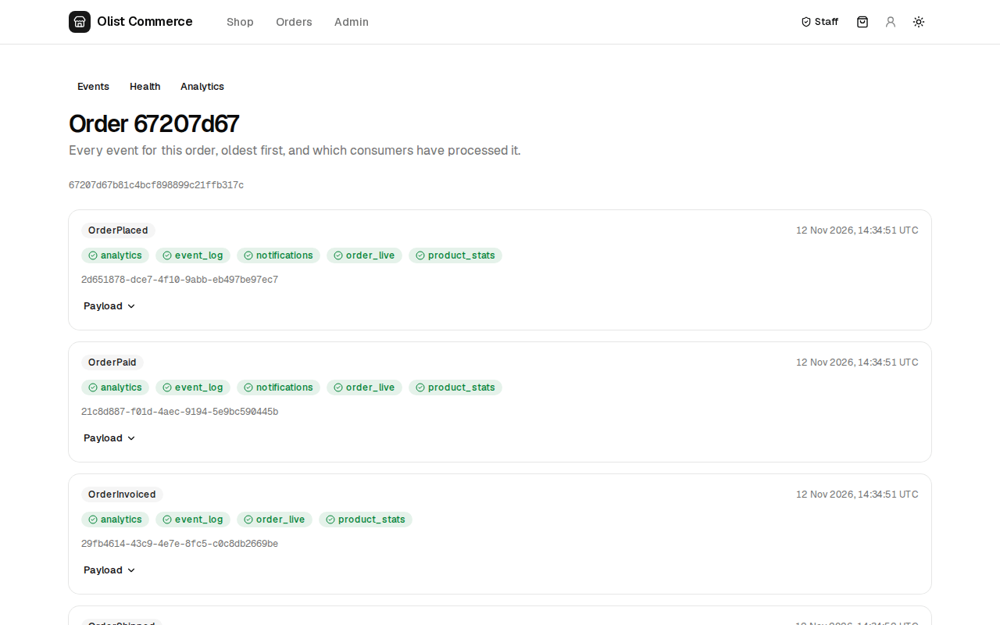](docs/images/staff-order-timeline.png)<br>**Staff**: one order's events and consumers | [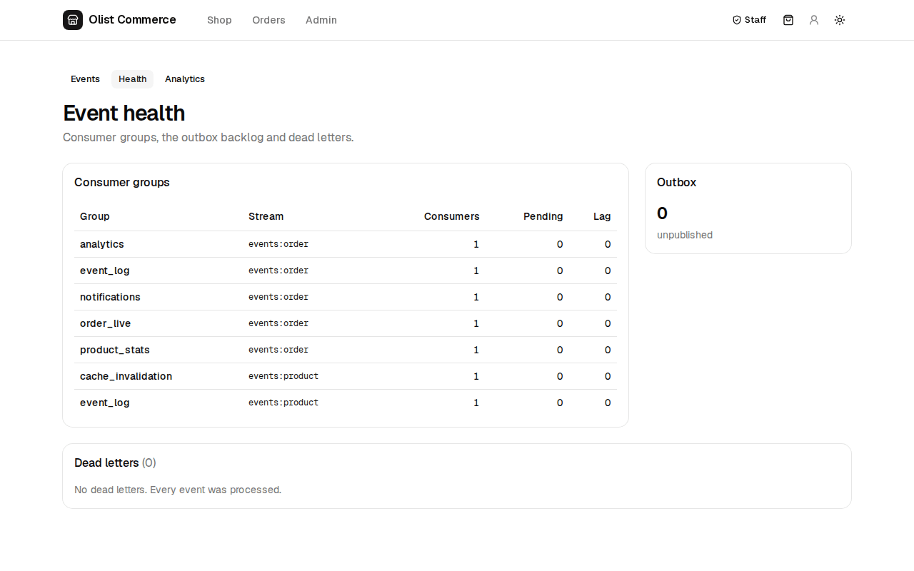](docs/images/staff-health.png)<br>**Staff**: consumer lag, outbox, dead letters | [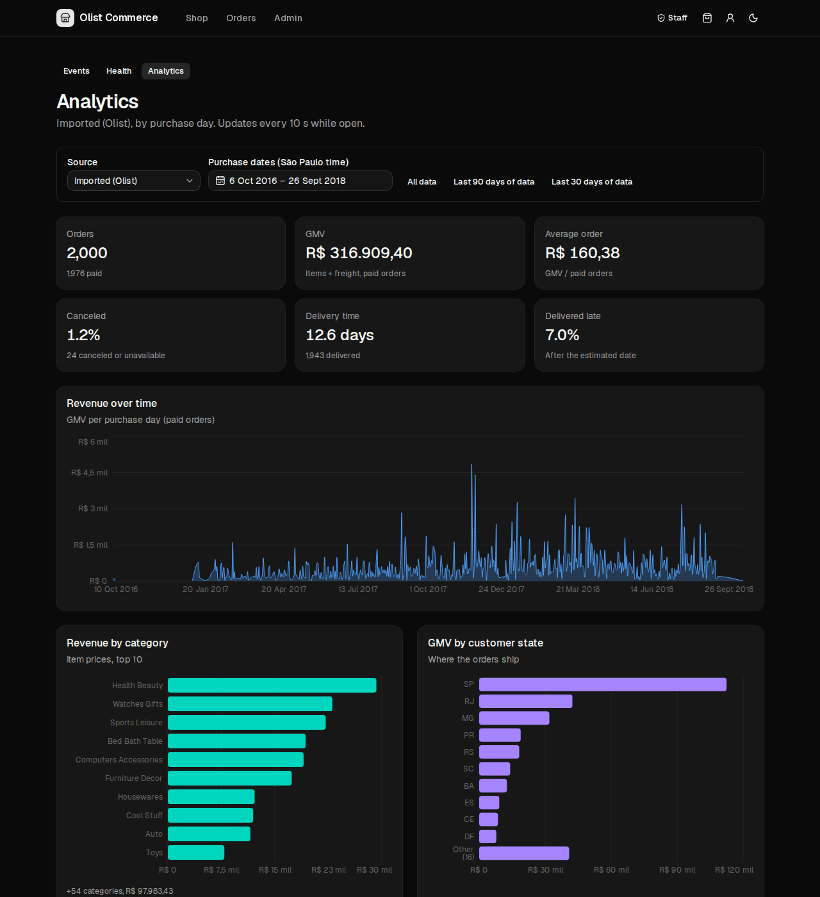](docs/images/staff-analytics-dark.png)<br>**Staff**: analytics, dark theme |
| [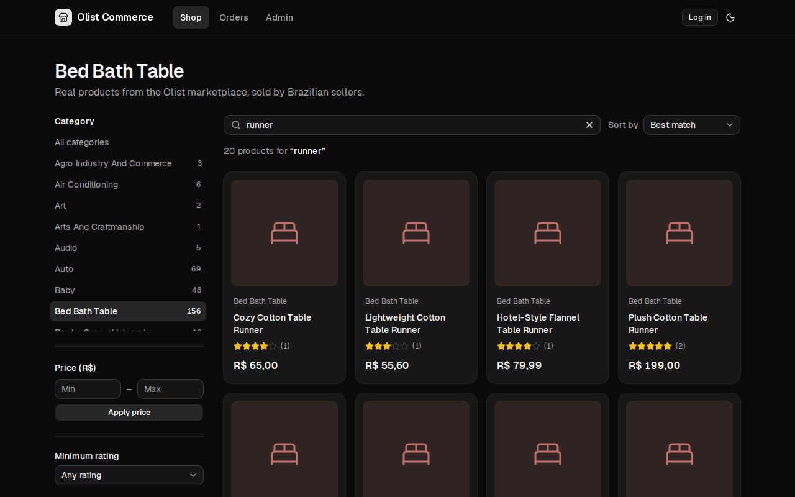](docs/images/shop-dark.png)<br>**Shop**: dark theme | [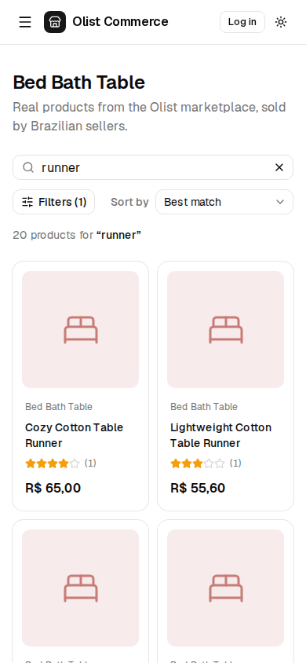](docs/images/shop-mobile.png)<br>**Shop**: 390 px wide | |

</details>

*Regenerated by `make screenshots` against a disposable stack; see the [runbook](docs/operations/runbook.md#regenerate-the-readme-screenshots).*

## Highlights: hard problems solved

- **Oversell-proof checkout.** Stock is reserved at checkout under row locks taken in one fixed order, and an `Idempotency-Key` makes a retried request return the same order: [cart, checkout and stock](docs/flows/cart-checkout-stock.md), [ADR 0015](docs/adr/0015-stock-reserved-at-checkout-under-row-locks.md).
- **Events that can't be lost or invented.** Each change writes its event to an outbox table in the same transaction, and a relay publishes it to Redis Streams, so a rollback produces no event and a crash produces no gap: [event pipeline](docs/flows/event-pipeline.md), [ADR 0002](docs/adr/0002-transactional-outbox-and-relay.md).
- **Effectively-once consumers.** Delivery is at-least-once, so each consumer records the event id in the same transaction as its side effects and recomputes from the database instead of applying deltas: [ADR 0003](docs/adr/0003-state-based-idempotent-consumers.md).
- **Signed, out-of-order webhooks.** HMAC over the raw body, a replay window, duplicate and stale-event handling, and money that arrives for an order that can no longer take it is flagged for refund: [payments](docs/flows/payments.md), [ADR 0006](docs/adr/0006-payment-intent-vs-ledger.md).
- **Live order tracking over SSE.** A separate ASGI service re-reads a database snapshot whenever a lossy Pub/Sub signal says something changed, so a missed signal is repaired by the next one or a reconnect: [live tracking](docs/flows/live-tracking.md), [ADR 0007](docs/adr/0007-sse-signal-plus-snapshot.md).
- **Race-free replay.** Imported orders are re-enacted through the real order services on a simulated clock; one run at a time is enforced by a partial unique index, and the replay's analytics matched the imported totals: [replay](docs/flows/replay.md), [ADR 0014](docs/adr/0014-replay-through-real-services.md).
- **Analytics projections.** Per-day tables rebuilt from the orders under per-day advisory locks, so concurrent consumers queue instead of double-counting: [analytics](docs/flows/analytics.md), [ADR 0011](docs/adr/0011-analytics-projections-recompute.md).
- **Bugs found by checking the docs against the code.** Five real bugs (a live-update race in order streams, a wrong refund email, a navigation race, credentials in a URL, an e2e run that polluted the dev database), each fixed with a test that failed before the fix or with before/after checks: [interview guide](docs/interview-guide.md#bugs-found-and-how).

## Architecture

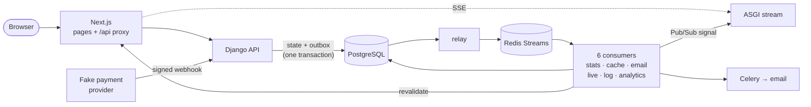

The detail is in [docs/architecture.md](docs/architecture.md).

## Tech stack

| Technology | Used for | Notes |
|---|---|---|
| Python 3.13, Django 6 | the whole backend: models, ORM, admin, sessions, ASGI | [python](docs/stack/python.md), [django](docs/stack/django.md) |
| Django REST Framework, drf-spectacular | the API and its OpenAPI schema | [drf-and-openapi](docs/stack/drf-and-openapi.md) |
| PostgreSQL 17 | the system of record, outbox, constraints, full-text search | [postgresql](docs/stack/postgresql.md) |
| Redis 7 | event streams, Pub/Sub signals, the Celery broker | [redis](docs/stack/redis.md) |
| Celery, uvicorn | webhook delivery, email, reservation expiry; the SSE service | [celery-and-asgi](docs/stack/celery-and-asgi.md) |
| Next.js (App Router) | Server Components, caching, the same-origin API proxy | [nextjs](docs/stack/nextjs.md) |
| React, TypeScript | the UI, with types generated from the OpenAPI schema | [react-and-typescript](docs/stack/react-and-typescript.md) |
| Tailwind, shadcn/ui, Recharts | the design system, dark mode, charts | [ui](docs/stack/ui.md) |
| pytest, Vitest, Playwright | backend, frontend and end-to-end tests | [backend-testing](docs/stack/backend-testing.md), [frontend-testing](docs/stack/frontend-testing.md) |
| Docker Compose, Make | one command starts everything | [docker-and-make](docs/stack/docker-and-make.md) |

## Quick start

You need Docker with Compose v2 and `make`. Download the
[Olist dataset](https://www.kaggle.com/datasets/olistbr/brazilian-ecommerce) from Kaggle and put
the CSVs directly in `data/olist/` (the folder is gitignored).

```sh
cp .env.example .env   # adjust the host ports here if they clash with something local
make up                # build and start every service
make migrate           # create the schema
make seed              # import ~2,000 orders, create the dev users, build the analytics
```

| What | URL |
|---|---|
| Shop | http://localhost:3000/shop |
| API docs (Swagger) | http://localhost:8000/api/docs/ |
| Email (Mailpit) | http://localhost:8025 |

Dev accounts, password `devpass123` (`DEV_USER_PASSWORD` in `.env`): `customer@example.com` (buy
something), `staff@example.com` (event explorer, health, analytics), `admin@example.com`
(superuser) and `replay@example.com` (owns replayed orders).

Everything else (other ports, snapshots, replays, what each `make` target does to your data,
troubleshooting) is in the [runbook](docs/operations/runbook.md).

## Documentation map

| Document | What's in it |
|---|---|
| [Architecture](docs/architecture.md) | processes, request paths, where consistency is synchronous or eventual |
| [Data model](docs/data-model.md) | tables, relations, constraints |
| [API](docs/api.md) | endpoints, errors and conventions |
| [Flows](docs/flows/event-pipeline.md) | one page per feature: [checkout](docs/flows/cart-checkout-stock.md), [payments](docs/flows/payments.md), [live tracking](docs/flows/live-tracking.md), [replay](docs/flows/replay.md), [analytics](docs/flows/analytics.md) and more |
| [ADRs](docs/adr/README.md) | 17 decision records: what was chosen, and what was given up |
| [Concepts](docs/concepts/README.md) | tutorials on transactions, locks, idempotency, delivery guarantees and more, with exercises |
| [Stack reference](docs/stack/README.md) | one page per technology: what this project uses, with code |
| [Testing](docs/testing.md) | the suites, the isolated e2e stack, known gaps |
| [Runbook](docs/operations/runbook.md) | running, walkthroughs, data safety, symptoms and fixes |
| [Limitations and roadmap](docs/limitations-and-roadmap.md) | what it doesn't do, where it breaks first, what could come next |
| [Interview guide](docs/interview-guide.md) | a 60-second pitch, a 5-minute walkthrough, and the bugs found |

## Testing

Backend (pytest, including real concurrent transactions), frontend (Vitest and Testing Library) and
a typecheck run with `make test`; the last recorded run was 354 backend and 91 frontend tests, all
passing ([testing.md](docs/testing.md#latest-run-2026-11-09)). `make e2e` runs Playwright smoke
tests, which log in, buy, pay on the provider's page and check the email, on a **separate compose
project with its own database**, seeded fresh each run, and checked to be the e2e database before
anything writes ([how it works](docs/testing.md#the-isolated-e2e-stack)).

## Project status

The roadmap is complete: catalog and search, cart and checkout, payments, the event pipeline, live
tracking, email, analytics, replay and the staff tools all work end to end, and are documented.
What's next is **deployment**: a production server, HTTPS and secure cookies, rate limiting and
real secrets. The checklist is in [CLAUDE.md](CLAUDE.md#before-deploying-not-done-yet--required-for-any-non-local-environment)
and the [runbook](docs/operations/runbook.md#production); what else is open is in
[limitations and roadmap](docs/limitations-and-roadmap.md).
