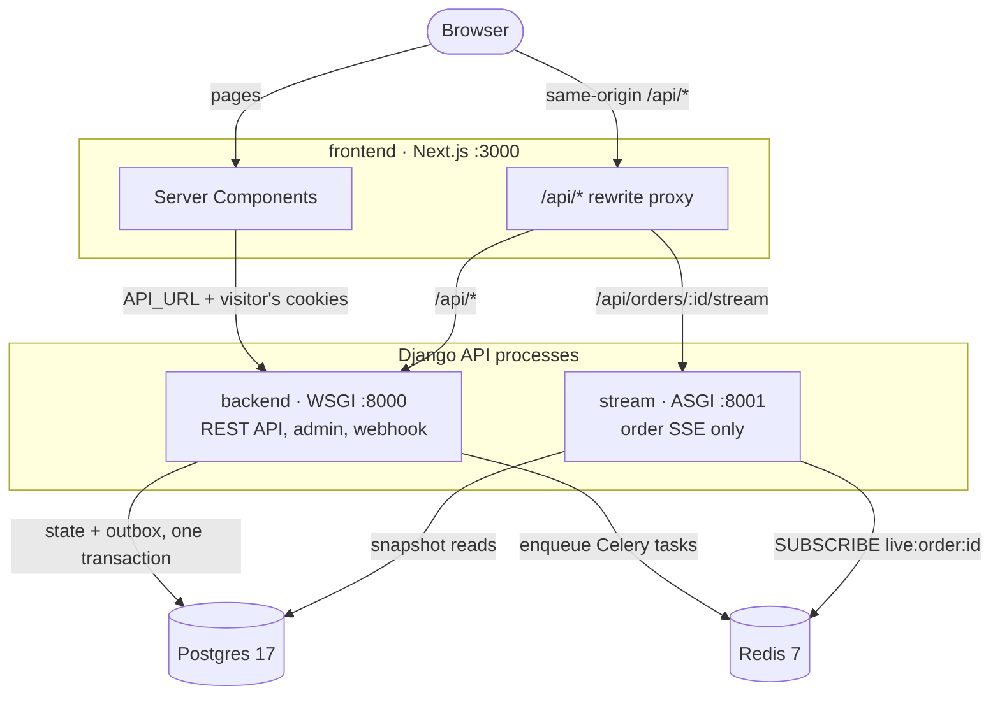
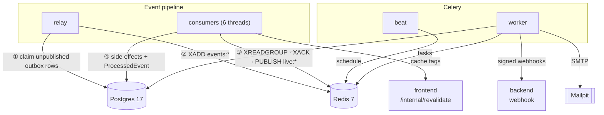

# Architecture

This is a single Django codebase and a Next.js frontend, run as several processes by Docker
Compose. Every order, payment and stock change happens in a Postgres transaction. Each change
also writes a domain event to an outbox table in that same transaction. A relay copies those
events to Redis Streams. Independent consumers react to them: stats, cache invalidation,
emails, live updates, the event log and analytics.

This page covers the processes, the request paths, where consistency is synchronous and where
it is eventual, and how the code is organised. The individual flows are described in
[flows/](flows/), and the reasons behind key decisions in [adr/](adr/).

## System context

How a request reaches Django:



## Processes

All the Django processes run the same code from [backend/](../backend/). They differ only in
their entry point ([docker-compose.yml](../docker-compose.yml)).

| Service | Entry point | Host port | Job |
|---|---|---|---|
| `backend` | `manage.py runserver` (WSGI) | `BACKEND_HOST_PORT` (default 8000) → 8000 | The REST API, Django admin, OpenAPI schema and the payment webhook |
| `stream` | `uvicorn config.asgi:application` | none (internal :8001) | Only `GET /api/orders/<id>/stream/` (Server-Sent Events) |
| `worker` | `celery -A config worker` | none | Fake-provider webhook delivery, sending emails, reservation expiry |
| `beat` | `celery -A config beat` | none | Schedules the periodic tasks (see below) |
| `relay` | `manage.py run_relay` | none | Publishes outbox rows to Redis Streams |
| `consumers` | `manage.py run_consumers` | none | One thread per event consumer |
| `frontend` | Next.js dev server | `FRONTEND_HOST_PORT` (default 3000) → 3000 | Pages (Server Components), the `/api` proxy, cache revalidation |
| `db` | Postgres 17 | `DB_HOST_PORT` (default 5432) → 5432 | The only system of record |
| `redis` | Redis 7, AOF `appendfsync everysec` | `REDIS_HOST_PORT` (default 6379) → 6379 | Celery broker, event streams, live-update Pub/Sub |
| `mailpit` | Mailpit | `MAILPIT_HOST_PORT` (default 8025) → 8025 (web UI; SMTP :1025 internal) | A dev SMTP server with a web UI |

**Ports.** Host ports come from `.env`, so they can be moved when the defaults clash with
other local services. For example, a `.env` with `FRONTEND_HOST_PORT=3001` serves the site at
http://localhost:3001; the container still listens on 3000. Containers always talk to each
other on the default ports. The `stream` service publishes no host port: browsers reach it
only through the Next proxy (`/api/orders/:id/stream`).

**Why separate processes, not one server.**
- **`stream` runs separately because an open SSE connection must not occupy a WSGI worker.**
  Under ASGI an idle stream is just a suspended coroutine. The rest of the API stays on WSGI,
  because under ASGI Django's sync views would share one thread
  ([config/asgi.py](../backend/config/asgi.py)). The view refuses to stream under WSGI: it
  returns 404 instead of buffering a whole stream
  ([apps/orders/stream.py](../backend/apps/orders/stream.py)).
- **`relay` and `consumers` are long-running loops, not Celery tasks.** They block on the
  database and on `XREADGROUP`. Both are safe to run more than once:
  - the relay claims rows with `SELECT … FOR UPDATE SKIP LOCKED`;
  - consumers are members of Redis consumer groups.

  See [flows/event-pipeline.md](flows/event-pipeline.md).
- **Celery handles work that is triggered by time or needs retries**: webhook delivery, email
  sending, and the beat schedule.

What runs behind the requests (① to ④ follow one event through the pipeline):



The beat schedule, from [config/settings/base.py](../backend/config/settings/base.py):

| Task | Every | Purpose |
|---|---|---|
| `release_expired_reservations` | 60 s | Cancel unpaid orders whose stock hold expired, and return the stock |
| `send_due_notifications` | 30 s | Send pending emails that are due: retries after backoff, and any whose enqueue was lost |
| `purge_expired_idempotency_keys` | 24 h | Delete expired idempotency keys (they live 24 h) |
| `purge_old_events` | 24 h | Delete published outbox rows after 7 days, and EventLog + ProcessedEvent after 90 days |

## Request paths

There are three ways a request reaches Django.

1. **The browser calls `/api/*` on the frontend's own origin.** A rewrite in
   [frontend/next.config.ts](../frontend/next.config.ts) proxies the call to `backend`. So the
   `sessionid` and `csrftoken` cookies are first-party, and there is no CORS.
   - `skipTrailingSlashRedirect` keeps Django's trailing slashes.
   - Without it, a `POST` to `/api/cart/` would be redirected, and Django can't redirect a POST.
2. **Live order streams** use `/api/orders/:id/stream`. This path is listed before the general
   `/api/*` rule and goes to `STREAM_URL` (the `stream` service).
3. **Server Components** call `API_URL` directly and forward the visitor's cookies
   ([frontend/src/lib/api/server.ts](../frontend/src/lib/api/server.ts)). Every call goes through
   `withTimeout()` (5 s) in [frontend/src/lib/api/client.ts](../frontend/src/lib/api/client.ts).

Requests also flow in the other direction, from backend processes to other services:
- The `worker` posts signed webhooks to `BACKEND_INTERNAL_URL`. It does this on the fake
  provider's behalf.
- The `cache_invalidation` consumer posts cache tags to the frontend's `/internal/revalidate`
  route, at `FRONTEND_INTERNAL_URL`, with a shared secret.

Auth details are in [flows/auth-and-sessions.md](flows/auth-and-sessions.md).

## Write path and read side

Every change goes through a service function in the same shape: lock the rows, check the rule,
change the state, record an event, commit. Examples:
- checkout, payment, cancel, expiry and fulfilment in
  [apps/orders/services.py](../backend/apps/orders/services.py);
- the webhook handling in [apps/payments/services.py](../backend/apps/payments/services.py).

Views stay thin. Services raise plain domain errors ([apps/core/errors.py](../backend/apps/core/errors.py)),
and one DRF exception handler maps them to HTTP. So the same services can be called from
views, Celery tasks, management commands and tests.

```
service():  BEGIN
              lock rows (select_for_update, fixed lock order)
              check + transition (apps/orders/state.py)
              write state (orders, stock, reservations, history)
              record_event()  → OutboxEvent row
            COMMIT          ← the event exists if and only if the change does
```

What is updated synchronously and what is eventual:

| Data | Updated | Why |
|---|---|---|
| Stock, reservations, order status | In the service's transaction | Overselling must be impossible ([flows/cart-checkout-stock.md](flows/cart-checkout-stock.md)) |
| `Product.min_price`, rating | Right after commit (`refresh_product_stats_on_commit`) | The listing's price and its in-stock filter must be correct at once |
| `Product.sales_count` | `product_stats` consumer (seconds of lag) | Ordering by popularity tolerates lag; the consumer recomputes from the DB |
| Product page cache (Next `"use cache"`) | `cache_invalidation` consumer, after `product_stats` | Chained so that revalidation always follows the recompute |
| Analytics projections | `analytics` consumer | Dashboard data; see [flows/analytics.md](flows/analytics.md) |
| Emails | `notifications` consumer → Celery sender | Never sent inside a transaction ([flows/notifications.md](flows/notifications.md)) |
| Live order page | `order_live` consumer → Pub/Sub → `stream` | The signal carries no state; the stream re-reads the DB ([flows/live-tracking.md](flows/live-tracking.md)) |
| Event history | `event_log` consumer | Powers the staff explorer ([flows/staff-tools.md](flows/staff-tools.md)) |

The Olist importer is the one writer that emits no events. It isn't part of the order flow, so
after an import the stats are recomputed with set-based SQL instead
([flows/olist-import.md](flows/olist-import.md)).

## Code map

### Backend: `backend/apps/`

| App | Responsibility |
|---|---|
| [accounts](../backend/apps/accounts/) | Custom `User` (case-insensitive unique email), session login/register/logout, 401-for-anonymous auth class |
| [core](../backend/apps/core/) | Health and stats endpoints, the Olist importer, `IdempotencyKey` + `run_idempotent`, domain errors, dev seeding commands |
| [catalog](../backend/apps/catalog/) | Category, Product, Seller, Offer; catalog API; generated names/descriptions (`enrichment.py`); set-based stats SQL (`stats.py`) |
| [customers](../backend/apps/customers/) | `Customer`: the real person (Olist's `customer_unique_id`), optionally linked to a `User` |
| [cart](../backend/apps/cart/) | Cart and lines. A cart never reserves stock |
| [orders](../backend/apps/orders/) | Orders and their history; the state machine (`state.py`); the services that change stock and status; order events; live snapshot and the SSE view |
| [payments](../backend/apps/payments/) | `PaymentIntent`, `ProviderEvent`, the `PaymentGateway` interface, HMAC verification, the webhook |
| [fake_provider](../backend/apps/fake_provider/) | A Stripe-like provider for dev and tests: hosted page, intents, signed webhook delivery. Its URLs are mounted only with `ALLOW_FAKE_PAYMENTS` |
| [events](../backend/apps/events/) | Outbox, relay, consumer framework, the six consumers, event log, dead-letter retry records |
| [notifications](../backend/apps/notifications/) | `Notification` rows, email rendering, the Celery sender |
| [staff](../backend/apps/staff/) | Staff-only API: event explorer, order timelines, consumer health, dead-letter retry, analytics endpoint |
| [analytics](../backend/apps/analytics/) | Projection tables, set-based recompute, dashboard queries, backfill command |
| [replay](../backend/apps/replay/) | Replays imported orders as live events (dev/test only) |

Settings live in [backend/config/settings/](../backend/config/settings/): `base.py`, plus `dev.py`
for the running stack and `test.py`, which pytest always uses.

### Frontend: `frontend/src/`

- **App Router pages** are in [app/](../frontend/src/app/): the storefront (`/`, `/shop`,
  `/shop/[slug]`), the cart, checkout, orders, login/register, and staff pages under `/staff`.
- **Caching:** `cacheComponents` is on. Only the product detail fetch is cached
  (`"use cache"` with `cacheTag`, in [lib/api/catalog.ts](../frontend/src/lib/api/catalog.ts)).
  Listings stay dynamic.
- **API types** are generated from the OpenAPI schema by `make types`
  ([lib/api/schema.d.ts](../frontend/src/lib/api/schema.d.ts)), and used through `openapi-fetch`.
  - Server Components use [lib/api/server.ts](../frontend/src/lib/api/server.ts).
  - Client Components use [lib/api/browser.ts](../frontend/src/lib/api/browser.ts), which sends
    `X-CSRFToken`.
- **UI** is built from shadcn/ui primitives in [components/ui/](../frontend/src/components/ui/),
  composed into feature folders under [components/](../frontend/src/components/).
- **URL state:** the URL is the single source of truth for shop filters, staff event filters
  and analytics filters ([lib/shop-params.ts](../frontend/src/lib/shop-params.ts),
  [lib/staff-params.ts](../frontend/src/lib/staff-params.ts),
  [lib/analytics-params.ts](../frontend/src/lib/analytics-params.ts)).

## Sources

- [docker-compose.yml](../docker-compose.yml), [.env.example](../.env.example)
- [backend/config/settings/base.py](../backend/config/settings/base.py), [backend/config/urls.py](../backend/config/urls.py), [backend/config/asgi.py](../backend/config/asgi.py)
- [frontend/next.config.ts](../frontend/next.config.ts), [frontend/src/lib/api/](../frontend/src/lib/api/)
- [backend/apps/orders/services.py](../backend/apps/orders/services.py), [backend/apps/orders/stream.py](../backend/apps/orders/stream.py)
- [backend/apps/events/consumers/\_\_init\_\_.py](../backend/apps/events/consumers/__init__.py)
