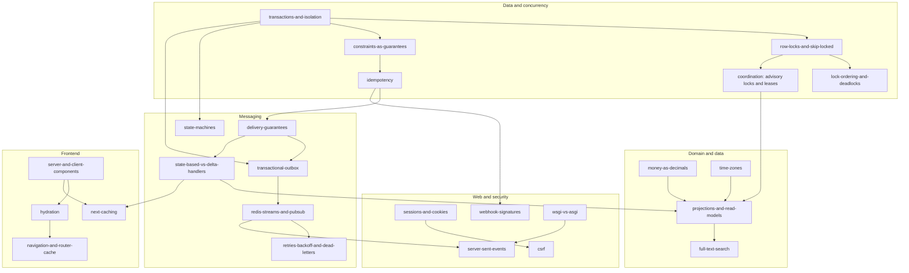

# Concepts

Tutorials on the ideas this project is built on: transactions and locks, idempotency, event
delivery, Redis Streams, CSRF, Server-Sent Events, React Server Components, and more. The
[flow docs](../flows/) and [ADRs](../adr/README.md) explain **what this project does**; these
pages explain **the concepts they assume**, in general terms first, then in this codebase.

Each page has:
1. **What it is**, in general terms;
2. **The problem it solves**, with a minimal worked example;
3. **A diagram**, where one helps;
4. **In this project:** links to the flow docs, ADRs, code and tests;
5. **Pitfalls and interview follow-ups** (concept-level; the project-specific questions are in
   [interview-guide.md](../interview-guide.md));
6. **Hands-on exercises in this repo,** each with the expected result and a worked solution;
7. **Further reading:** official docs for the versions used here, and original sources.

**Exercises never modify the dev database.** Each one says where it runs:
- **A.** The isolated lab stack (`make lab-up`).
- **B.** The dev database, read-only (`SELECT` and `EXPLAIN` only).
- **C.** The test suite, with a mutation you undo straight away.

[lab.md](lab.md) has the setup and the rules.

**Versions** (checked 2026-11-12): PostgreSQL 17, Redis 7, Django 6.1.2, Celery 5.6.3, Next.js
16.4.2, React 19.3.0. Claims that couldn't be checked against an official source are marked
**Unverified**.

## Reading order

An arrow means "read this first". Start at the top of any column; the data column underpins most
of the rest.

## Pages

Written so far (2026-11-12): the data and concurrency group, plus state-machines,
delivery-guarantees and transactional-outbox, and [lab.md](lab.md). The other pages are
planned for the next batches; until then, their links don't resolve yet.

| Group | Page | Covers |
|---|---|---|
| Data and concurrency | [transactions-and-isolation](transactions-and-isolation.md) | ACID, MVCC, Read Committed vs Repeatable Read vs Serializable, savepoints, `on_commit` |
| | [row-locks-and-skip-locked](row-locks-and-skip-locked.md) | `FOR UPDATE`, `NOWAIT`, `SKIP LOCKED`, Postgres as a work queue |
| | [lock-ordering-and-deadlocks](lock-ordering-and-deadlocks.md) | Deadlock detection, a global lock order, retry as a second line |
| | [constraints-as-guarantees](constraints-as-guarantees.md) | CHECK, partial unique indexes, `NULLS NOT DISTINCT`, PROTECT; letting the database decide races |
| | [idempotency](idempotency.md) | Idempotency keys, natural keys and upserts, dedupe tables |
| | [coordination-advisory-locks-and-leases](coordination-advisory-locks-and-leases.md) | Advisory locks; leases, heartbeats, takeover and fencing |
| Messaging | [state-machines](state-machines.md) | Transition tables, illegal moves, history rows, checking under a lock |
| | [delivery-guarantees](delivery-guarantees.md) | At most, at least and effectively once |
| | [transactional-outbox](transactional-outbox.md) | The dual-write problem, outbox + relay |
| | [redis-streams-and-pubsub](redis-streams-and-pubsub.md) | Consumer groups, the pending list, `XAUTOCLAIM`, persistence; Pub/Sub compared |
| | [state-based-vs-delta-handlers](state-based-vs-delta-handlers.md) | Ordering, recompute vs increment |
| | [retries-backoff-and-dead-letters](retries-backoff-and-dead-letters.md) | Backoff with jitter, poison messages, dead-letter queues |
| Domain and data | [money-as-decimals](money-as-decimals.md) | Floats vs decimals, rounding, money in JSON |
| | [time-zones](time-zones.md) | UTC storage, local input, business-day boundaries |
| | [projections-and-read-models](projections-and-read-models.md) | Read models, denormalised columns, rebuild vs incremental |
| | [full-text-search](full-text-search.md) | `tsvector`, GIN, weights, prefix queries, ranking |
| Web and security | [sessions-and-cookies](sessions-and-cookies.md) | Sessions vs tokens, cookie attributes, same-origin proxies, 401/403/404 |
| | [csrf](csrf.md) | The attack, tokens, origin checks, login CSRF, rotation |
| | [webhook-signatures](webhook-signatures.md) | HMAC over the raw body, timestamps, constant-time compare |
| | [wsgi-vs-asgi](wsgi-vs-asgi.md) | Worker threads vs an event loop |
| | [server-sent-events](server-sent-events.md) | EventSource, `Last-Event-ID`, heartbeats, signal + snapshot, proxy buffering |
| Frontend | [server-and-client-components](server-and-client-components.md) | What runs where, the props boundary, dynamic rendering |
| | [hydration](hydration.md) | The window before hydration, native form fallback |
| | [navigation-and-router-cache](navigation-and-router-cache.md) | Soft vs full navigation, `router.refresh()` |
| | [next-caching](next-caching.md) | `"use cache"`, `cacheLife`, `cacheTag`, `revalidateTag` |

## Which concepts each flow doc relies on

| Flow doc | Concepts |
|---|---|
| [olist-import](../flows/olist-import.md) | [constraints](constraints-as-guarantees.md), [idempotency](idempotency.md), [money](money-as-decimals.md), [time zones](time-zones.md), [projections](projections-and-read-models.md), [full-text search](full-text-search.md) |
| [catalog-and-search](../flows/catalog-and-search.md) | [projections](projections-and-read-models.md), [full-text search](full-text-search.md), [Next caching](next-caching.md), [state-based handlers](state-based-vs-delta-handlers.md) |
| [auth-and-sessions](../flows/auth-and-sessions.md) | [sessions and cookies](sessions-and-cookies.md), [CSRF](csrf.md), [Server and Client Components](server-and-client-components.md), [hydration](hydration.md), [navigation](navigation-and-router-cache.md) |
| [cart-checkout-stock](../flows/cart-checkout-stock.md) | [transactions](transactions-and-isolation.md), [row locks](row-locks-and-skip-locked.md), [lock ordering](lock-ordering-and-deadlocks.md), [constraints](constraints-as-guarantees.md), [idempotency](idempotency.md), [state machines](state-machines.md), [navigation](navigation-and-router-cache.md) |
| [payments](../flows/payments.md) | [idempotency](idempotency.md), [webhook signatures](webhook-signatures.md), [transactions](transactions-and-isolation.md) (savepoints), [lock ordering](lock-ordering-and-deadlocks.md), [state machines](state-machines.md), [retries](retries-backoff-and-dead-letters.md) |
| [event-pipeline](../flows/event-pipeline.md) | [transactional outbox](transactional-outbox.md), [delivery guarantees](delivery-guarantees.md), [Redis Streams](redis-streams-and-pubsub.md), [state-based handlers](state-based-vs-delta-handlers.md), [retries and dead letters](retries-backoff-and-dead-letters.md), [row locks](row-locks-and-skip-locked.md) (`SKIP LOCKED`) |
| [live-tracking](../flows/live-tracking.md) | [Server-Sent Events](server-sent-events.md), [Redis Pub/Sub](redis-streams-and-pubsub.md), [WSGI vs ASGI](wsgi-vs-asgi.md), [navigation](navigation-and-router-cache.md) (`router.refresh()`) |
| [notifications](../flows/notifications.md) | [transactions](transactions-and-isolation.md) (`on_commit`), [row locks](row-locks-and-skip-locked.md) (`SKIP LOCKED`), [idempotency](idempotency.md), [retries](retries-backoff-and-dead-letters.md) |
| [analytics](../flows/analytics.md) | [projections](projections-and-read-models.md), [coordination](coordination-advisory-locks-and-leases.md) (advisory locks), [state-based handlers](state-based-vs-delta-handlers.md), [time zones](time-zones.md), [money](money-as-decimals.md) |
| [replay](../flows/replay.md) | [coordination](coordination-advisory-locks-and-leases.md) (leases, fencing), [state machines](state-machines.md), [idempotency](idempotency.md), [constraints](constraints-as-guarantees.md) |
| [staff-tools](../flows/staff-tools.md) | [Redis Streams](redis-streams-and-pubsub.md), [retries and dead letters](retries-backoff-and-dead-letters.md), [sessions](sessions-and-cookies.md) (404 semantics) |
