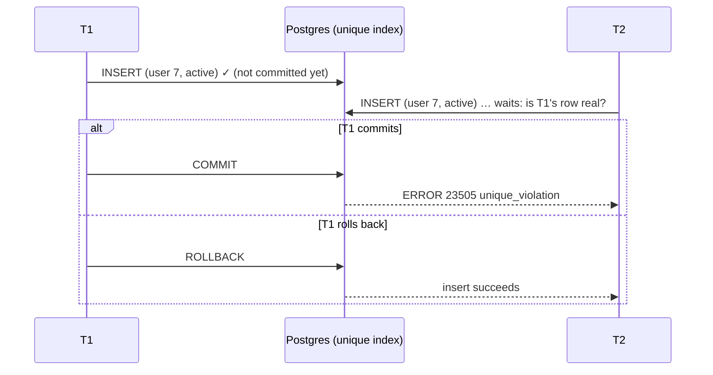

# Constraints as guarantees

## What it is

A **constraint** is a rule the database enforces on every write, whoever makes it: your service
code, a management command, an admin action, a migration, or someone in `psql`. A write that
breaks the rule fails, and its transaction is aborted
([constraints](https://www.postgresql.org/docs/17/ddl-constraints.html)).

The kinds that carry business rules:

| Constraint | Rule it enforces |
|---|---|
| `CHECK` | A condition on the row's own values ("stock is not negative") |
| `UNIQUE` / unique index | No two rows share a key |
| **Partial** unique index | No two rows share a key **among the rows matching a predicate** ("at most one open payment per order") |
| `NULLS NOT DISTINCT` | Treats NULLs as equal for uniqueness, so "no value" can occur only once per key (Postgres 15+) |
| Foreign key | A referencing row must point at an existing row. Its `ON DELETE` action says what deleting the referenced row does: refuse (`NO ACTION`, the default, or `RESTRICT`) or take the references with it (`CASCADE`). A `DEFERRABLE INITIALLY DEFERRED` key is checked at commit, not at each statement |

Sources: [check constraints](https://www.postgresql.org/docs/17/ddl-constraints.html#DDL-CONSTRAINTS-CHECK-CONSTRAINTS),
[unique constraints](https://www.postgresql.org/docs/17/ddl-constraints.html#DDL-CONSTRAINTS-UNIQUE-CONSTRAINTS),
[foreign keys](https://www.postgresql.org/docs/17/ddl-constraints.html#DDL-CONSTRAINTS-FK),
[partial unique index example](https://www.postgresql.org/docs/17/indexes-partial.html#INDEXES-PARTIAL-EX3),
[Postgres 15 release notes](https://www.postgresql.org/docs/release/15.0/) (`NULLS NOT DISTINCT`).

**What a `CHECK` can't do.** It can't look at other rows or tables: Postgres doesn't support
`CHECK` constraints that reference table data. Rules across rows belong in unique, exclusion or
foreign key constraints instead.

## The problem it solves: "check, then insert" races

The rule: a user may have at most one *active* subscription. The obvious code:

```python
if not Subscription.objects.filter(user=user, active=True).exists():   # both see "none"
    Subscription.objects.create(user=user, active=True)                # both insert
```

Two concurrent requests can both pass the check, and both insert. Under Read Committed, nothing
about the `SELECT` stops the other transaction from inserting.

A **partial unique index** makes the rule part of the data:

```sql
CREATE UNIQUE INDEX one_active_subscription ON subscription (user_id) WHERE active;
```

Now the second insert can't succeed. And it doesn't fail too early either: if the first
transaction hasn't committed yet, the second insert **waits** for it
([unique index checks](https://www.postgresql.org/docs/17/index-unique-checks.html#INDEX-UNIQUE-CHECKS)):



That waiting is what makes a constraint a **race-free decision**: exactly one of the concurrent
inserts wins, and the loser finds out only once the winner is real. The application turns the
loser's `IntegrityError` into the right answer: "already running", "replay the stored response",
"duplicate, ignore".

Two habits go with it:
- **Insert inside a savepoint.** The violation aborts the transaction; a savepoint lets the code
  catch it and carry on ([transactions-and-isolation.md](transactions-and-isolation.md#transactions-in-django)).
- **Keep the check as a fast path, not the guarantee.** A friendly "you already have one" before
  the insert is fine UX; the constraint is what's actually relied on.

## In Django

Constraints are declared in a model's `Meta.constraints`, and created by migrations
([Django: constraints reference](https://docs.djangoproject.com/en/6.1/ref/models/constraints/)):
- **`CheckConstraint(condition=Q(...), name=...)`**.
- **`UniqueConstraint(fields=..., condition=Q(...))`.** With a condition, it's a partial unique
  index.
- **`nulls_distinct=False`** gives `NULLS NOT DISTINCT`.
- **Unique on expressions,** for example `Lower("email")`.
- **A violation raises `IntegrityError`.** `full_clean()` can also check constraints at
  validation time, but only the database check holds under concurrency.

### `on_delete` is not a database constraint (unless it's a `DB_*` value)

A `ForeignKey`'s `on_delete` (`CASCADE`, `PROTECT`, `RESTRICT`, `SET_NULL`, …) is carried out by
**Django's ORM**, not by Postgres. When you call `.delete()`, Django collects the related rows
first, then deletes them (`CASCADE`), or refuses by raising `ProtectedError` (`PROTECT`) or
`RestrictedError` (`RESTRICT`), both subclasses of `IntegrityError`
([on_delete](https://docs.djangoproject.com/en/6.1/ref/models/fields/#django.db.models.ForeignKey.on_delete),
[exceptions](https://docs.djangoproject.com/en/6.1/ref/exceptions/#django.db.models.ProtectedError)).
Django 6.1 adds `DB_CASCADE`, `DB_SET_NULL` and `DB_SET_DEFAULT`, which make the database do it;
this project uses none of them.

What Postgres itself holds is a plain foreign key. On this project's database every one, whatever
its `on_delete`, is `NO ACTION` and `DEFERRABLE INITIALLY DEFERRED` (read from `pg_constraint` on
2026-11-12: [exercise 4](#4-what-a-raw-delete-really-does) shows the query). The Django docs don't
state that shape, so this is an observation of this database, not a documented rule. It means:
- **From the ORM,** `PROTECT` refuses before any SQL `DELETE` is sent, with `ProtectedError`.
- **From raw SQL** (psql, a migration's `RunSQL`), `on_delete` doesn't exist. A `DELETE` of a
  referenced row succeeds as a statement, because the key is deferred. The transaction then fails
  **at `COMMIT`**, because `NO ACTION` still forbids dangling references. Nothing is cascaded
  either: a raw delete of a product doesn't delete its offers, it fails.

## In this project

Every one of these is a business rule, not just data hygiene
([data-model.md](../data-model.md#constraints-that-carry-business-rules)):

| Constraint | Model | Guarantees |
|---|---|---|
| `CHECK (stock >= 0)` (from `PositiveIntegerField`) | `Offer.stock` ([catalog/models.py](../../backend/apps/catalog/models.py)) | No oversell, even if service code were wrong (`test_stock_check_constraint_blocks_negative_stock`) |
| `review_score_1_to_5`, cart line quantity 1–10, `reservation_quantity_positive` | `Review`, `CartItem`, `Reservation` | Values in range |
| `uniq_open_intent_per_order` (partial: status in requires_payment, processing) | `PaymentIntent` ([payments/models.py](../../backend/apps/payments/models.py)) | One open payment per order: a second Pay click reuses it (`test_two_concurrent_pay_clicks_get_one_intent`) |
| `one_running_replay` (partial: status = running) | `ReplayRun` ([replay/models.py](../../backend/apps/replay/models.py)) | One replay at a time, even when two start at once (`test_two_runs_starting_at_once_cannot_both_start`) |
| `uniq_replay_copy` (partial: `replay_of` not null) | `Order` ([orders/models.py](../../backend/apps/orders/models.py)) | At most one copy per original |
| `uniq_user_email_ci` (unique on `Lower(email)`, partial: email not empty) | `User` ([accounts/models.py](../../backend/apps/accounts/models.py)) | Emails unique regardless of case |
| `uniq_idempotency_user_key` | `IdempotencyKey` | A checkout key is used once per user ([idempotency](idempotency.md)) |
| `uniq_provider_event`, `uniq_processed_event`, `uniq_notification_event_kind` | `ProviderEvent`, `ProcessedEvent`, `Notification` | Dedupe: a webhook, an event per consumer, an email per event and kind |
| `uniq_category_sales` with `nulls_distinct=False` | `CategorySales` ([analytics/models.py](../../backend/apps/analytics/models.py)) | "No category" is one row per day and source, not many |

**Enforced by Django, not the database:** `on_delete=PROTECT` on `Order.replay_of` and
`replay_run`, and on order items' product and seller ([orders/models.py](../../backend/apps/orders/models.py)).
Deleting an imported order that has a replay copy, or a product that was sold, **through the
ORM** raises `ProtectedError` ([replay.md](../flows/replay.md#reset)). Underneath, the deferred
`NO ACTION` foreign keys still stop a raw SQL delete, at commit.

**The insert-in-a-savepoint pattern** appears wherever a unique constraint decides a race:
- `run_idempotent()` ([idempotency.py](../../backend/apps/core/idempotency.py));
- `_record_once()` and `start_payment()` ([payments/services.py](../../backend/apps/payments/services.py));
- `start_run()` ([replay/services.py](../../backend/apps/replay/services.py)).

Its docstring states the waiting behaviour explicitly: a second request with the same key blocks
on the unique index until the first commits.

**Indexes that aren't constraints.** Some partial indexes exist only for speed. One is
`outbox_unpublished_idx` on unpublished outbox rows
([row locks, exercise 4](row-locks-and-skip-locked.md#4-read-the-relays-query-plan)); another is
the active-reservations expiry index.

**Adding a required column to a populated table** follows a three-migration pattern: nullable,
then a backfill, then the constraint ([data-model.md](../data-model.md#migration-pattern-for-populated-tables),
[ADR 0012](../adr/0012-order-source-without-default.md)).

## Pitfalls

- **Check-then-insert without a constraint.** It works in tests and fails under concurrency.
- **Catching the violation without a savepoint.** The transaction is aborted, and the next query
  fails.
- **Forgetting that NULLs are distinct by default.** A unique key with a nullable column allows
  any number of NULL rows unless you ask for `NULLS NOT DISTINCT`.
- **Expecting a `CHECK` to compare rows.** Use a unique, exclusion or foreign key constraint, or
  rethink the model.
- **Relying on validation alone.** `full_clean()` and serializers check before the write, which is
  good for messages, but two concurrent requests both pass validation.
- **Assuming `on_delete` lives in the database.** `CASCADE` and `PROTECT` happen only through the
  ORM's `.delete()`. A raw SQL delete, or another application sharing the database, gets the
  database's own rule instead (here: refuse, at commit).
- **Identifying violations by message text.** Prefer the SQLSTATE (`23505` unique_violation,
  `23514` check_violation) or the constraint's name, which is stable.

## Interview follow-ups

- **Why enforce a rule in the database if the code already checks it?** Every write path is
  covered (scripts, admin, future code), and concurrent requests can't both pass. The code's check
  gives the friendly message; the constraint gives the guarantee.
- **What's a partial unique index, and when would you use one?** Uniqueness among the rows that
  match a predicate: one *active* subscription, one *open* payment, one *running* job. It enforces
  "at most one in this state" without forbidding history.
- **What happens when two transactions insert the same unique key at once?** The second waits for
  the first. If the first commits, the second gets a unique violation; if it rolls back, the second
  succeeds.
- **`RESTRICT` vs `NO ACTION` vs `CASCADE`?** `CASCADE` deletes the referencing rows. `RESTRICT`
  refuses at once; `NO ACTION` also refuses, but the check can be deferred to the end of the
  transaction. In Django, `on_delete=CASCADE` or `PROTECT` is the ORM's behaviour, not the
  database's.
- **Constraint or application lock?** A constraint when the rule is about data shape (uniqueness,
  ranges); a lock when the decision needs to read several rows and act on them consistently.

Project-specific questions: [interview-guide.md](../interview-guide.md).

## Exercises

### 1. Find the project's constraints in the catalog

**Runs on: B** (dev database, read-only).

```sql
SELECT conname, pg_get_constraintdef(oid)
FROM pg_constraint
WHERE conrelid = 'catalog_offer'::regclass;

SELECT indexname, indexdef
FROM pg_indexes
WHERE indexdef LIKE '%WHERE%' AND schemaname = 'public'
ORDER BY indexname;
```

**Expected:** `catalog_offer` has a check constraint on `stock >= 0`, plus the primary key, the
unique `(product_id, seller_id)` and its foreign keys. The second query lists the partial indexes,
`one_running_replay`, `uniq_open_intent_per_order`, `uniq_replay_copy` and `uniq_user_email_ci`
(unique), and `outbox_unpublished_idx` and `reservation_active_expiry_idx` (not unique: they
exist for speed).

<details><summary>Solution</summary>

The `stock` check isn't written anywhere as `CheckConstraint`: Django's `PositiveIntegerField`
generates it on Postgres (the model comment in
[catalog/models.py](../../backend/apps/catalog/models.py) relies on that, and
`test_stock_check_constraint_blocks_negative_stock` proves it). The partial unique constraints show
up in `pg_indexes`, as unique **indexes** with a `WHERE` clause, rather than in `pg_constraint`.
</details>

### 2. Race two inserts on a partial unique index

**Runs on: A** (lab stack, two sessions).

1. S1:
   ```sql
   CREATE TABLE lab_run (id serial PRIMARY KEY, status text NOT NULL);
   CREATE UNIQUE INDEX lab_one_running ON lab_run (status) WHERE status = 'running';
   ```
2. S1: `BEGIN; INSERT INTO lab_run (status) VALUES ('running');`
3. S2: `BEGIN; INSERT INTO lab_run (status) VALUES ('running');` (what happens?)
4. S1: `COMMIT;` (and S2?) Then S2: `ROLLBACK;`
5. Free the slot first: `UPDATE lab_run SET status = 'completed';` (step 4 committed a `running`
   row, so S1's next insert would otherwise fail at once). Then repeat steps 2–3 with a new pair
   of transactions, but this time run `ROLLBACK;` in S1, then `COMMIT;` in S2.
6. `INSERT INTO lab_run (status) VALUES ('completed'), ('completed');` and
   `SELECT status, count(*) FROM lab_run GROUP BY status;`

**Expected:** in step 3, S2 waits. After S1 commits, S2 fails with a duplicate key error on
the lab_one_running index. After S1 rolls back (step 5), S2's insert succeeds. In step 6, any number of
`completed` rows are allowed, but there is only ever one `running` row: 3 `completed` and 1
`running`. The ids have gaps (observed: 1, 4, 5, 6).

<details><summary>Solution</summary>

S2 can't know whether S1's row will exist, so it waits for S1 to finish, then decides. That's the
mechanism `start_run()` relies on for "one replay at a time". Two processes can both find "no
running replay" and both insert, and exactly one insert survives. The predicate (`WHERE
status = 'running'`) limits uniqueness to the running state, so finished runs accumulate freely.
Note the `serial` ids: S2's failed insert in step 4 and S1's rolled-back insert in step 5 each
consumed a sequence value (2 and 3), so the ids have gaps.
</details>

### 3. Hit the stock backstop

**Runs on: A** (lab stack; one session, rolled back).

```sql
BEGIN;
UPDATE catalog_offer SET stock = -1 WHERE id = (SELECT min(id) FROM catalog_offer);
ROLLBACK;
```

**Expected:** the `UPDATE` fails with a check constraint violation on `catalog_offer`, naming the
`stock` check.

<details><summary>Solution</summary>

`CHECK (stock >= 0)` rejects the row whatever wrote it. In the order flow this is the last line of
defence. The real protection is that checkout locks the offers and refuses a line that's short
([row locks, exercise 3](row-locks-and-skip-locked.md#3-remove-the-offer-lock-from-checkout) shows
what happens when only the constraint is left). The `ROLLBACK` is a formality here: the failed
statement had already aborted the transaction.
</details>

### 4. What a raw `DELETE` really does

**Runs on: B** for step 1 (read-only), then **A** for steps 2–3 (lab stack; the delete is never
committed).

1. On the dev database (B), look at the foreign keys Django created:
   ```sql
   SELECT conrelid::regclass AS table, conname, confdeltype, condeferrable, condeferred
   FROM pg_constraint
   WHERE contype = 'f' AND conrelid IN ('orders_order'::regclass, 'orders_orderitem'::regclass,
                                        'catalog_offer'::regclass)
   ORDER BY 1, 2;
   ```
2. On the lab stack (A), delete a product that has offers and was sold, in a transaction:
   ```sql
   BEGIN;
   DELETE FROM catalog_product
   WHERE id = (SELECT product_id FROM orders_orderitem ORDER BY id LIMIT 1);
   ```
3. `COMMIT;`

**Expected:** step 1 shows `confdeltype = a` (`NO ACTION`) and `condeferrable = condeferred = t`
for every key, including `replay_of` (`PROTECT` in Django) and `catalog_offer.product_id`
(`CASCADE` in Django). Step 2 reports `DELETE 1`. Step 3 fails with a foreign key violation, and
the product is still there.

<details><summary>Solution</summary>

The database knows nothing about `PROTECT` or `CASCADE`: both keys are the same deferred
`NO ACTION`. So the `DELETE` statement itself succeeds (the check is deferred), and the commit
fails, because offers and order items would point at a missing product. Nothing was cascaded: the
offers weren't deleted, the transaction was refused. Through the ORM, the same delete would have
stopped earlier, with `ProtectedError` from the order items' `PROTECT`, before any SQL `DELETE`.
The `confdeltype` codes are listed in the
[pg_constraint docs](https://www.postgresql.org/docs/17/catalog-pg-constraint.html):
`a` is no action, `r` restrict, `c` cascade.
</details>

**Run status:** all four run on 2026-11-12. Venue A ran on the lab stack (`make lab-up`); its SQL was issued in the stated order by two connections from a script inside the lab backend container, not typed into `psql`. Venue B ran on the dev database with the read-only guard, venue C with the [mutation protocol](lab.md#c-the-test-suite-mutation-exercises). **One correction:** exercise 2's step 5 was missing the `UPDATE` that frees the `running` slot; without it S1's insert fails immediately. With it, every result matched: exercise 3 named "catalog_offer_stock_check" (SQLSTATE `23514`); in exercise 4 the `DELETE` reported `DELETE 1` and the `COMMIT` failed with a foreign key violation (SQLSTATE `23503`) on the order items' key; the product and its offer were still there.

## Further reading

- PostgreSQL 17: [Constraints](https://www.postgresql.org/docs/17/ddl-constraints.html), [Partial indexes](https://www.postgresql.org/docs/17/indexes-partial.html), [Index uniqueness checks](https://www.postgresql.org/docs/17/index-unique-checks.html) (why a concurrent insert waits), [error codes](https://www.postgresql.org/docs/17/errcodes-appendix.html#ERRCODES-TABLE), [release notes 15](https://www.postgresql.org/docs/release/15.0/) (`NULLS NOT DISTINCT`), [pg_constraint](https://www.postgresql.org/docs/17/catalog-pg-constraint.html) (`confdeltype` codes), [CREATE TABLE](https://www.postgresql.org/docs/17/sql-createtable.html) (`DEFERRABLE`, `INITIALLY DEFERRED`)
- Django 6.1: [Constraints reference](https://docs.djangoproject.com/en/6.1/ref/models/constraints/), [ForeignKey.on_delete](https://docs.djangoproject.com/en/6.1/ref/models/fields/#django.db.models.ForeignKey.on_delete), [ProtectedError and RestrictedError](https://docs.djangoproject.com/en/6.1/ref/exceptions/#django.db.models.ProtectedError)
- Project: [data-model.md: constraints that carry business rules](../data-model.md#constraints-that-carry-business-rules)

**Verified** 2026-11-12 against the PostgreSQL 17 and Django 6.1 pages linked above. The shape of
this project's foreign keys (`NO ACTION`, `DEFERRABLE INITIALLY DEFERRED`) was read from the
database itself, because the Django docs don't state it.
