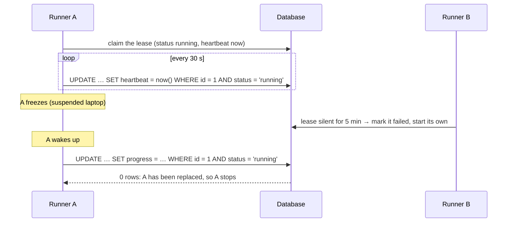

# Coordination: advisory locks, leases and fencing

## What it is

Row locks protect **rows** ([row-locks-and-skip-locked.md](row-locks-and-skip-locked.md)). Some
things that need mutual exclusion aren't a row: "recomputing the sales of 24 November", "the one
replay that may run right now". Two tools cover those:

- **Advisory locks.** Locks on a number you choose. Postgres enforces mutual exclusion on the
  number and attaches no meaning to it; the application decides what it stands for
  ([advisory locks](https://www.postgresql.org/docs/17/explicit-locking.html#ADVISORY-LOCKS)).
- **Leases.** A lock with an expiry. The holder keeps it alive with **heartbeats**; if the
  heartbeats stop, the holder is presumed dead, and someone else may **take over**. Leases suit
  long-running work (minutes or hours), where holding a database lock or transaction open the
  whole time isn't an option.

A lease raises a problem a lock doesn't have: the "dead" holder may not be dead, only paused (a
long GC pause, a suspended laptop, a network partition). When it wakes up it still believes it
holds the lease. **Fencing** makes its late writes harmless: every write carries proof of current
ownership, and the storage rejects writes from a holder that has been replaced. Martin
Kleppmann's classic form is a **fencing token**, a number that increases every time the lock is
acquired, checked by the storage on each write
([How to do distributed locking](https://martin.kleppmann.com/2016/02/08/how-to-do-distributed-locking.html)).

### Advisory locks in Postgres 17

- **Two scopes.** A session-level lock is held until it's released explicitly or the session ends.
  A **transaction-level** lock is released automatically at the end of the transaction, and has
  no explicit unlock.
- **Keys.** A `bigint`, or two `integer`s. Advisory locks are local to each database
  ([pg_locks](https://www.postgresql.org/docs/17/view-pg-locks.html)).
- **Functions** ([advisory lock functions](https://www.postgresql.org/docs/17/functions-admin.html#FUNCTIONS-ADVISORY-LOCKS)):
  - `pg_advisory_xact_lock(key)` takes an exclusive transaction-level lock, waiting if necessary.
  - `pg_try_advisory_xact_lock(key)` returns `false` at once instead of waiting.
  - Session-level and shared variants exist too.
- **The docs' caution:** don't take advisory locks in a query whose `LIMIT` might be applied after
  the locking function runs. You can end up holding locks for rows you never returned.

Two sessions that take two advisory keys in opposite orders wait on each other like any other
locks, so the [lock-ordering rule](lock-ordering-and-deadlocks.md) applies to them as well.

## The problem it solves

### 1. "Only one of us may rebuild this day": an advisory lock

Two workers rebuild a summary row for the same day by deleting and re-inserting it. Both run
`DELETE` (nothing to delete yet), then both `INSERT`: the day is counted twice, or a unique
constraint turns it into an error. There's no row to `SELECT … FOR UPDATE` before the first
insert. An advisory lock on a key derived from "summary, day" makes the second worker wait:

```sql
BEGIN;
SELECT pg_advisory_xact_lock(hashtext('summary:2026-11-24'));   -- the second worker waits here
DELETE FROM daily_summary WHERE day = '2026-11-24';
INSERT INTO daily_summary SELECT ...;
COMMIT;                                                         -- releases the advisory lock
```

### 2. "Only one runner at a time, for hours": a lease with fencing



The `WHERE … AND status = 'running'` is the fence. A's write succeeds only if A's lease is still
the live one, and the check and the write are one atomic statement.

## In this project

**Advisory locks: analytics.** `recompute_days(days, source)` in
[projections.py](../../backend/apps/analytics/projections.py) takes
`pg_advisory_xact_lock(hashtext('analytics:<source>:<day>'))` for each day, **in ascending day
order**, then deletes and re-inserts those days' projection rows in the same transaction
([analytics.md](../flows/analytics.md#state-based-recompute),
[ADR 0011](../adr/0011-analytics-projections-recompute.md)).
- **Transaction-level.** The locks go away with the commit or rollback; nothing can leak.
- **Ascending order.** Two multi-day recomputes can't deadlock.
- **Tested:** `test_concurrent_recomputes_of_the_same_day_queue_instead_of_double_inserting` in
  [test_analytics.py](../../backend/tests/test_analytics.py).
- **`hashtext()` is an internal function.** The Postgres 17 manual doesn't document it as a
  general function: a site search finds it only in the `bloom` extension's examples. It returns
  a 32-bit `integer` (observed with `\df hashtext`, 2026-11-12), which widens to the `bigint`
  key. Two different day strings could therefore hash to the same key; that would make two
  unrelated recomputes wait for each other, never let two recomputes of one day run together.

**A lease: the replay.** One replay may run at a time, for as long as it takes
([replay.md](../flows/replay.md#one-running-replay-at-a-time),
[ADR 0014](../adr/0014-replay-through-real-services.md)). The code is in
[replay/services.py](../../backend/apps/replay/services.py):

| Part | How |
|---|---|
| Claim | `start_run()` inserts a `ReplayRun` with `status='running'`. The partial unique index `one_running_replay` lets only one such row exist, so two simultaneous starts can't both win ([constraints](constraints-as-guarantees.md)) |
| Heartbeat | The runner saves `heartbeat_at` at least every `HEARTBEAT_SECONDS` (30) |
| Expiry and takeover | `take_over_stale()`: a running run silent for `STALE_AFTER` (5 min) is marked `failed` ("Abandoned: no heartbeat since …") by the next `replay_orders` or `replay_reset`; a fresh one is refused |
| Fence | Every runner write (heartbeat, progress, final status) is `_checkpoint()`: `UPDATE … WHERE id = ? AND status = 'running'`. Zero rows means "taken over": the runner stops, and never overwrites the `failed` status |

**Where the fence sits, and why that's enough.** The heartbeat check runs at the **top of the
loop**, before the next step. A runner frozen long enough to be taken over finds out on its next
heartbeat, before applying anything else (`test_a_taken_over_run_stops_without_writing_further_steps`).
A runner frozen *between* that check and a step would still apply that one step late. The design
tolerates it: each step is idempotent, applied only from its from-status under the order's row
lock, so a late step either lands once or fails with `InvalidTransition`
([idempotency.md](idempotency.md), `test_two_runners_over_the_same_orders_apply_every_step_exactly_once`).
The fence protects the run's own record; the per-step state check protects the orders.

**Compared with a fencing token.** The replay fences on *state* (still `running`?), not on an
increasing number. That works because a taken-over run never becomes `running` again: a new run is
a new row. A token is needed when the same lease record can be re-acquired.

## Pitfalls

- **Session-level advisory locks with a connection pool.** The lock belongs to the database
  session, which outlives your request; forget to unlock and the next user of that connection holds
  it. Prefer the transaction-level form.
- **Advisory locks with `LIMIT`.** The `LIMIT` may apply after the lock function has run on more
  rows than you return (the docs' caution).
- **Colliding keys.** Two meanings mapped to the same number block each other. Namespace your keys
  (`"analytics:"…`, or the two-integer form with a class id).
- **A lease without a fence.** Expiry alone lets a paused holder resume and overwrite its successor.
- **A heartbeat that's checked too rarely.** The longer between checks, the more work a replaced
  holder can do before it notices. Keep that work idempotent.
- **Clock trust.** A lease compares a stored heartbeat with "now". If the writer's and the
  checker's clocks disagree, a lease looks expired early or late. The replay writes `heartbeat_at`
  and checks staleness with the **application host's** clock (`timezone.now()` in
  [replay/services.py](../../backend/apps/replay/services.py)). In dev every process runs on one
  machine; across machines, clock skew would shift the expiry, which a generous `STALE_AFTER`
  (5 min against a 30 s heartbeat) absorbs. Using the database's `now()` for both would remove the
  question.

## Interview follow-ups

- **What's an advisory lock, and when would you use one?** A lock on an application-chosen key, with
  no table behind it. Use it for mutual exclusion on something that isn't a row: a computation, a
  time bucket, a job type.
- **Session-level or transaction-level?** Transaction-level whenever the work fits in one
  transaction: it can't leak. Session-level only when the exclusion must outlive a transaction, and
  then release it in a `finally`.
- **What is a lease, and what can go wrong?** A time-limited lock renewed by heartbeats. The holder
  may be paused rather than dead, and resume after someone else took over: two holders at once.
- **What's fencing?** Making the shared resource reject writes from an outdated holder: a fencing
  token checked on every write, or a conditional write on the lease's current state.
- **Why not hold a database lock for the whole job?** A transaction open for an hour holds locks and
  old row versions the whole time, and a crash mid-way loses all the progress. A lease row plus
  short transactions keeps progress durable.

Project-specific questions: [interview-guide.md](../interview-guide.md#replay).

## Exercises

### 1. Two recomputes of the same day

**Runs on: A** (lab stack, two `psql` sessions plus a third).

1. S1: `BEGIN; SELECT pg_advisory_xact_lock(hashtext('analytics:app:2026-11-24'));`
2. S2: `BEGIN; SELECT pg_advisory_xact_lock(hashtext('analytics:app:2026-11-24'));` (it waits)
3. S3: `SELECT locktype, objid, mode, granted FROM pg_locks WHERE locktype = 'advisory';`
4. S3: `SELECT pg_try_advisory_xact_lock(hashtext('analytics:app:2026-11-24'));`
5. S1: `COMMIT;` (and S2?) Then S2: `COMMIT;`

**Expected:** S2 waits. Step 3 shows two advisory rows, one `granted = true` (S1) and one
`granted = false` (S2). Step 4 returns `false` immediately. After S1's commit, S2's call returns.

<details><summary>Solution</summary>

Both sessions asked for the same key, and the transaction-level lock is released only by S1's
`COMMIT`. That's how the analytics consumer and the backfill queue on the same day instead of both
deleting and both inserting. The `try` form never waits. It suits "skip this if someone else is
already doing it", where the blocking form suits "do it after them". In `pg_locks` the key shows up
in the `classid`/`objid` columns; the
[pg_locks docs](https://www.postgresql.org/docs/17/view-pg-locks.html) explain the encoding. On
2026-11-12 the key was `hashtext(…) = -1906989476`, shown as `classid` 4294967295 (the high half
of the sign-extended `bigint`, all ones) and `objid` 2387977820 (the low half).
</details>

### 2. A fenced write

**Runs on: A** (lab stack, two sessions; S1 plays the old runner, S2 the one that takes over).

1. S1:
   ```sql
   CREATE TABLE lab_lease (id int PRIMARY KEY, status text, heartbeat_at timestamptz, progress int);
   INSERT INTO lab_lease VALUES (1, 'running', now() - interval '6 minutes', 10);
   ```
2. S2 takes over a lease that has been silent for more than 5 minutes:
   ```sql
   UPDATE lab_lease SET status = 'failed'
   WHERE id = 1 AND status = 'running' AND heartbeat_at < now() - interval '5 minutes';
   ```
3. S1 wakes up and checkpoints its progress:
   ```sql
   UPDATE lab_lease SET progress = 11, heartbeat_at = now() WHERE id = 1 AND status = 'running';
   SELECT * FROM lab_lease;
   ```

**Expected:** S2's update reports `UPDATE 1`. S1's reports `UPDATE 0`, and the row still says
`failed` with progress 10.

<details><summary>Solution</summary>

The old runner's write carries its claim ("I'm still the running one") as a condition, and the
database evaluates the claim and the write atomically. `UPDATE 0` is the runner's signal to stop.
The replay's `_checkpoint()` does exactly this, and the runner sets `taken_over` and stops. Without
the `AND status = 'running'`, S1 would have overwritten the takeover. Mutating that condition away
is exercise 3.
</details>

### 3. Remove the replay's fence

**Runs on: C** ([mutation protocol](lab.md#c-the-test-suite-mutation-exercises)).

0. Check the file is unmodified, or stop and commit or stash first:
   `git diff --quiet -- backend/apps/replay/services.py && git diff --cached --quiet -- backend/apps/replay/services.py && echo clean`
1. In [backend/apps/replay/services.py](../../backend/apps/replay/services.py), in `_checkpoint()`,
   change `ReplayRun.objects.filter(pk=self.run.pk, status=ReplayRun.Status.RUNNING)` to
   `ReplayRun.objects.filter(pk=self.run.pk)`.
2. `docker compose exec backend pytest tests/test_replay.py -k taken_over_run_stops`
3. Restore and prove it: `git checkout -- backend/apps/replay/services.py`, then
   `git diff --quiet -- backend/apps/replay/services.py && echo restored` and `git status --short`
   (the same as before step 1). Never commit the mutated file.

**Expected:** the test fails at its first assertion, `runner.taken_over` is `False`: the runner
never noticed the takeover, and kept applying steps.

<details><summary>Solution</summary>

The test marks the run `failed` after five steps (standing in for another process taking over).
With the fence, the next heartbeat updates 0 rows and the runner stops at 5 events. Without it, the
heartbeat "succeeds", the runner never notices, and it writes further steps (and, at the end,
overwrites `failed` with its own final status). This is the mutation check recorded in
[testing.md](../testing.md#techniques-worth-knowing).
</details>

### 4. Remove the analytics advisory lock

**Runs on: C** ([mutation protocol](lab.md#c-the-test-suite-mutation-exercises)).

0. Check the file is unmodified, or stop and commit or stash first:
   `git diff --quiet -- backend/apps/analytics/projections.py && git diff --cached --quiet -- backend/apps/analytics/projections.py && echo clean`
1. In [backend/apps/analytics/projections.py](../../backend/apps/analytics/projections.py), in
   `recompute_days()`, delete the loop that runs `pg_advisory_xact_lock` (the two lines starting
   `for day in days:`).
2. `docker compose exec backend pytest tests/test_analytics.py -k concurrent_recomputes`
3. Restore and prove it: `git checkout -- backend/apps/analytics/projections.py`, then
   `git diff --quiet -- backend/apps/analytics/projections.py && echo restored` and
   `git status --short`. Never commit the mutated file.

**Expected:** the test fails: at least one of the concurrent recomputes raises an `IntegrityError`
(a duplicate key on a projection's unique constraint).

<details><summary>Solution</summary>

Both recomputes delete the day's rows (in each one's own snapshot, nothing of the other's is visible
yet), then both insert. The second insert waits on the unique index for the first transaction, then
fails as a duplicate once it commits. The unique constraints turn a silent double count into a loud
error ([constraints](constraints-as-guarantees.md)); the advisory lock turns the error into
queueing.
</details>

**Run status:** all four run on 2026-11-12, and every result matched. Venue A on the lab stack
(`make lab-up`), with each exercise's SQL issued in the stated order by two connections from a
script inside the lab backend container, not typed into `psql`; venue C with the
[mutation protocol](lab.md#c-the-test-suite-mutation-exercises). Exercise 4's error was
`duplicate key value violates unique constraint "uniq_daily_sales"`.

## Further reading

- PostgreSQL 17: [Advisory locks](https://www.postgresql.org/docs/17/explicit-locking.html#ADVISORY-LOCKS), [advisory lock functions](https://www.postgresql.org/docs/17/functions-admin.html#FUNCTIONS-ADVISORY-LOCKS), [pg_locks](https://www.postgresql.org/docs/17/view-pg-locks.html)
- Martin Kleppmann, [How to do distributed locking](https://martin.kleppmann.com/2016/02/08/how-to-do-distributed-locking.html) (2016): leases, process pauses and fencing tokens
- Project: [ADR 0011](../adr/0011-analytics-projections-recompute.md), [ADR 0014](../adr/0014-replay-through-real-services.md), [replay.md](../flows/replay.md#one-running-replay-at-a-time)

**Verified** 2026-11-12 against the PostgreSQL 17 pages and the article linked above.
