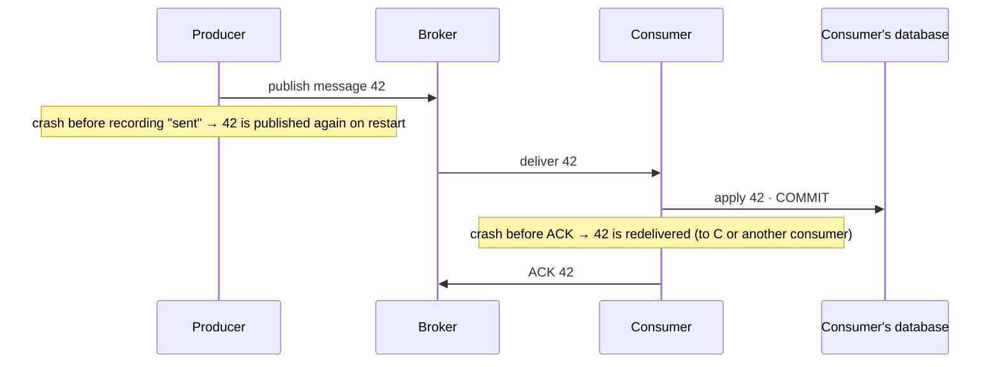

# Delivery guarantees

## What it is

When one process hands a message to another (through a queue, a stream, a webhook), something can
fail at every step: the sender, the network, the broker, the receiver. A **delivery guarantee**
says what happens to a message across those failures:

| Guarantee | Meaning | How it's built | The cost |
|---|---|---|---|
| **At most once** | Never processed twice, but may be lost | Acknowledge (or forget) the message **before** processing it | A crash during processing loses the message |
| **At least once** | Never lost, but may be processed more than once | Acknowledge **after** processing; redeliver anything unacknowledged | Duplicates, so the receiver must cope |
| **Exactly once** | Processed once, never lost | Not achievable by delivery alone across independent systems | — |

What systems call "exactly once" in practice is **effectively once**: at-least-once delivery
plus **idempotent** processing, so a duplicate delivery has no second effect
([idempotency.md](idempotency.md)). The message may arrive twice; its effect happens once.

Two examples from the tools this project uses:
- **Redis Pub/Sub is at-most-once.** If a subscriber can't handle a message (an error, a network
  disconnect), the message is lost forever. Redis Streams, by contrast, persist messages and support
  at-least-once delivery with consumer groups
  ([Redis Pub/Sub: delivery semantics](https://redis.io/docs/latest/develop/pubsub/)).
- **Celery acknowledges a task right before it runs, by default.** `task_acks_late` (disabled by
  default) moves the acknowledgement to after the task has run
  ([task_acks_late](https://docs.celeryq.dev/en/v5.6.0/userguide/configuration.html#std-setting-task_acks_late)).
  Late acks alone don't cover a crash, though: **even with `task_acks_late` enabled**, the worker
  still acknowledges a task whose worker process exits abruptly or is signaled (a `KILL`, say).
  Only `task_reject_on_worker_lost` (also disabled by default) re-queues it instead, and the docs
  warn that this can cause message loops
  ([task_reject_on_worker_lost](https://docs.celeryq.dev/en/v5.6.0/userguide/configuration.html#std-setting-task_reject_on_worker_lost)).
  So `task_reject_on_worker_lost` only matters together with `task_acks_late`, and a default
  Celery task is effectively at most once against a worker crash. Retries (`Task.retry`) are a
  separate mechanism, for failures the task itself sees.

## The problem it solves: where duplicates and losses come from

At-least-once delivery redelivers whenever the sender can't be sure. These are the classic
windows:



1. **Producer retry:** the message went out, but the producer didn't record that before crashing.
2. **Consumer crash between commit and ack:** the effect is committed, the broker never heard.
3. **Redelivery to a slow consumer:** a broker that reassigns messages unacknowledged for too long
   can hand one to a second consumer while the first is still working on it.
4. **Retries after timeouts:** an HTTP caller (a payment provider sending a webhook) retries
   because the response was slow or lost.

Choosing at-least-once means accepting all four, and making every effect idempotent. Choosing
at-most-once means accepting losses. That's fine for data that is regenerated anyway, never for
money or orders.

## In this project

Each hop has its own guarantee ([event-pipeline.md](../flows/event-pipeline.md),
[ADR 0002](../adr/0002-transactional-outbox-and-relay.md), [ADR 0003](../adr/0003-state-based-idempotent-consumers.md)):

| Hop | Guarantee | Why |
|---|---|---|
| Service → outbox | Exactly once, by construction | The event is a row in the same transaction as the change ([transactional-outbox.md](transactional-outbox.md)) |
| Outbox → Redis Stream (relay) | At least once | A relay crash after `XADD`, before it stamps `published_at`, re-sends the rows (window 1) |
| Stream → a consumer's database effects | **Effectively once** | Ack after commit (at least once), plus `ProcessedEvent(consumer, event_id)` in the effect's transaction. Windows 2 and 3 become no-ops (`test_crash_after_commit_before_ack_does_not_apply_twice`) |
| Consumer → frontend cache revalidation | At least once | Revalidating a tag twice is harmless |
| Consumer → email | At least once, with one known duplicate | A `Notification` row per (event, kind), sent by Celery; a crash after SMTP accepted it but before the row is marked sent resends it once ([notifications.md](../flows/notifications.md#guarantees)) |
| `order_live` → the open order page (Pub/Sub) | At most once | A missed signal is corrected by the next signal, a reconnect or the fallback poll, because the signal carries no state ([live-tracking.md](../flows/live-tracking.md#signal-vs-state)) |
| Payment provider → webhook | At least once | Retries with backoff (window 4); `ProviderEvent` dedupes |

**Celery is never the only record of work that must happen.** The project doesn't change Celery's
acknowledgement defaults (no `CELERY_TASK_ACKS_LATE` in [base.py](../../backend/config/settings/base.py)).
Where a lost task would matter, the database holds the truth and a periodic sweep makes up for it:
- **Email.** `send_notification` is the fast path; the pending `Notification` row is the record,
  and beat's `send_due_notifications` (every 30 s) sends any row whose task was lost.
- **Reservation expiry.** `release_expired_reservations` scans the database every minute, so a
  lost run only delays the next one.
- **The fake provider's webhook delivery is the exception.** `deliver_event` retries a failed
  delivery up to 6 times, but nothing re-sends a delivery whose task was lost with a crashed worker.
  That's acceptable for a dev-only fake; a real provider retries on its own schedule.

**Durability below the guarantee.** "At least once" from the outbox to the stream assumes Redis
keeps what it acknowledged. With AOF `appendfsync everysec`, a hard crash can lose up to about a
second of entries already marked published
([limitations-and-roadmap.md](../limitations-and-roadmap.md#events-and-live-updates)).

## Pitfalls

- **Calling something "exactly once" without saying where.** Delivery is at least once; the
  *effect* is made once by idempotency, hop by hop.
- **Acknowledging first "for safety".** It turns every crash into a lost message.
- **Dedupe outside the effect's transaction.** It reopens the windows it was meant to close
  ([idempotency.md](idempotency.md#pitfalls)).
- **Forgetting the slow-consumer duplicate.** Reclaiming an entry another consumer is still
  processing produces two concurrent attempts; the dedupe insert must also be safe under
  concurrency (a unique constraint makes the second wait, then skip).
- **Assuming the broker never loses acknowledged messages.** Check its persistence settings.
- **Relying on a task queue's delivery for money or orders.** Keep the record in the database and
  let the queue be the fast path.

## Interview follow-ups

- **At-most-once vs at-least-once: which would you choose?** At-least-once for anything that
  matters, with idempotent consumers. At-most-once only where loss is harmless or self-correcting
  (live UI signals, metrics samples).
- **Is exactly-once delivery possible?** Not across independent systems by delivery alone. You
  build exactly-once *effects* with at-least-once delivery and idempotent, transactional
  processing.
- **Where do duplicates come from?** Producer retries, consumer crashes between commit and ack,
  redelivery to slow consumers, and client retries after timeouts.
- **What does `acks_late` change in Celery?** The task message is acknowledged after the task
  runs instead of right before. That alone isn't at-least-once against a crash: if the worker
  process executing the task dies abruptly, the worker still acknowledges it, unless
  `task_reject_on_worker_lost` is also enabled, which re-queues it (and can loop on a task that
  always kills its process). With both on, tasks must be idempotent.
- **How do you make a side effect outside your database effectively once?** Give it its own
  idempotency key or deterministic id on the far side, or accept and document a small
  duplicate window.

Project-specific questions: [interview-guide.md](../interview-guide.md#event-pipeline).

## Exercises

### 1. Deliver an event twice

**Runs on: A** (lab stack; the Django shell: `lab exec backend python manage.py shell`).

1. Re-add the newest order event to its stream, with the same fields (and so the same event id),
   the way a relay crash would:
   ```python
   from apps.events.streams import redis_client, stream_name
   r = redis_client()
   entry_id, fields = r.xrevrange(stream_name("order"), count=1)[0]
   event_id = fields["id"]; print(fields["type"], event_id)
   print("re-added as", r.xadd(stream_name("order"), fields))
   ```
2. Wait a few seconds, then count what each consumer recorded for that event:
   ```python
   from apps.events.models import EventLog, ProcessedEvent
   from django.db.models import Count
   print(list(ProcessedEvent.objects.filter(event_id=event_id).values("consumer").annotate(n=Count("id"))))
   print(EventLog.objects.filter(event_id=event_id).count())
   ```
3. `print(r.xpending(stream_name("order"), "event_log"))`

**Expected:** the stream now holds the event twice. Every consumer that handles its type shows
`n = 1`, `EventLog` has one row, and nothing is left pending. (On 2026-11-12 the newest event was
an `OrderCanceled`: `analytics`, `event_log`, `notifications`, `order_live` and `product_stats`
each showed 1, so there was no second email and no second `ProductsChanged`.)

<details><summary>Solution</summary>

Each consumer group received both entries. For the second, each consumer's
`INSERT … ON CONFLICT DO NOTHING` into `ProcessedEvent` returned no row, so the handler was
skipped, and the entry was acknowledged anyway. That's at-least-once delivery turned into one
effect per consumer. Consumers that don't handle the type (for example `cache_invalidation` for
an order event) never wrote a row at all: they just acked.
</details>

### 2. A message nobody hears

**Runs on: A** (lab stack; `lab exec redis redis-cli`).

```
PUBLISH live:order:does-not-exist hello
XADD lab:demo * greeting hello
XLEN lab:demo
DEL lab:demo
```

**Expected:** `PUBLISH` returns `(integer) 0`. `XLEN` returns `(integer) 1`.

<details><summary>Solution</summary>

`PUBLISH` returns the number of clients the message was sent to
([PUBLISH](https://redis.io/docs/latest/commands/publish/)): zero, and the message is gone. A
stream keeps the entry until it's trimmed or deleted, whoever is listening. That's why the project
uses streams for events and Pub/Sub only for signals whose loss is harmless: the live order page
re-reads the database on the next signal, on a reconnect, or on its fallback poll.
</details>

### 3. Acknowledge first

**Runs on: C** ([mutation protocol](lab.md#c-the-test-suite-mutation-exercises)).

0. Check the file is unmodified, or stop and commit or stash first:
   `git diff --quiet -- backend/apps/events/consumer.py && git diff --cached --quiet -- backend/apps/events/consumer.py && echo clean`
1. In [backend/apps/events/consumer.py](../../backend/apps/events/consumer.py), in `_process()`,
   add `self._ack(key, entry_id)` as the line just before `try:`. The message is now acknowledged
   before it's processed.
2. `docker compose exec backend pytest tests/test_events_consumer.py -k poison_event`
3. Restore and prove it: `git checkout -- backend/apps/events/consumer.py`, then
   `git diff --quiet -- backend/apps/events/consumer.py && echo restored` and `git status --short`.
   Never commit the mutated file.

**Expected:** the test fails at `pending(events_redis) == 1` (it's `0`): the failing event is no
longer pending after its first failure, so it's never retried or dead-lettered.

<details><summary>Solution</summary>

With the ack first, the consumer is at-most-once: the handler fails, the transaction rolls back,
and the entry is already acknowledged, so Redis forgets it. No retry, no dead letter, no trace
except a log line. The original order (process, commit, then ack) keeps a failed entry pending, so
it's reclaimed and retried, and after `EVENTS_MAX_DELIVERIES` it's dead-lettered where staff can see
and retry it.
</details>

**Run status:** all three run on 2026-11-12, and every result matched. Venue A on the lab stack
(`make lab-up`), in the Django shell and `redis-cli`; venue C with the
[mutation protocol](lab.md#c-the-test-suite-mutation-exercises).

## Further reading

- Redis: [Pub/Sub delivery semantics](https://redis.io/docs/latest/develop/pubsub/), [PUBLISH](https://redis.io/docs/latest/commands/publish/), [Streams](https://redis.io/docs/latest/develop/data-types/streams/) (redis.io documents the current Redis, with no Redis 7 edition; the exercises ran on the lab's Redis 7)
- Celery 5.6: [task_acks_late](https://docs.celeryq.dev/en/v5.6.0/userguide/configuration.html#std-setting-task_acks_late), [task_reject_on_worker_lost](https://docs.celeryq.dev/en/v5.6.0/userguide/configuration.html#std-setting-task_reject_on_worker_lost)
- Project: [event-pipeline.md](../flows/event-pipeline.md), [ADR 0002](../adr/0002-transactional-outbox-and-relay.md), [ADR 0003](../adr/0003-state-based-idempotent-consumers.md)

**Verified** 2026-11-12 against the Redis and Celery 5.6 pages linked above.
