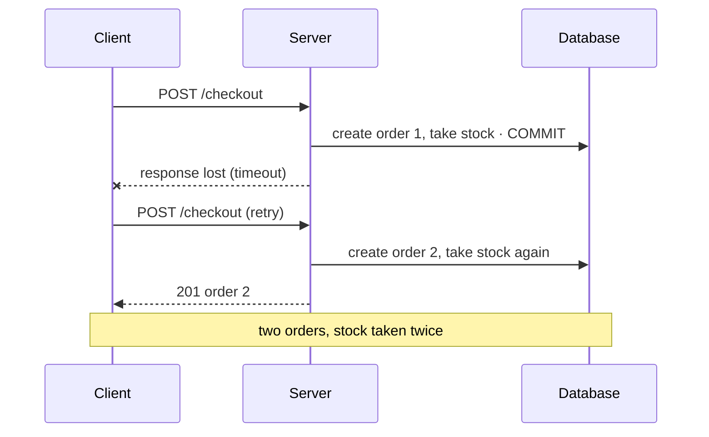

# Idempotency

## What it is

An operation is **idempotent** if doing it several times has the same effect as doing it once.
HTTP defines it per method: the intended effect on the server of several identical requests is
the same as for one. `GET`, `HEAD`, `OPTIONS`, `TRACE`, `PUT` and `DELETE` are idempotent; `POST`
is not ([RFC 9110, section 9.2.2](https://www.rfc-editor.org/rfc/rfc9110#section-9.2.2)).

It matters because **retries are unavoidable**. A client whose request times out can't tell
whether the server never got it, or did the work and the response was lost. A queue redelivers a
message whose acknowledgement went missing. The only safe answer is to make the retry harmless.

There are three common ways to make a non-idempotent operation safe to repeat:

| Technique | Idea | Typical use |
|---|---|---|
| **Idempotency key** | The client names the attempt; the server stores the outcome under that name and replays it for a repeat | API calls that create something (`POST /checkout`, `POST /charges`) |
| **Natural key + upsert** | The data identifies itself; writing it again updates the same row instead of adding one | Imports and syncs: `INSERT … ON CONFLICT (key) DO UPDATE` |
| **Dedupe table** | Record "message X applied" in the same transaction as its effect; skip if already recorded | Message consumers, webhooks |

A fourth, simpler form is the **state check**: an operation that applies only from a given state
("pay only an unpaid order") is naturally a no-op, or a clear error, when repeated
([state-machines.md](state-machines.md)).

## The problem it solves: the lost response



With an idempotency key, the retry carries the same key, and the server answers with order 1
instead of creating order 2. Disabling the button doesn't help: the first request *was* processed.

### Designing an idempotency key store

The decisions, and what two well-known designs do:

| Decision | [Stripe](https://docs.stripe.com/api/idempotent_requests) | [IETF draft, Idempotency-Key header](https://datatracker.ietf.org/doc/draft-ietf-httpapi-idempotency-key-header/) |
|---|---|---|
| Same key, same request | Return the saved response | Return the saved response |
| Same key, **different** request | An error: parameters are compared with the original | `422` |
| Same key while the first is still running | (not covered by the quoted text) | `409` |
| Key missing where required | — | `400` |
| Failed requests | Saved too, **including `500` errors**, once the endpoint has begun executing | — |
| Lifetime | Keys can be removed after at least 24 hours | — |

The IETF document is an Internet-Draft (revision 08, updated 2026-10-22), **not an RFC**: a
proposal, not a standard.

The other decisions to make:
- **Scope.** Per client or user: two users may pick the same random key.
- **Where the key lives.** In the same transaction as the work, so "done" and "recorded as done"
  can't disagree. A key in a separate store (say Redis) can disagree after a crash between the
  two writes.
- **What identifies "the same request".** Usually a hash of a canonical form of the body.
- **The attempt boundary on the client.** One key per *attempt* (reused on retry), not per click,
  and a new key when the request changes.

## In this project

**Checkout** takes a required `Idempotency-Key` header ([api.md](../api.md#idempotency-key-checkout),
[ADR 0016](../adr/0016-idempotency-key-for-checkout.md)):
- **One transaction.** `run_idempotent()` in [idempotency.py](../../backend/apps/core/idempotency.py)
  inserts `IdempotencyKey(user, key, request_hash)`, runs `checkout()`, and stores the response, all
  in one transaction. The unique constraint `uniq_idempotency_user_key` scopes keys per user.
- **Same key, same body:** the stored response is replayed, with an `Idempotent-Replayed: true`
  header ([orders/views.py](../../backend/apps/orders/views.py)).
- **Same key, different body:** `request_hash()` (sha256 of the body as canonical JSON) differs,
  giving `409 idempotency_conflict`. That's where this project differs from the draft, which
  suggests `422`.
- **Same key, concurrently:** the second insert waits on the unique index until the first commits,
  then replays it. It doesn't answer `409` as the draft suggests; the client simply gets the
  first result (`test_concurrent_retries_with_the_same_key_create_one_order`).
- **Failures aren't stored**, unlike Stripe. A failed checkout (out of stock, say) rolls back
  everything, the key row included, and checkout has no effect outside the database. So a retry
  can safely run again, and may succeed if stock came back. Stripe's opposite choice protects
  against re-running work whose external effects might already have happened.
- **Keys expire after 24 h** (`IDEMPOTENCY_KEY_TTL_HOURS`); an expired key is forgotten on its next
  use and purged daily by Celery beat (03:15 UTC).
- **The browser side,** [checkout-attempt.ts](../../frontend/src/lib/checkout-attempt.ts): one key
  per attempt, bound to a fingerprint of the cart and address and kept in `sessionStorage`. It is
  reused after a network error, timeout or 5xx, and dropped after any definitive answer. Keys come
  from `crypto.getRandomValues`, because `crypto.randomUUID` only exists in secure contexts.

**Starting a payment needs no key.** It's idempotent by construction: the partial unique index
`uniq_open_intent_per_order` allows one open payment per order, and the provider call carries its
own idempotency key, `order:<id>:intent` ([payments.md](../flows/payments.md#1-starting-a-payment)).

**Natural keys and upserts: the importer.** Every table is written with
`INSERT … ON CONFLICT (Olist id) DO UPDATE`, so a second import updates in place
(`test_reimport_is_idempotent`). Postgres refuses an `ON CONFLICT DO UPDATE` that would update the
same row twice in one statement (a cardinality violation), so the importer removes in-file
duplicates first ([olist-import.md](../flows/olist-import.md#re-running-is-safe),
[INSERT … ON CONFLICT](https://www.postgresql.org/docs/17/sql-insert.html#SQL-ON-CONFLICT)).

**Dedupe tables:**

| Table | Dedupes | How |
|---|---|---|
| `ProcessedEvent(consumer, event_id)` | An event delivered twice to one consumer | `INSERT … ON CONFLICT DO NOTHING RETURNING id` in the handler's transaction; no row back means "already applied" (`_mark_processed()` in [consumer.py](../../backend/apps/events/consumer.py)) |
| `ProviderEvent(provider, provider_event_id)` | A webhook delivered twice | Insert in a savepoint; `IntegrityError` means "duplicate", answered with 200 (`_record_once()` in [payments/services.py](../../backend/apps/payments/services.py)) |
| `Notification(event_id, kind)` | One email per event and kind, even if `ProcessedEvent` rows were purged | Unique constraint ([notifications.md](../flows/notifications.md)) |
| `DeadLetterRetry(dlq_entry_id)` | Two staff clicks on Retry | Unique row taken before the re-add ([staff-tools.md](../flows/staff-tools.md#dead-letter-retry)) |

**State checks:** `pay()`, `cancel()` and the fulfilment steps lock the order and check its status
first, so a repeat is an `InvalidTransition`. The replay applies a step only while the copy is in
that step's from-status ([replay.md](../flows/replay.md#idempotent-and-resumable)).

## Pitfalls

- **A new key per click.** A retry with a fresh key is a new request: the duplicate you meant to
  prevent.
- **Storing the key apart from the work.** A crash between "order created" and "key recorded" (or
  the reverse) breaks the guarantee in one direction or the other.
- **Not comparing the body.** Without a request hash, a reused key with a different cart would
  silently replay the wrong order.
- **Marking "processed" outside the effect's transaction.** Mark first and crash: the effect is
  lost. Apply first and crash: it's applied twice.
- **Forgetting external side effects.** A dedupe row protects database effects. An email, an HTTP
  call or a charge at a provider needs its own key, or a deterministic id, on the far side.
- **Keys that never expire.** The table grows forever, and an old key can collide with a much later
  request.

## Interview follow-ups

- **Which HTTP methods are idempotent, and why isn't `POST`?** `GET`, `HEAD`, `OPTIONS`, `TRACE`,
  `PUT` and `DELETE`. `POST` means "process this", typically creating something new each time,
  so a repeat has a different effect.
- **How would you implement idempotency keys?** Store the key, scoped per client, with a hash of
  the request and its response, in the same transaction as the work. Replay on a match, reject a
  different body with the same key, and expire keys after a window.
- **Should a failed request's result be stored?** It depends on whether a failure can leave
  effects behind. If a failure always rolls back completely, re-running is safe and may succeed
  later. If it might have reached an external system, store and replay the failure.
- **What's the difference between an idempotency key and a dedupe table?** Same idea, different
  side: a key is chosen by the caller of an API; a dedupe table is keyed by the message's own id,
  on the consumer side.
- **Is exactly-once delivery possible?** Not in general. You get at-least-once delivery plus
  idempotent processing, which makes the *effect* happen once ([delivery-guarantees.md](delivery-guarantees.md)).

Project-specific questions: [interview-guide.md](../interview-guide.md#checkout-and-concurrency).

## Exercises

### 1. Replay a checkout, then misuse the key

**Runs on: A** (lab stack; the API through curl, see
[lab.md](lab.md#calling-the-lab-api-with-curl)).

1. Log in with the `api` helper, and put one unit of an in-stock offer in the cart:
   `api POST /api/cart/items/ '{"offer_id": <id>, "quantity": 1}'`
2. Check out with a key, printing the response headers:
   `api POST /api/checkout/ "$SHIPPING" -i -H 'Idempotency-Key: lab-attempt-0001'`
3. Send exactly the same request again.
4. Send it once more with the same key but a different body, for example `"city": "Campinas"`.
5. Send it without the header.

**Expected:** step 2 answers `201` with the new order. Step 3 answers `201` with **the same order
id** and an `Idempotent-Replayed: true` header (through the Next proxy it arrives lowercased,
`idempotent-replayed: true`; header names are case-insensitive), even though the cart is now empty. Step 4 answers
`409` with `"code":"idempotency_conflict"`. Step 5 answers `400` asking for an `Idempotency-Key`.

<details><summary>Solution</summary>

Step 3 never reached `checkout()`: `run_idempotent()` found the key row, compared the request hash
(equal), and returned the stored response. That's why an empty cart doesn't matter. In step 4 the
hash differs, so replaying would answer a different request than the one sent, and the server
refuses. A new attempt needs a new key. Step 5 is rejected before any of this, by the view's
header check.
</details>

### 2. A dedupe table, and the upsert trap

**Runs on: A** (lab stack, one `psql` session).

1. ```sql
   CREATE TABLE lab_processed (consumer text, event_id int, PRIMARY KEY (consumer, event_id));
   INSERT INTO lab_processed VALUES ('stats', 1) ON CONFLICT DO NOTHING RETURNING event_id;
   INSERT INTO lab_processed VALUES ('stats', 1) ON CONFLICT DO NOTHING RETURNING event_id;
   INSERT INTO lab_processed VALUES ('email', 1) ON CONFLICT DO NOTHING RETURNING event_id;
   ```
2. Now an upsert with the same key twice in one statement:
   ```sql
   INSERT INTO lab_processed VALUES ('stats', 2), ('stats', 2)
   ON CONFLICT (consumer, event_id) DO UPDATE SET event_id = EXCLUDED.event_id;
   ```

**Expected:** in step 1 the first and third inserts return a row, the second returns none. Step 2
fails with an error that `ON CONFLICT DO UPDATE` can't affect a row a second time.

<details><summary>Solution</summary>

"No row returned" is the consumer's signal that it already applied event 1, and it skips the
handler. That's `_mark_processed()`. Other consumers have their own rows, so the email consumer
still applies event 1. Step 2 is the cardinality violation the importer avoids by dropping
in-file duplicates before each batch: Postgres won't decide which of two updates of the same row in
one command should win.
</details>

### 3. Turn off a consumer's dedupe

**Runs on: C** ([mutation protocol](lab.md#c-the-test-suite-mutation-exercises)).

0. Check the file is unmodified, or stop and commit or stash first:
   `git diff --quiet -- backend/apps/events/consumer.py && git diff --cached --quiet -- backend/apps/events/consumer.py && echo clean`
1. In [backend/apps/events/consumer.py](../../backend/apps/events/consumer.py), make
   `_mark_processed()` always report a new event: replace its body with `return True`.
2. `docker compose exec backend pytest tests/test_events_consumer.py -k "same_event_twice or crash_after_commit"`
3. Restore and prove it: `git checkout -- backend/apps/events/consumer.py`, then
   `git diff --quiet -- backend/apps/events/consumer.py && echo restored` and `git status --short`
   (the same as before step 1). Never commit the mutated file.

**Expected:** both tests fail. The handler runs again for the second delivery; in these tests its
side effect (a `Category` row with a unique name) collides, so the re-run errors ("event … failed"
in the log) and the entry stays pending: the assertion that fails is `pending == 0` (`1 == 0`).

<details><summary>Solution</summary>

`test_the_same_event_twice_is_applied_once` publishes one event id twice (as a relay does after a
crash between `XADD` and its commit). `test_crash_after_commit_before_ack_does_not_apply_twice`
commits and then crashes before the ack, so the entry is reclaimed. In both cases the delivery
really happens twice; only the dedupe row turns it into one effect.

Without it, what you see depends on the side effect. The test handler's row happens to be unique,
so the second run hits a constraint, rolls back, and the entry is retried until it's dead-lettered:
a loud failure. A handler whose effect isn't constrained would simply apply twice, silently: a
counter incremented twice, a second email. That's why the dedupe row, not the luck of a constraint,
is the guarantee.
</details>

**Run status:** all three run on 2026-11-12. Venue A on the lab stack (`make lab-up`): exercise 1
with the [lab.md curl helper](lab.md#calling-the-lab-api-with-curl) exactly as written, exercise 2
in one `psql` session; venue C with the [mutation protocol](lab.md#c-the-test-suite-mutation-exercises).
Exercises 1 and 2 matched. **One correction:** exercise 3 was expected to show the handler applied
twice; in fact the second run collided with the test handler's unique row and stayed pending (see
its solution).

## Further reading

- [RFC 9110, section 9.2.2: idempotent methods](https://www.rfc-editor.org/rfc/rfc9110#section-9.2.2)
- [The Idempotency-Key HTTP header field](https://datatracker.ietf.org/doc/draft-ietf-httpapi-idempotency-key-header/) (IETF Internet-Draft, revision 08; not an RFC)
- [Stripe: idempotent requests](https://docs.stripe.com/api/idempotent_requests)
- PostgreSQL 17: [INSERT … ON CONFLICT](https://www.postgresql.org/docs/17/sql-insert.html#SQL-ON-CONFLICT)
- Brandur Leach, [Implementing Stripe-like Idempotency Keys in Postgres](https://brandur.org/idempotency-keys) (2017): keys, recovery points and atomic phases, in depth
- Project: [ADR 0016](../adr/0016-idempotency-key-for-checkout.md), [ADR 0003](../adr/0003-state-based-idempotent-consumers.md)

**Verified** 2026-11-12 against RFC 9110, the IETF draft (revision 08), Stripe's API reference and
the PostgreSQL 17 page linked above.
