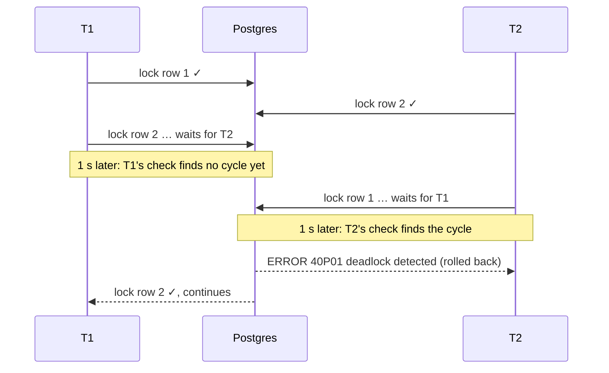

# Lock ordering and deadlocks

## What it is

A **deadlock** is a cycle of waits: transaction 1 holds lock A and waits for lock B, while
transaction 2 holds B and waits for A. Neither can proceed, and neither will ever release what it
holds, because each is waiting for the other. The same can happen with three or more transactions
in a longer cycle.

Postgres **detects** deadlocks and **resolves** them by aborting one of the transactions involved;
the others can then continue
([deadlocks](https://www.postgresql.org/docs/17/explicit-locking.html#LOCKING-DEADLOCKS)).
- **When it checks.** A transaction that has waited for a lock longer than `deadlock_timeout`
  (default `1s`) triggers the check
  ([lock management settings](https://www.postgresql.org/docs/17/runtime-config-locks.html#GUC-DEADLOCK-TIMEOUT)).
- **Who is aborted.** The docs say only that it's "difficult to predict and should not be
  relied upon". What you can observe: the check runs for a transaction that has been waiting for
  `deadlock_timeout`, and when that check finds a cycle, that transaction is the one aborted. If
  the first waiter's check ran before the cycle was complete, it found nothing, so the victim is
  the later waiter, whose check closes the cycle. **Unverified against the docs:** this describes
  observed behaviour (exercise 1), not a documented rule; never write code that depends on which
  side loses.
- **What the victim sees.** An error with SQLSTATE `40P01` (deadlock_detected), and its
  transaction is rolled back ([error codes](https://www.postgresql.org/docs/17/errcodes-appendix.html#ERRCODES-TABLE)).

So a deadlock in Postgres is not a hang; it's an error, about a second later, in one of the
transactions. Still a failure for that request, and under load a source of retries and latency.

**Prevention: a lock order.** The Postgres docs' advice is the classic one: make every transaction
that locks several objects acquire them **in the same, consistent order**. A cycle needs someone
to hold a "later" lock while waiting for an "earlier" one. If everyone takes locks in the same
order, nobody ever does that.

## The problem it solves

Two transfers between the same pair of accounts, in opposite directions:

```sql
-- T1: transfer from account 1 to account 2     -- T2: transfer from 2 to 1
BEGIN;                                           BEGIN;
UPDATE account SET ... WHERE id = 1;             UPDATE account SET ... WHERE id = 2;
UPDATE account SET ... WHERE id = 2;  -- waits   UPDATE account SET ... WHERE id = 1;  -- waits
```



In this timeline T2 started waiting more than a second after T1, so T1's check came too early,
and T2, the transaction whose check found the cycle, was aborted. With a different timing (both
waits starting within a second) either side could be the victim.

**The fix: lock in ascending id order**, whichever direction the money moves. Both transactions
start by locking the lower id first, so the second simply waits for the first to finish:

```sql
SELECT id FROM account WHERE id IN (1, 2) ORDER BY id FOR UPDATE;   -- both T1 and T2
-- then update in any order: the locks are already held
```

**The second line of defence: retry.** A deadlock victim was rolled back cleanly, so the whole
transaction can simply be run again. That's safe if the transaction is a pure recompute, or is
idempotent ([idempotency](idempotency.md)).

## In this project

**One global lock order** for every path in the order flow, written down in CLAUDE.md and
[ADR 0015](../adr/0015-stock-reserved-at-checkout-under-row-locks.md):

```
Cart (owner) → Order → PaymentIntent → Offers (ascending id)
      … commit …
Products (ascending id), in their own transaction
```

| Path | Locks, in order |
|---|---|
| Checkout | cart → offers |
| `pay`, cancel, the sweeper | order → offers |
| The payment webhook | order → payment intent → (inside `pay`) offers |
| Product stats refresh | products, after the order transaction has committed |

([cart-checkout-stock.md](../flows/cart-checkout-stock.md#lock-order))

**How the order is enforced in code:**
- **Offers.** `lock_offers()` in [services.py](../../backend/apps/orders/services.py) locks the
  offers with one query, `ORDER BY id`, whatever order the cart lines are in. Its docstring: rows
  are locked as they come out of the sort, so every transaction acquires overlapping offers in the
  same order.
- **Products.** `lock_products()` in [stats.py](../../backend/apps/catalog/stats.py) does the same
  with raw SQL. The product locks are taken in a **separate transaction after the order commits**
  (`refresh_product_stats_on_commit`), so an order transaction never holds offer locks while
  waiting for product locks.
- **Retry as the second line.** `refresh_product_stats()` retries up to three times on SQLSTATE
  `40P01` or `40001`, because it's a pure recompute.
- **Analytics.** The same idea with advisory locks: `recompute_days()` takes its per-day locks
  in ascending day order ([analytics.md](../flows/analytics.md#state-based-recompute)).

**Tests:**
- `test_opposite_cart_order_does_not_deadlock` puts the same two offers in two carts in opposite
  orders and checks both out at the same instant, ten times.
- `test_concurrent_stats_refreshes_over_overlapping_products` runs two refreshes over the same
  products, one with the ids reversed.

Both are in [test_concurrency.py](../../backend/tests/test_concurrency.py).

**The limit of the approach.** The order is a rule that every new code path must follow; the
database doesn't check it. ADR 0015 lists that as a cost: reviewers must enforce it.

## Pitfalls

- **Locking in "natural" order.** Cart line order, set iteration order and the order of ids in a
  request are all arbitrary. Always sort by a stable key first, or let one `ORDER BY` query take
  all the locks.
- **Sorting by a key that can change.** Postgres warns that at Read Committed, a
  `SELECT … ORDER BY … FOR UPDATE` can return rows out of order, because the sort happens before
  the locks are taken, and a row may have changed meanwhile
  ([the locking clause](https://www.postgresql.org/docs/17/sql-select.html#SQL-FOR-UPDATE-SHARE)).
  Sorting by the primary key, which never changes, avoids that.
- **Implicit locks count too.** An `UPDATE` locks every row it changes. A multi-row
  `UPDATE … WHERE id IN (…)` takes those locks in whatever order the query plan visits the rows,
  which you don't control. **Unverified against the docs:** the visiting order isn't documented;
  lock the rows first with an ordered `SELECT … FOR UPDATE` if it matters.
- **Mixing lock kinds without one order.** A transaction that holds a row lock and then takes an
  advisory lock (or the reverse) can deadlock with one that does the opposite. The order has to
  cover every kind of lock.
- **Retrying something that isn't safe to retry.** Retrying a deadlock victim is only safe if
  re-running the transaction can't double-apply anything outside the database (an email, an HTTP
  call).
- **Hiding deadlocks with timeouts.** Deadlocks are a design signal, not noise; fix the order.

## Interview follow-ups

- **What is a deadlock, and how does Postgres handle it?** A cycle of transactions each waiting for
  a lock the next one holds. Postgres checks after `deadlock_timeout` (1 s by default), aborts one
  of them with SQLSTATE `40P01`, and the others proceed.
- **How do you prevent deadlocks?** Acquire locks in one global order (for example, ascending
  primary key), keep transactions short, and take all the locks you need up front. Keep a retry as
  a second line of defence for pure or idempotent work.
- **Why is a retry on deadlock safe?** The victim's transaction is rolled back completely, so
  re-running it starts from a clean state, provided it has no non-transactional side effects.
- **Can you get a deadlock with only one table?** Yes: two transactions locking the same two rows
  of one table in opposite orders. The table count doesn't matter; the order of acquisition does.
- **What's the difference between a deadlock and lock contention?** Contention is waiting that
  ends when the holder commits. A deadlock never ends by itself; it needs an abort.

Project-specific questions: [interview-guide.md](../interview-guide.md#checkout-and-concurrency).

## Exercises

### 1. Cause a deadlock, then prevent it

**Runs on: A** (lab stack, two `psql` sessions).

1. Pick two offers: `SELECT id FROM catalog_offer ORDER BY id LIMIT 2;` Call them `<a>` < `<b>`.
2. Lock them in opposite orders:
   - S1: `BEGIN; SELECT id FROM catalog_offer WHERE id = <a> FOR UPDATE;`
   - S2: `BEGIN; SELECT id FROM catalog_offer WHERE id = <b> FOR UPDATE;`
   - S1: `SELECT id FROM catalog_offer WHERE id = <b> FOR UPDATE;` (waits)
   - S2: `SELECT id FROM catalog_offer WHERE id = <a> FOR UPDATE;`
3. `ROLLBACK;` in both.
4. Now both sessions lock both offers with one ordered query, in the same interleaving:
   - S1: `BEGIN; SELECT id FROM catalog_offer WHERE id IN (<b>, <a>) ORDER BY id FOR UPDATE;`
   - S2: `BEGIN; SELECT id FROM catalog_offer WHERE id IN (<a>, <b>) ORDER BY id FOR UPDATE;` (waits)
   - S1: `COMMIT;`  then S2: `COMMIT;`

**Expected:** in step 2, about a second after S2's second `SELECT`, S2 gets
`ERROR: deadlock detected` (SQLSTATE `40P01`) and S1's waiting `SELECT` returns. (Typed by hand, S1
has waited well over a second by then, so its own check found no cycle.) In step 4, S2 just waits until S1 commits; no
error.

<details><summary>Solution</summary>

In step 2 each session holds one lock and waits for the other's: a cycle. After
`deadlock_timeout`, Postgres runs the check, aborts one transaction (the error detail names both
processes and what each waited for), and the other's wait is satisfied. In step 4 the `IN` list's
order doesn't matter: `ORDER BY id` makes both sessions request `<a>` first. S2 blocks on `<a>`
while holding nothing, so no cycle is possible. This is the shape of `lock_offers()`.
</details>

### 2. Break the project's lock order

**Runs on: C** ([mutation protocol](lab.md#c-the-test-suite-mutation-exercises)).

0. Check the file is unmodified, or stop and commit or stash first ([lab.md, step 1](lab.md#c-the-test-suite-mutation-exercises)):
   `git diff --quiet -- backend/apps/orders/services.py && git diff --cached --quiet -- backend/apps/orders/services.py && echo clean`
1. In [backend/apps/orders/services.py](../../backend/apps/orders/services.py), replace the body of
   `lock_offers()` with a version that locks one offer at a time, in the order given (cart line
   order):
   ```python
   offers = {}
   for offer_id in offer_ids:
       offers[offer_id] = Offer.objects.select_for_update().get(pk=offer_id)
   return offers
   ```
2. `docker compose exec backend pytest tests/test_concurrency.py -k opposite_cart_order`
3. Restore and prove it: `git checkout -- backend/apps/orders/services.py`, then `git diff --quiet -- backend/apps/orders/services.py && echo restored`
   and `git status --short` (the same as before step 1). Never commit the mutated file.

**Expected:** the test fails: in at least one of its ten rounds a checkout raises a deadlock error
(an `OperationalError`) instead of returning an order.

<details><summary>Solution</summary>

Alice's cart has A then B, Bob's has B then A. Locking in line order, Alice takes A and Bob takes
B; then each waits for the other. Postgres aborts one with `40P01`, and that checkout surfaces as
an error. The test's `run_concurrently()` starts both at the same instant behind a barrier, and
runs ten rounds, so the cycle shows up. With the original single `ORDER BY id` query, both
request A first, and the second just waits.
</details>

### 3. How quickly does Postgres notice?

**Runs on: B** (dev database, read-only).

`SHOW deadlock_timeout;`

**Expected:** `1s`.

<details><summary>Solution</summary>

That's the default: a transaction waiting on a lock for one second triggers deadlock detection.
The check isn't run on every wait immediately because it's comparatively expensive, and most waits
end on their own. That's also why the deadlock in exercise 1 took about a second to be reported.
</details>

**Run status:** all three run on 2026-11-12; every result matched the expected one. Venue A ran on the lab stack (`make lab-up`); its SQL was issued in the stated order by two connections from a script inside the lab backend container, not typed into `psql`. Venue B ran on the dev database with the read-only guard, venue C with the [mutation protocol](lab.md#c-the-test-suite-mutation-exercises). Observed: with S2's wait starting 2 s after S1's, S2 was aborted about 1.0 s into its wait. A second run with the waits 0.3 s apart aborted **S1** instead, whose check then found the cycle first, as described under "Who is aborted". Exercise 2's checkout failed with a deadlock error while locking a `catalog_offer` row.

## Further reading

- PostgreSQL 17: [Deadlocks](https://www.postgresql.org/docs/17/explicit-locking.html#LOCKING-DEADLOCKS), [deadlock_timeout](https://www.postgresql.org/docs/17/runtime-config-locks.html#GUC-DEADLOCK-TIMEOUT), [the locking clause](https://www.postgresql.org/docs/17/sql-select.html#SQL-FOR-UPDATE-SHARE) (the caution on `ORDER BY` with `FOR UPDATE`), [error codes](https://www.postgresql.org/docs/17/errcodes-appendix.html#ERRCODES-TABLE)
- Project: [ADR 0015](../adr/0015-stock-reserved-at-checkout-under-row-locks.md), [cart-checkout-stock.md](../flows/cart-checkout-stock.md#lock-order)

**Verified** 2026-11-12 against the PostgreSQL 17 pages linked above.
