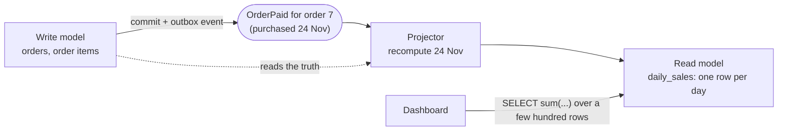

# Projections and read models

## What it is

The tables a system **writes** are shaped for correctness: normalised, one fact in one place,
constraints and locks. The questions it **reads** are often shaped differently: "revenue per day
for two years", "products under R$ 50 with stock, sorted by popularity". Answering those from the
write tables means aggregating or joining large amounts of data on every request.

A **read model** (or **projection**) is data derived from the source of truth and shaped for one
kind of read: a summary table, a denormalised column, a search index, a cache. It is:
- **derived:** it can always be rebuilt from the source, so it's never the only copy of a fact;
- **maintained:** something keeps it current, synchronously in the same transaction, or
  asynchronously, driven by events;
- **usually eventually consistent** when maintained asynchronously: briefly behind the source.

Three related terms, kept apart:
- **CQRS** (Command Query Responsibility Segregation): using different models for updates and for
  reads. Martin Fowler, who popularised the name, warns that for most systems it adds risky
  complexity ([CQRS](https://martinfowler.com/bliki/CQRS.html), 2011). Projections are a lighter
  form: same database and same code, just extra derived tables.
- **Event sourcing:** capturing all changes to application state as a sequence of events, the
  events being the source of truth ([Event Sourcing](https://martinfowler.com/eaaDev/EventSourcing.html), 2005).
  Projections there are rebuilt by replaying events. **This project isn't event-sourced:** the
  tables are the truth, events only announce changes, and projections are rebuilt from the tables.
- **Materialized views:** a database-managed projection, refreshed as a whole on demand. That's
  simple, but stale between refreshes, and a full refresh recomputes everything.

## The problem it solves

```sql
-- On every dashboard view, over every order ever:
SELECT (purchased_at AT TIME ZONE 'America/Sao_Paulo')::date AS day, count(*), sum(...)
FROM orders JOIN order_items ... GROUP BY 1;          -- cost grows with history, per request
```

A projection moves the work from **read time** to **write time**, and to only what changed:



The two ways to maintain it, with the trade-off from
[state-based-vs-delta-handlers.md](state-based-vs-delta-handlers.md):
- **Incremental:** apply each event's change (`+1 order, +R$ 75`). Cheap, but fragile under
  duplicates, reordering and lost events.
- **Rebuild a slice:** recompute the affected key (a day, a product) from the truth. Correct under
  all of those, and the same code serves the initial load and repairs.

## In this project

**1. Denormalised product columns: a read model inside the write tables.** `Product.min_price`,
`rating_avg`/`rating_count`, `sales_count`/`first_sold_at` and `search_vector` exist so the shop
listing filters and sorts on indexed columns of one table
([catalog-and-search.md](../flows/catalog-and-search.md#filtering-on-denormalised-columns)).
They're maintained in three ways, by how fresh each must be:

| Columns | Kept current by | Freshness |
|---|---|---|
| `min_price` (and the in-stock filter), ratings | `refresh_product_stats_on_commit()` right after each order transaction | Immediate (next request) |
| `sales_count`, `first_sold_at` | The `product_stats` consumer | Seconds behind |
| Everything, including `search_vector` | The importer's set-based SQL (`stats.py`), `make backfill-sales` | On import or on demand |

**2. Analytics projections: separate read-model tables.** `DailySales`, `CategorySales`,
`StateSales` and `DeliveryStats`, one row per (São Paulo purchase day, source[, category or state])
([analytics.md](../flows/analytics.md), [ADR 0011](../adr/0011-analytics-projections-recompute.md)):
- **Maintained by rebuilding a slice.** `recompute_days(days, source)` in
  [projections.py](../../backend/apps/analytics/projections.py) deletes and re-inserts those days'
  rows from the orders, under per-day advisory locks
  ([coordination](coordination-advisory-locks-and-leases.md)).
- **Triggered** by the `analytics` consumer on every order event (the order's day), and by
  `backfill_analytics` / `make analytics-backfill` for everything (the importer emits no events).
- **Read** by `GET /api/staff/analytics/`, which sums a few hundred small rows; the page refreshes
  every 10 s while visible.
- **Checked:** `test_backfill_matches_a_direct_computation`; and on 2026-11-09 the replay's
  projected totals equalled the imported ones (2,000 orders, 1,976 paid, GMV R$ 316.909,40).

**3. The event log: a read model of the event stream.** `EventLog`, written once per event by its
own consumer, kept for 90 days, is what the staff explorer reads; the outbox is only a 7-day
delivery buffer ([staff-tools.md](../flows/staff-tools.md#event-explorer)).

**The cost.** Each analytics recompute rereads a whole day. During a `--speed 0` replay the
consumer managed about 64 events/s (2026-11-09), the pipeline's bottleneck. Coalescing each read
batch to its distinct days is the planned fix ([analytics.md](../flows/analytics.md#performance)).

## Pitfalls

- **A read model with no rebuild path.** If it can't be recomputed from the source, it isn't a
  projection, it's a second source of truth that can drift.
- **Forgetting writers that don't emit events.** The importer writes orders without events, so its
  data reaches the projections only through the backfill.
- **Upserting a slice instead of replacing it.** A category that disappears from a day leaves a stale
  row behind; delete and re-insert the slice.
- **Concurrent rebuilds of one slice.** Serialise them, or they double-insert.
- **Unclear definitions.** "Revenue" must say which orders count (here: approved or later) and what's
  included (items + freight for GMV, items only per category), and the definitions must be the same
  in the projector and the documentation.
- **Reading the projection where freshness matters.** The in-stock filter reads `min_price`, which is
  refreshed synchronously for that reason; `sales_count` may lag.

## Interview follow-ups

- **What's a read model, and why have one?** Data derived from the source of truth and shaped for a
  specific read, so reads are cheap and don't scale with history. The price is maintenance and
  some staleness.
- **Projections vs materialized views?** A materialized view is refreshed as a whole by the database;
  a projection is maintained by your code, per changed key, as changes happen.
- **Is this event sourcing?** No: the relational tables are the truth, and events announce changes.
  In event sourcing the events are the truth and every model is a projection of them.
- **How do you rebuild a projection after a bug?** Fix the projector and run the same recompute
  over the affected keys. With slice rebuilds it's the same code as live maintenance.
- **What does eventual consistency mean for the user here?** A sales count may lag by seconds; the
  dashboard may lag by its refresh interval. Anything that must be exact at once (stock, price
  filter) is maintained synchronously.

Project-specific questions: [interview-guide.md](../interview-guide.md#analytics).

## Exercises

### 1. The projection equals a direct computation

**Runs on: A** (lab stack; `psql`).

```sql
WITH direct AS (
    SELECT (o.purchased_at AT TIME ZONE 'America/Sao_Paulo')::date AS day,
           count(*) AS orders,
           count(*) FILTER (WHERE o.status IN ('approved','invoiced','processing','shipped','delivered')) AS paid
    FROM orders_order o
    WHERE o.source = 'olist'
    GROUP BY 1
)
SELECT count(*) AS days,
       count(*) FILTER (WHERE d.orders IS DISTINCT FROM p.orders OR d.paid IS DISTINCT FROM p.paid_orders) AS mismatches
FROM direct d
FULL JOIN (SELECT * FROM analytics_dailysales WHERE source = 'olist') p USING (day);
```

**Expected:** a few hundred days (554 on the lab's small seed, 2026-11-12), and `mismatches` 0.

<details><summary>Solution</summary>

`analytics_dailysales` was built by `backfill_analytics` during `make lab-up`, with the same
definitions as this query: São Paulo purchase day, every order counted, "paid" meaning approved or
later. The `FULL JOIN` also catches days present on only one side. On the dev database the same
check would include any orders you placed, once the consumer has processed them.
</details>

### 2. Lose a slice, rebuild it

**Runs on: A** (lab stack; `psql`, then the backend container).

1. Pick the busiest day and delete its rows:
   ```sql
   SELECT day, orders FROM analytics_dailysales WHERE source = 'olist' ORDER BY orders DESC LIMIT 1;
   DELETE FROM analytics_dailysales WHERE source = 'olist' AND day = '<day>';
   ```
2. `lab exec backend python manage.py backfill_analytics`
3. `SELECT day, orders FROM analytics_dailysales WHERE source = 'olist' AND day = '<day>';`

**Expected:** the row is back, with the same count (on 2026-11-12: 2017-11-24, 28 orders).

<details><summary>Solution</summary>

A projection holds nothing the orders don't. The backfill finds every day that has orders, or
stale rows, for each source, and rebuilds them in chunks, deleting and re-inserting, so the missing
day reappears exactly as before. A table that couldn't be rebuilt this way would be a source of
truth, and would need a backup.
</details>

### 3. What the projection saves

**Runs on: B** (dev database, read-only; `EXPLAIN ANALYZE` runs the `SELECT`s, which only read).

```sql
EXPLAIN ANALYZE
SELECT sum(gmv), sum(orders) FROM analytics_dailysales WHERE source = 'olist';

EXPLAIN ANALYZE
SELECT sum(i.price + i.freight_value), count(DISTINCT o.id)
FROM orders_order o JOIN orders_orderitem i ON i.order_id = o.id
WHERE o.source = 'olist' AND o.status IN ('approved','invoiced','processing','shipped','delivered');
```

**Expected:** the first plan reads a few hundred rows; the second joins thousands of order items.
Compare the execution times. (On 2026-11-12 the dev database read 554 projection rows in about 2 ms,
against 2,239 joined item rows in about 9 ms.) (The second query computes paid GMV only; it isn't the projection's
full definition.)

<details><summary>Solution</summary>

With the small seed, both are fast; the difference is in what each scales with. The projection
grows with the number of days (and sources), the direct query with every order item ever sold. The
full Olist dataset is about 50 times the small seed, and the dashboard asks several such questions
per view, every 10 s while open.
</details>

### 4. Replace without deleting

**Runs on: C** ([mutation protocol](lab.md#c-the-test-suite-mutation-exercises)).

0. Check the file is unmodified, or stop and commit or stash first:
   `git diff --quiet -- backend/apps/analytics/projections.py && git diff --cached --quiet -- backend/apps/analytics/projections.py && echo clean`
1. In [backend/apps/analytics/projections.py](../../backend/apps/analytics/projections.py), in
   `recompute_days()`, delete the line that runs `DELETE FROM {table} …`.
2. `docker compose exec backend pytest tests/test_analytics.py -k update_their_days_rows`
3. Restore and prove it: `git checkout -- backend/apps/analytics/projections.py`, then
   `git diff --quiet -- backend/apps/analytics/projections.py && echo restored` and
   `git status --short`. Never commit the mutated file.

**Expected:** the test fails after the payment: the day's row still shows the unpaid numbers
(`items` 0 instead of 3). With log output (`-o log_cli=true --log-cli-level=ERROR`) you see why: the
analytics consumer's recompute hit `duplicate key value violates unique constraint "uniq_daily_sales"`.

<details><summary>Solution</summary>

A slice rebuild is "replace", and replace needs the delete. Without it, the first event inserts the
day and the second inserts it again; the unique key turns a double count into an error. The error
doesn't reach the test: the consumer catches it, rolls back, and leaves the entry pending to retry
(and, after five deliveries, dead-letters it). So the visible symptom is a projection that silently
stops updating, which is what `/staff/health` (pending, dead letters) is there to show. An upsert
would avoid the error, but leave stale rows behind when a category or state disappears from the
day, which is why the project deletes and re-inserts.
</details>

**Run status:** all four run on 2026-11-12. Venue A on the lab stack (`make lab-up`), venue B
read-only on the dev database, venue C with the [mutation protocol](lab.md#c-the-test-suite-mutation-exercises). Exercises 1–3 matched. **One correction:** exercise 4 was expected
to surface a duplicate-key error in the test; the error happened (confirmed in the consumer's log),
but the consumer caught it and the test saw a stale row instead (see its solution).

## Further reading

- Martin Fowler, [CQRS](https://martinfowler.com/bliki/CQRS.html) (2011), and [Event Sourcing](https://martinfowler.com/eaaDev/EventSourcing.html) (2005)
- Project: [ADR 0011](../adr/0011-analytics-projections-recompute.md), [analytics.md](../flows/analytics.md), [catalog-and-search.md](../flows/catalog-and-search.md#filtering-on-denormalised-columns)

**Verified** 2026-11-12 against the two articles linked above.
