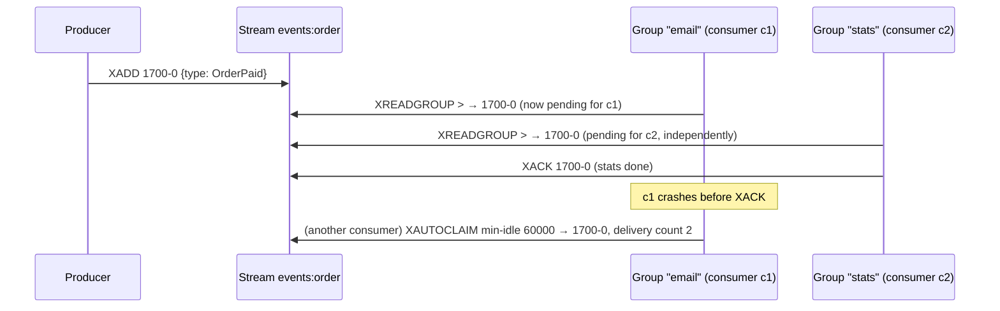

# Redis Streams and Pub/Sub

## What it is

Redis offers two ways to move messages between processes, with opposite trade-offs.

**Pub/Sub** is a broadcast with no memory. A publisher sends a message to a channel; every client
subscribed **at that moment** receives it; nothing is stored. Redis calls its delivery semantics
at-most-once: a subscriber that can't handle a message (an error, a network disconnect) has lost
it for good. `PUBLISH` returns how many clients received the message
([Pub/Sub](https://redis.io/docs/latest/develop/pubsub/), [PUBLISH](https://redis.io/docs/latest/commands/publish/)).

A **Stream** is an append-only log. `XADD` appends an entry (a small map of fields) with an id
that increases over time; entries stay until they're trimmed or deleted, whoever is listening.
Streams support at-least-once delivery through **consumer groups**
([Streams](https://redis.io/docs/latest/develop/data-types/streams/)):

| Command | What it does |
|---|---|
| `XADD key MAXLEN ~ N * field value …` | Append an entry. `~` trims approximately, which is more efficient and may leave slightly more than N entries ([XADD](https://redis.io/docs/latest/commands/xadd/)) |
| `XGROUP CREATE key group 0 MKSTREAM` | Create a consumer group. `0` starts it at the beginning of the stream, `$` at its end; `MKSTREAM` creates an empty stream if it doesn't exist ([XGROUP CREATE](https://redis.io/docs/latest/commands/xgroup-create/)) |
| `XREADGROUP GROUP g c … STREAMS key >` | Read entries never delivered to anyone in the group. Each one goes to this consumer's **pending entries list** (PEL): delivered, not yet acknowledged. With an explicit id instead of `>`, a consumer re-reads its own pending entries ([XREADGROUP](https://redis.io/docs/latest/commands/xreadgroup/)) |
| `XACK key group id` | Remove an entry from the PEL: "done" ([XACK](https://redis.io/docs/latest/commands/xack/)) |
| `XPENDING key group` | Inspect the PEL; the extended form shows each entry's owner, idle time and **delivery count** ([XPENDING](https://redis.io/docs/latest/commands/xpending/)) |
| `XAUTOCLAIM key group consumer min-idle start` | Take over entries pending longer than `min-idle` ms from whoever holds them, returning a cursor for the next call. Claiming increments the delivery count. Since Redis 7.0 it also drops PEL entries whose message no longer exists, and reports their ids ([XAUTOCLAIM](https://redis.io/docs/latest/commands/xautoclaim/)) |
| `XINFO GROUPS key` | Per group: consumers, pending count, last delivered id, `entries-read` and `lag`, the entries still waiting to be delivered, or null when Redis can't compute it ([XINFO GROUPS](https://redis.io/docs/latest/commands/xinfo-groups/)) |
| `XGROUP DELCONSUMER key group c` | Remove a consumer. Its pending messages become **unclaimable** ([XGROUP DELCONSUMER](https://redis.io/docs/latest/commands/xgroup-delconsumer/)) |

**Each group sees every entry; within a group, each entry goes to one consumer.** That gives both
fan-out (one group per subscriber service) and load sharing (several consumers in one group).

**Durability** depends on persistence. With AOF and `appendfsync everysec` (the suggested default
policy), Redis may lose about one second of writes in a disaster
([persistence](https://redis.io/docs/latest/operate/oss_and_stack/management/persistence/#how-durable-is-the-append-only-file)).

redis.io documents the current Redis, with no Redis 7 edition; this project runs Redis 7, and the
exercises below ran on it.

## The problem it solves

A service publishes "order paid", and three others need it: stats, email, a live page.
- **With Pub/Sub,** the email service that's restarting at that second never hears it.
- **With a plain list as a queue** (`LPUSH`/`BRPOP`), each message goes to one reader only, and a
  reader that crashes after popping loses it.
- **With a stream and a consumer group per service,** each service gets every event, unacknowledged
  work survives a crash in the PEL, and another consumer can claim it.



Pub/Sub still has a place: a **signal** whose loss is harmless, such as "something changed, look
again". It's cheap, has no storage and no acknowledgements, and reaches subscribers immediately.

## In this project

**Streams carry events** ([event-pipeline.md](../flows/event-pipeline.md),
[ADR 0001](../adr/0001-redis-streams-over-kafka.md)). The code is in
[streams.py](../../backend/apps/events/streams.py), [relay.py](../../backend/apps/events/relay.py)
and [consumer.py](../../backend/apps/events/consumer.py):
- **One stream per aggregate type:** `events:order`, `events:product`, plus the dead-letter stream
  `events:dlq`. The relay writes with `MAXLEN ~ 100000` (`EVENTS_STREAM_MAXLEN`).
- **One group per consumer.** `ensure_groups()` runs `XGROUP CREATE … id=0 MKSTREAM`, so a new
  consumer processes the stream's whole remaining history. `ProcessedEvent` makes that safe
  ([idempotency.md](idempotency.md)).
- **Reading.** `XREADGROUP … >` with `BLOCK` 2 s and up to 10 entries; each entry is handled in a
  transaction, then `XACK`ed after commit.
- **Recovery.** Every 30 s, `XAUTOCLAIM` with `min-idle` 60 s (`EVENTS_CLAIM_IDLE_MS`) takes over
  entries a crashed or failing consumer left pending. `XPENDING` supplies the delivery count;
  above `EVENTS_MAX_DELIVERIES` (5) the entry goes to `events:dlq`
  ([retries-backoff-and-dead-letters.md](retries-backoff-and-dead-letters.md)). An entry trimmed
  away while pending comes back without fields, and is just acked.
- **Dead consumer names.** Names are `hostname-pid`, so every restart leaves the old one in the
  group. `prune_dead_consumers()` removes names idle for over 10 minutes **with 0 pending**, never
  one that owns pending entries, because `DELCONSUMER` would make them unclaimable
  (`test_dead_consumer_names_are_pruned_on_start_but_not_while_they_own_pending_entries`).
- **Health.** `/staff/health` reads `XINFO GROUPS` (pending, `lag`, last delivered id) and
  `XINFO CONSUMERS` (active within a minute) ([staff-tools.md](../flows/staff-tools.md#health)).
- **Persistence:** AOF with `appendfsync everysec` ([docker-compose.yml](../../docker-compose.yml));
  a hard crash can lose about a second of published entries
  ([limitations](../limitations-and-roadmap.md#events-and-live-updates)).

**Pub/Sub carries signals** ([live-tracking.md](../flows/live-tracking.md),
[ADR 0007](../adr/0007-sse-signal-plus-snapshot.md)):
- **Publishing.** The `order_live` consumer, and the payment return view, `PUBLISH` to
  `live:order:<id>` (`publish_order_signal()` in [live.py](../../backend/apps/orders/live.py),
  best effort: a Redis error is logged, not raised).
- **Subscribing.** Each open SSE stream subscribes to its order's channel, then re-reads the order
  from the database on every message. The message carries no state, so a lost one costs only a
  delay until the next signal, a reconnect, or the fallback poll.

**Why not Kafka.** Redis was already the Celery broker, and Streams provide consumer groups, a
PEL, claiming and replay. The trade-offs, bounded retention, no partitions and a single instance,
are in [ADR 0001](../adr/0001-redis-streams-over-kafka.md).

## Pitfalls

- **Creating a group at `$` when you meant `0`.** The group starts at the end and silently skips
  the existing history.
- **Never acknowledging.** The PEL grows forever, and `XPENDING` becomes a list of everything ever
  read.
- **Deleting a consumer that owns pending entries.** They become unclaimable.
- **Trimming more aggressively than your slowest group.** A group lagging past `MAXLEN` loses the
  trimmed entries.
- **Using Pub/Sub for data.** Anything that must not be lost belongs in a stream (or a database
  row); Pub/Sub is for "look again" signals.
- **A blocking read longer than the client's socket timeout.** The client errors on every idle
  read. Here `BLOCK` (2 s) stays under the socket timeout (5 s).

## Interview follow-ups

- **Pub/Sub vs Streams?** Pub/Sub broadcasts to whoever is connected right now and keeps nothing:
  at-most-once. A stream is a persisted log with consumer groups, acknowledgements and claiming:
  at-least-once.
- **What's the pending entries list?** Per group, the entries delivered to a consumer but not yet
  acknowledged, with their owner, idle time and delivery count. It's what makes redelivery and
  claiming possible.
- **How do you recover a crashed consumer's work?** Another consumer claims entries idle beyond a
  threshold (`XAUTOCLAIM`); the delivery count rises each time, so poison messages can be
  dead-lettered after N attempts.
- **How do you scale consumers?** Add consumers to the same group: entries are shared between
  them. Add a group for a new independent subscriber.
- **When would you choose Kafka instead?** Long retention, partitioned throughput, many independent
  teams consuming, or per-partition ordering guarantees.

Project-specific questions: [interview-guide.md](../interview-guide.md#event-pipeline).

## Exercises

### 1. A consumer group by hand

**Runs on: A** (lab stack; `lab exec redis redis-cli`, on a scratch key).

```
XADD lab:s * n 1
XADD lab:s * n 2
XADD lab:s * n 3
XGROUP CREATE lab:s g 0
XREADGROUP GROUP g c1 COUNT 2 STREAMS lab:s >
XPENDING lab:s g
XACK lab:s g <id of n=1>
XINFO GROUPS lab:s
XAUTOCLAIM lab:s g c2 0 0-0
XPENDING lab:s g - + 10
DEL lab:s
```

**Expected:**
- **`XREADGROUP`** returns entries `n 1` and `n 2` to `c1`, and `XPENDING` shows 2 pending.
- **After the `XACK`,** `XINFO GROUPS` shows `pending` 1 and `lag` 1 (entry `n 3` was never
  delivered).
- **`XAUTOCLAIM`** with `min-idle` 0 moves the remaining pending entry to `c2`, and the extended
  `XPENDING` shows it owned by `c2` with a delivery count of 2. The reply's third element (ids of
  entries that no longer exist, Redis 7.0+) is empty.

<details><summary>Solution</summary>

`>` asks for entries never delivered to the group; they land in `c1`'s PEL until acknowledged.
`lag` counts entries the group hasn't been given yet: only the third. `XAUTOCLAIM` transfers
ownership of entries idle longer than its threshold (0 here, 60 s in the project) and counts
another delivery; that count is what the project compares with `EVENTS_MAX_DELIVERIES` before
dead-lettering.
</details>

### 2. Look at the project's real groups

**Runs on: A** (lab stack; `lab exec redis redis-cli`).

```
XLEN events:order
XINFO GROUPS events:order
XINFO CONSUMERS events:order event_log
XINFO GROUPS events:product
```

**Expected:** on a freshly started lab `XLEN events:order` is 0 (the importer emits no events; the
stream and its groups exist because `ensure_groups()` creates them). `events:order` has one group per
order consumer: `analytics`, `event_log`,
`notifications`, `order_live`, `product_stats`. Each shows `pending` 0 and `lag` 0 when idle.
`events:product` has `cache_invalidation` and `event_log`. Each group has at least one consumer
named `<hostname>-<pid>`.

<details><summary>Solution</summary>

These are the same numbers `/staff/health` shows. A consumer that's down shows up as growing
`lag` (entries not yet delivered); one that's failing shows up as `pending` that doesn't go down.
`XINFO CONSUMERS` shows each name's idle time: the health page counts a consumer as active if it
tried to read within a minute.
</details>

### 3. Prune a consumer that still owns work

**Runs on: C** ([mutation protocol](lab.md#c-the-test-suite-mutation-exercises)).

0. Check the file is unmodified, or stop and commit or stash first:
   `git diff --quiet -- backend/apps/events/consumer.py && git diff --cached --quiet -- backend/apps/events/consumer.py && echo clean`
1. In [backend/apps/events/consumer.py](../../backend/apps/events/consumer.py), in
   `prune_dead_consumers()`, delete the line `and consumer["pending"] == 0`.
2. `docker compose exec backend pytest tests/test_staff_explorer.py -k dead_consumer_names`
3. Restore and prove it: `git checkout -- backend/apps/events/consumer.py`, then
   `git diff --quiet -- backend/apps/events/consumer.py && echo restored` and `git status --short`.
   Never commit the mutated file.

**Expected:** the test fails: `crashed-host-1`, which owns an unacknowledged entry, is removed
too.

<details><summary>Solution</summary>

`XGROUP DELCONSUMER` returns the number of pending messages the consumer had, and those messages
become unclaimable: `XAUTOCLAIM` can no longer recover them. Pruning only idle names with nothing
pending keeps the group tidy without losing work. A crashed consumer's entries are recovered by
claiming, not by deleting the consumer.
</details>

**Run status:** all three run on 2026-11-12, on the lab's Redis 7.4.12, and every result matched; venue C with the [mutation protocol](lab.md#c-the-test-suite-mutation-exercises).
Refinements recorded above: the empty third element of the `XAUTOCLAIM` reply, and `XLEN` 0 on a
fresh lab. `XINFO CONSUMERS` on Redis 7.4 also reports an `inactive` field.

## Further reading

- Redis: [Streams](https://redis.io/docs/latest/develop/data-types/streams/), [Pub/Sub](https://redis.io/docs/latest/develop/pubsub/), the commands linked in the table above, [persistence](https://redis.io/docs/latest/operate/oss_and_stack/management/persistence/)
- Project: [ADR 0001](../adr/0001-redis-streams-over-kafka.md), [ADR 0007](../adr/0007-sse-signal-plus-snapshot.md), [event-pipeline.md](../flows/event-pipeline.md)

**Verified** 2026-11-12 against the redis.io pages linked above (current Redis documentation;
no Redis 7 edition exists).
