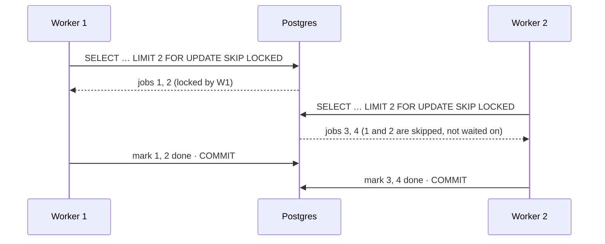

# Row locks, `FOR UPDATE` and `SKIP LOCKED`

## What it is

A **row lock** marks a row as "in use" by one transaction until that transaction ends. Postgres
takes row locks automatically when it updates or deletes a row, and you can take them explicitly
with a **locking clause** on a `SELECT`
([row-level locks](https://www.postgresql.org/docs/17/explicit-locking.html#LOCKING-ROWS)).

There are four modes, from strongest to weakest: `FOR UPDATE`, `FOR NO KEY UPDATE`, `FOR SHARE`
and `FOR KEY SHARE`. This project only uses the strongest, `FOR UPDATE`, which conflicts with any
other transaction that tries to update, delete or lock the same row.

What a row lock does **not** do: block plain reads. Because of MVCC, an ordinary `SELECT` reads
its snapshot without waiting ([transactions-and-isolation.md](transactions-and-isolation.md)).
Locks only order the transactions that **lock or write**.

**What to do when the row is already locked.** That's the choice the locking clause offers
([the locking clause](https://www.postgresql.org/docs/17/sql-select.html#SQL-FOR-UPDATE-SHARE)):

| Clause | If a selected row is locked by another transaction |
|---|---|
| (none) | Wait until that transaction ends |
| `NOWAIT` | Fail at once with an error |
| `SKIP LOCKED` | Leave that row out of the result, and carry on (Postgres 9.5+) |

The docs are explicit that **skipping locked rows gives an inconsistent view of the data**. It's
meant for queue-like tables with several consumers, not for general queries.

Every lock is held **until the transaction ends** (commit or rollback). There's no "unlock" in
the middle.

## The problem it solves

### 1. Check, then act

A rule involving a decision ("only sell if there's enough stock") is a read followed by a write.
Without a lock, two transactions can both read "enough", both act, and break the rule:

```sql
BEGIN;
SELECT stock FROM item WHERE id = 7 FOR UPDATE;   -- the second buyer waits here
-- application decides: stock >= wanted?
UPDATE item SET stock = stock - 1 WHERE id = 7;
COMMIT;                                           -- the second buyer now reads the new stock
```

`FOR UPDATE` makes the check and the act happen with nobody else in between, for that row.

### 2. Several workers, one queue

Several workers poll a table of pending jobs. Without locks, two workers can pick the same job.
With plain `FOR UPDATE` they don't, but the second worker waits for the first. With
`SKIP LOCKED`, each worker takes the next job **nobody else holds**, and nobody waits:

```sql
BEGIN;
SELECT id, payload FROM job
WHERE done_at IS NULL
ORDER BY id
LIMIT 10
FOR UPDATE SKIP LOCKED;          -- rows another worker holds are simply not returned
-- do the work, mark the rows done
COMMIT;                          -- releases the locks
```



If a worker crashes mid-batch, its transaction rolls back, its locks disappear, and the rows are
pending again for the next worker. No lease or timeout is needed for that.

## In Django

`QuerySet.select_for_update(nowait=False, skip_locked=False, of=(), no_key=False)`
([Django: select_for_update](https://docs.djangoproject.com/en/6.1/ref/models/querysets/#select-for-update)):
- **It must run inside `transaction.atomic()`.** In autocommit mode, evaluating it raises an
  error, because the lock would be released at once.
- **`of=("self",)`** locks only the queryset's own table, when the query joins others.
- **`nowait` and `skip_locked`** map to the clauses above, and can't be combined.

## In this project

| Where | Lock | Why |
|---|---|---|
| Checkout ([services.py](../../backend/apps/orders/services.py)) | The cart (`select_for_update()`), then the offers (`lock_offers()`, ascending id) | Two tabs checking out one cart are serialised. Every line's stock is checked on locked rows before any decrement ([cart-checkout-stock.md](../flows/cart-checkout-stock.md#checkout)) |
| `pay`, cancel, fulfilment | The order (`lock_order()`, `of=("self",)`), then its offers | The status is re-checked under the lock; `of` avoids also locking the joined customer row |
| Payment webhook, return view ([payments/services.py](../../backend/apps/payments/services.py)) | The order, then the `PaymentIntent` | The project lock order ([lock-ordering-and-deadlocks.md](lock-ordering-and-deadlocks.md)) |
| Expiry sweeper (`release_expired()`) | Each order with `skip_locked=True`, one transaction per order | An order held by a concurrent sweeper, payment or cancel is **skipped, not waited on**; the next run picks it up |
| Relay ([relay.py](../../backend/apps/events/relay.py)) | Up to 100 unpublished outbox rows, `skip_locked=True` | Several relays can run: each claims a different batch (`test_two_relays_never_publish_the_same_row`) |
| Email sender ([sender.py](../../backend/apps/notifications/sender.py)) | One pending `Notification`, `skip_locked=True` | Two senders never send the same row |
| Stats refresh ([stats.py](../../backend/apps/catalog/stats.py)) | Products, raw `SELECT … ORDER BY id FOR UPDATE` (`lock_products()`) | Overlapping refreshes queue in a fixed order |

Two habits run through all of them:
- **Re-check under the lock.** The sweeper picks its candidates *without* locks, then locks each
  order and checks again that it's still `created` with an expired reservation. Someone may have
  paid in between ([cart-checkout-stock.md](../flows/cart-checkout-stock.md#the-expiry-sweeper)).
- **Locks guard decisions, constraints guard invariants.** Even with every lock in place,
  `CHECK (stock >= 0)` is the backstop ([constraints-as-guarantees.md](constraints-as-guarantees.md)).

Tests: `test_two_buyers_one_last_unit` and `test_concurrent_sweepers_release_each_order_once` in
[test_concurrency.py](../../backend/tests/test_concurrency.py) run real concurrent transactions
([testing.md](../testing.md#techniques-worth-knowing)).

## Pitfalls

- **`select_for_update()` outside a transaction.** Django refuses (in autocommit the lock would
  end immediately).
- **Locking more than you meant.** With joins, `FOR UPDATE` locks the rows of every joined table
  unless you restrict it (`of=` in Django, `FOR UPDATE OF table` in SQL).
- **Using `SKIP LOCKED` where you need the truth.** A count or a report with `SKIP LOCKED` silently
  leaves rows out. It's for "give me some work", never for "tell me how many".
- **Forgetting to re-check after the lock.** The row you selected without a lock may have changed
  by the time you hold it.
- **Holding a lock across slow work.** An HTTP call or an email send inside the transaction keeps
  the row locked for its whole duration. This project keeps provider calls outside transactions
  for that reason ([payments.md](../flows/payments.md#1-starting-a-payment)).
- **Waiting forever.** By default a lock wait has no timeout
  ([client connection defaults](https://www.postgresql.org/docs/17/runtime-config-client.html#GUC-LOCK-TIMEOUT)).
  A stuck transaction elsewhere can stall every waiter. `NOWAIT` or a lock timeout bounds it, at
  the cost of handling the error.

## Interview follow-ups

- **What's the difference between `FOR UPDATE` and an `UPDATE`?** Both lock the row. `FOR UPDATE`
  locks at read time, so the decision made from what you read stays valid until you commit.
- **When would you use `SKIP LOCKED`, and when `NOWAIT`?** `SKIP LOCKED` when any unlocked row
  will do (work queues). `NOWAIT` when you need that specific row and would rather fail fast than
  wait (for example, to answer "busy, try again").
- **Do row locks block readers?** Not plain `SELECT`s: MVCC gives them a snapshot. They block
  other lockers and writers of the same rows.
- **How is a Postgres table as a queue different from a message broker?** It's transactional with
  the rest of your data: a job's completion and its side effects commit together. The costs are
  polling and table churn. It suits modest volumes, or (as here) an outbox in front of a real
  stream.
- **What happens to the locks if the worker crashes?** The connection drops, the transaction rolls
  back, and its locks are released; the rows are available again.

Project-specific questions: [interview-guide.md](../interview-guide.md#checkout-and-concurrency).

## Exercises

### 1. Watch a lock wait, and find who's blocking

**Runs on: A** (lab stack; two `psql` sessions, plus a third for observing).

1. Pick an offer: `SELECT id, stock FROM catalog_offer WHERE stock > 0 ORDER BY id LIMIT 1;`
2. S1: `BEGIN; SELECT id, stock FROM catalog_offer WHERE id = <id> FOR UPDATE;`
3. S2: `BEGIN; SELECT id, stock FROM catalog_offer WHERE id = <id> FOR UPDATE;` (it hangs)
4. In a third session:
   ```sql
   SELECT pid, pg_blocking_pids(pid) AS blocked_by, state, left(query, 60) AS query
   FROM pg_stat_activity
   WHERE cardinality(pg_blocking_pids(pid)) > 0;
   ```
5. Also in S3: `SELECT stock FROM catalog_offer WHERE id = <id>;` (does it wait?)
6. S1: `ROLLBACK;` then S2: `ROLLBACK;`

**Expected:** step 4 shows S2's process blocked by S1's pid. Step 5 returns at once. S2's
`SELECT` returns as soon as S1 rolls back.

<details><summary>Solution</summary>

S2 asked for a lock that conflicts with S1's `FOR UPDATE`, so it waits. `pg_blocking_pids()`
returns the pids holding the locks it's waiting for
([session information functions](https://www.postgresql.org/docs/17/functions-info.html#FUNCTIONS-INFO-SESSION-TABLE)).
The `pg_locks` docs recommend it over hand-written joins on `pg_locks`. S3's plain `SELECT` doesn't
lock, so MVCC lets it read the last committed version without waiting.

While S1 held the lock, a checkout of that offer on http://localhost:3101 would have waited too:
this is exactly how two buyers of the last unit are serialised.
</details>

### 2. A work queue with `SKIP LOCKED`

**Runs on: A** (two sessions).

1. S1:
   ```sql
   CREATE TABLE lab_job (id int PRIMARY KEY, done_at timestamptz);
   INSERT INTO lab_job SELECT g, NULL FROM generate_series(1, 6) g;
   ```
2. S1: `BEGIN; SELECT id FROM lab_job WHERE done_at IS NULL ORDER BY id LIMIT 2 FOR UPDATE SKIP LOCKED;`
3. S2: the same two statements.
4. S2: replace `SKIP LOCKED` with `NOWAIT` and run the `SELECT` again (in a new transaction).
5. S1: `UPDATE lab_job SET done_at = now() WHERE id IN (1, 2); COMMIT;` and S2: `ROLLBACK;`

**Expected:** S1 gets jobs 1 and 2, S2 gets 3 and 4, without waiting. In step 4, S2 fails at once
with `could not obtain lock on row in relation "lab_job"` (SQLSTATE `55P03`).

<details><summary>Solution</summary>

`SKIP LOCKED` removes rows S1 holds from S2's result, so S2 moves on to 3 and 4. That's the
relay's and the email sender's pattern. `NOWAIT` doesn't skip: it fails as soon as the first
selected row is locked. After step 5, jobs 1 and 2 are done, and 3–6 are pending again, because
S2 rolled back and released them.
</details>

### 3. Remove the offer lock from checkout

**Runs on: C** ([mutation protocol](lab.md#c-the-test-suite-mutation-exercises)).

0. Check the file is unmodified, or stop and commit or stash first ([lab.md, step 1](lab.md#c-the-test-suite-mutation-exercises)):
   `git diff --quiet -- backend/apps/orders/services.py && git diff --cached --quiet -- backend/apps/orders/services.py && echo clean`
1. In [backend/apps/orders/services.py](../../backend/apps/orders/services.py), in `lock_offers()`,
   remove `.select_for_update()`.
2. `docker compose exec backend pytest tests/test_concurrency.py -k two_buyers`
3. Restore and prove it: `git checkout -- backend/apps/orders/services.py`, then `git diff --quiet -- backend/apps/orders/services.py && echo restored`
   and `git status --short` (the same as before step 1). Never commit the mutated file.

**Expected:** the test fails, in at least one of its five rounds: instead of one order and one
`OutOfStock`, the losing buyer gets an `IntegrityError`.

<details><summary>Solution</summary>

Without the lock, both checkouts read `stock = 1` and both pass the check. Both then run
`stock = stock - 1`. The second `UPDATE` waits for the first's row lock, re-evaluates against the
committed value (0), and computes -1, which `CHECK (stock >= 0)` rejects. So the database still
prevented the oversell; the constraint is the backstop. But the buyer gets an unhandled integrity
error (a 500 from the API) instead of the 409 listing what's short. The lock is what turns
"impossible" into "handled". The race isn't guaranteed in every round: if one checkout commits
before the other reads, the second sees 0 and gets `OutOfStock` as usual, which is why the test
repeats it five times.
</details>

### 4. Read the relay's query plan

**Runs on: B** (dev database, read-only: `EXPLAIN` without `FOR UPDATE`).

```sql
EXPLAIN SELECT id FROM events_outboxevent
WHERE published_at IS NULL
ORDER BY occurred_at, id
LIMIT 100;
```

**Expected:** a plan using `outbox_unpublished_idx` (on 2026-11-12, with 167 outbox rows: an
Index Only Scan on it, under a Limit). On a very small table a sequential scan is also normal.

<details><summary>Solution</summary>

`outbox_unpublished_idx` ([events/models.py](../../backend/apps/events/models.py)) is a partial
index on `(occurred_at, id)` covering only rows `WHERE published_at IS NULL`. Its order matches the
relay's `ORDER BY`, so the relay can read the oldest unpublished rows straight from the index, and
published rows (almost all of them) aren't in it at all. On a small table the planner may decide
reading the whole table is cheaper; the index matters as the table grows. The relay's real query
adds `FOR UPDATE SKIP LOCKED`, which venue B doesn't allow.
</details>

**Run status:** all four run on 2026-11-12; every result matched the expected one. Venue A ran on the lab stack (`make lab-up`); its SQL was issued in the stated order by two connections from a script inside the lab backend container, not typed into `psql`. Venue B ran on the dev database with the read-only guard, venue C with the [mutation protocol](lab.md#c-the-test-suite-mutation-exercises). Observed: in exercise 1, `pg_blocking_pids()` listed S1's pid for S2, and S3's plain read took about 1 ms; exercise 3's losing buyer got an `IntegrityError` from "catalog_offer_stock_check".

## Further reading

- PostgreSQL 17: [Explicit locking: row-level locks](https://www.postgresql.org/docs/17/explicit-locking.html#LOCKING-ROWS), [The locking clause](https://www.postgresql.org/docs/17/sql-select.html#SQL-FOR-UPDATE-SHARE) (`NOWAIT`, `SKIP LOCKED`), [pg_locks](https://www.postgresql.org/docs/17/view-pg-locks.html), [pg_blocking_pids()](https://www.postgresql.org/docs/17/functions-info.html#FUNCTIONS-INFO-SESSION-TABLE), [release notes 9.5](https://www.postgresql.org/docs/release/9.5.0/) (where `SKIP LOCKED` was introduced)
- Django 6.1: [select_for_update](https://docs.djangoproject.com/en/6.1/ref/models/querysets/#select-for-update)
- PostgreSQL wiki: [Lock Monitoring](https://wiki.postgresql.org/wiki/Lock_Monitoring) (queries for blocked and blocking sessions; the page itself notes some correctness caveats)

**Verified** 2026-11-12 against the PostgreSQL 17 and Django 6.1 pages linked above.
