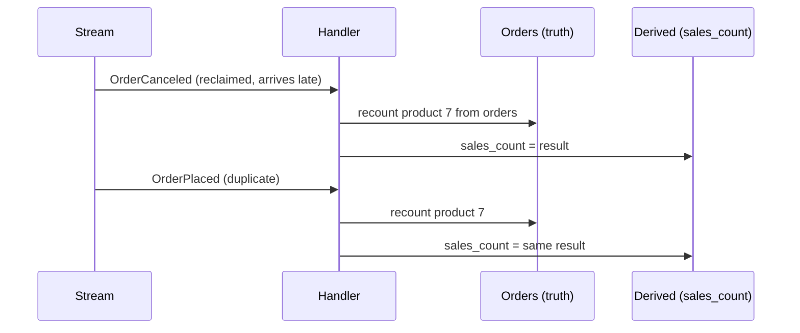

# State-based vs delta handlers

## What it is

An event handler that maintains derived data (a counter, a summary, a cache) can work in two ways:

- **Delta (incremental):** apply the change the event describes to the current value.
  "OrderPlaced with 3 units → `sales_count += 3`."
- **State-based (recompute):** treat the event only as a hint about *what* changed, and rebuild
  that piece of derived data from the source of truth. "OrderPlaced for product 7 → recount product
  7's sales from the orders table."

Deltas are cheap and simple **if every event arrives exactly once, in order**. Real pipelines
deliver at least once, and often out of order
([delivery-guarantees.md](delivery-guarantees.md)). Under those conditions:

| Situation | Delta handler | State-based handler |
|---|---|---|
| The same event twice | Counts it twice | Same result (the recount doesn't change) |
| Events out of order (a cancel processed before its placement) | Can go negative, or end wrong when a delta depends on the current value | Same result: the source of truth already reflects both |
| A lost event | Wrong forever, until someone repairs it | Fixed by the next event that touches the same data |
| Derived data corrupted by a bug | Stays wrong | Rebuilt on the next recompute |
| Cost per event | O(1) | Proportional to the data recomputed |

A dedupe table fixes the first row for delta handlers, not the others
([ADR 0003](../adr/0003-state-based-idempotent-consumers.md)). State-based handlers are
**idempotent and commutative by construction**: the result depends on the database, not on the
history of deliveries.

## The problem it solves

```text
Truth: product 7 has one live order of 3 units.

Delta handler, deliveries: OrderPlaced(+3), OrderPlaced(+3, redelivered)       → sales = 6  ✗
Delta handler, deliveries: OrderCanceled(-3), OrderPlaced(+3), (cancel first)  → sales = 0, but
                           only by luck: a handler clamping at zero ends at 3  ✗
State-based,   any order, any duplicates:  SELECT sum(units) FROM live orders  → sales = 3 or 0,
                           whatever the orders table says now                  ✓
```



The price is work: a recompute reads more than a delta writes. That's fine when the recomputed
unit is small (one product, one day); it becomes the bottleneck when the unit is large and events
are frequent.

## In this project

Every consumer that maintains data is state-based
([event-pipeline.md](../flows/event-pipeline.md#no-ordering-guarantee-handlers-are-state-based)):

| Consumer | The event is a hint about… | Recomputes |
|---|---|---|
| `product_stats` ([product_stats.py](../../backend/apps/events/consumers/product_stats.py)) | the products on the order | `sales_count`, `first_sold_at` and `min_price` for those products, with the same set-based SQL the importer uses (`SALES_SQL`, `MIN_PRICE_SQL` in [stats.py](../../backend/apps/catalog/stats.py)), scoped to their ids |
| `analytics` ([analytics.py](../../backend/apps/events/consumers/analytics.py)) | the order's purchase day | That (day, source) in all four projection tables: delete and re-insert from the orders ([projections-and-read-models.md](projections-and-read-models.md)) |
| `order_live` | the order | Nothing stored: it only signals, and the SSE stream re-reads the order |
| `cache_invalidation` | the products' slugs | Nothing stored: it drops cache entries, and the next visit re-reads |

Details that make them work:
- **Rules live in the SQL, not in the event.** `SALES_SQL` counts units on orders that aren't
  `canceled` or `unavailable`, excluding replay copies. A cancel needs no special "subtract" code:
  the recount just no longer includes that order (`test_sales_count_follows_order_events_and_excludes_canceled_orders`).
- **Writes only on change.** Each statement updates only rows whose value `IS DISTINCT FROM` the
  recomputed one, so a duplicate event writes nothing.
- **The same code repairs drift.** The importer, `make backfill-sales` and `make analytics-backfill`
  run the same recompute over everything; there's no separate repair logic.
- **The cost shows.** The analytics consumer recomputes a whole purchase day per event: about 64
  events/s during a `--speed 0` replay, measured 2026-11-09, making it the pipeline's bottleneck.
  The planned fix keeps it state-based, recomputing each distinct day once per read batch
  ([analytics.md](../flows/analytics.md#performance)).
- **Events still carry data.** Payloads include lines and totals, for consumers that render
  something as of the event (the email). Handlers that maintain derived data read the truth instead.

## Pitfalls

- **"We dedupe, so deltas are fine."** Dedupe handles duplicates, not reordering or lost events.
- **Recomputing from the event's payload** instead of the database: that's a delta in disguise,
  and wrong if the payload is stale.
- **A recompute unit that grows with time** ("all orders ever", "the whole day" under live
  traffic). Keep the unit small, or coalesce several events into one recompute.
- **Concurrent recomputes of the same unit.** Two can interleave a delete and an insert; serialise
  them (here with advisory locks: [coordination](coordination-advisory-locks-and-leases.md)).
- **Reading inside a stale snapshot.** The recompute must see committed data. Here each handler
  runs in its own transaction, after the event's change has committed, because the outbox only
  publishes committed rows.

## Interview follow-ups

- **What's the difference between a state-based and a delta handler?** A delta applies the change
  described by the event; a state-based handler recomputes the affected derived data from the
  source of truth. The second is idempotent and order-independent.
- **When is a delta acceptable?** When delivery is effectively exactly-once and ordered for that
  key (a single partition with idempotent producers), or when small errors are tolerable and
  periodically reconciled.
- **How do you make recomputes cheap?** Scope them to the smallest unit the event affects, index
  for that query, and coalesce bursts (recompute each unit once per batch).
- **How does a state-based design recover from a bug?** Fix the code and run the same recompute
  over the affected data; no event replay or manual correction needed.

Project-specific questions: [interview-guide.md](../interview-guide.md#analytics).

## Exercises

### 1. A delta goes wrong, a recount doesn't

**Runs on: A** (lab stack; one `psql` session, scratch tables).

```sql
CREATE TABLE lab_orders (id int PRIMARY KEY, product int, units int, live boolean);
CREATE TABLE lab_stats (product int PRIMARY KEY, sales int);
INSERT INTO lab_orders VALUES (1, 7, 3, true);
INSERT INTO lab_stats VALUES (7, 0);

-- Delta handler, "OrderPlaced +3" delivered twice:
UPDATE lab_stats SET sales = sales + 3 WHERE product = 7;
UPDATE lab_stats SET sales = sales + 3 WHERE product = 7;
SELECT sales FROM lab_stats;

-- State-based handler, run twice:
UPDATE lab_stats SET sales = (SELECT coalesce(sum(units), 0) FROM lab_orders WHERE product = 7 AND live)
WHERE product = 7;
UPDATE lab_stats SET sales = (SELECT coalesce(sum(units), 0) FROM lab_orders WHERE product = 7 AND live)
WHERE product = 7;
SELECT sales FROM lab_stats;

-- The order is canceled; recount once, whatever arrived when:
UPDATE lab_orders SET live = false WHERE id = 1;
UPDATE lab_stats SET sales = (SELECT coalesce(sum(units), 0) FROM lab_orders WHERE product = 7 AND live)
WHERE product = 7;
SELECT sales FROM lab_stats;
DROP TABLE lab_orders, lab_stats;
```

**Expected:** the delta version shows 6; the recount shows 3 after both runs, then 0 after the
cancel.

<details><summary>Solution</summary>

The delta handler has no way to know the second "+3" is a repeat; a dedupe table would catch that
one, but not a cancel applied before its placement. The recount reads the truth each time, so
repeating it changes nothing and its order relative to other events doesn't matter. That's the
property `product_stats` relies on.
</details>

### 2. Corrupt a derived value, let the system heal it

**Runs on: A** (lab stack; `psql` and the Django shell).

1. In `psql`, pick a product that has sold, and break its counter:
   ```sql
   SELECT id, sales_count FROM catalog_product WHERE sales_count > 0 ORDER BY id LIMIT 1;
   UPDATE catalog_product SET sales_count = 999 WHERE id = <id>;
   ```
2. In the Django shell, run the recompute the consumer uses:
   ```python
   from apps.catalog.stats import refresh_product_stats
   print(refresh_product_stats([<id>], labels=("sales",)))
   print(refresh_product_stats([<id>], labels=("sales",)))
   ```
3. In `psql`: `SELECT sales_count FROM catalog_product WHERE id = <id>;`

**Expected:** the first call reports `{'sales': 1}` (one row corrected), the second `{'sales': 0}`
(nothing to change), and `sales_count` is back to its original value.

<details><summary>Solution</summary>

The recompute doesn't trust the stored value; it recounts from the order items and writes only if
the result differs. So a corrupted counter is corrected by the next recompute of that product: the
next order event for it, or `make backfill-sales` for everything. With a delta handler the 999
would stay, and every later `+n` would build on it.
</details>

### 3. Change the rule, not the handler

**Runs on: C** ([mutation protocol](lab.md#c-the-test-suite-mutation-exercises)).

0. Check the file is unmodified, or stop and commit or stash first:
   `git diff --quiet -- backend/apps/catalog/stats.py && git diff --cached --quiet -- backend/apps/catalog/stats.py && echo clean`
1. In [backend/apps/catalog/stats.py](../../backend/apps/catalog/stats.py), in `SALES_SQL`, delete
   the line `WHERE o.status NOT IN ('canceled', 'unavailable')` and change the next line's `AND` to
   `WHERE`.
2. `docker compose exec backend pytest tests/test_events_consumers.py -k excludes_canceled`
3. Restore and prove it: `git checkout -- backend/apps/catalog/stats.py`, then
   `git diff --quiet -- backend/apps/catalog/stats.py && echo restored` and `git status --short`.
   Never commit the mutated file.

**Expected:** the test fails after the cancel: the sales counts stay at `(2, 1)` instead of
returning to `(0, 0)`.

<details><summary>Solution</summary>

The consumer has no cancel-specific code; it recomputes. So "what counts as a sale" lives entirely
in the SQL, and changing it changes what every recompute produces, for live events, backfills and
imports alike. With deltas, the same rule would be spread across a `+` handler and a `-` handler,
and fixing it later would need a separate repair of the stored counts.
</details>

**Run status:** all three run on 2026-11-12, and every result matched. Venue A on the lab stack
(`make lab-up`): exercise 1 in `psql` (6, then 3, then 0), exercise 2 with product 1 (`sales_count`
1 → 999 → 1; `{'sales': 1}` then `{'sales': 0}`); venue C with the [mutation protocol](lab.md#c-the-test-suite-mutation-exercises): the counts stayed `(2, 1)`.

## Further reading

- Project: [ADR 0003](../adr/0003-state-based-idempotent-consumers.md), [event-pipeline.md](../flows/event-pipeline.md#no-ordering-guarantee-handlers-are-state-based), [analytics.md](../flows/analytics.md#performance)
- Related concepts: [delivery-guarantees.md](delivery-guarantees.md), [idempotency.md](idempotency.md), [projections-and-read-models.md](projections-and-read-models.md)

There's no official specification for this distinction; it's a design choice explained here from
first principles and from this project's code.
