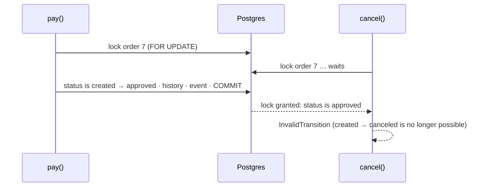
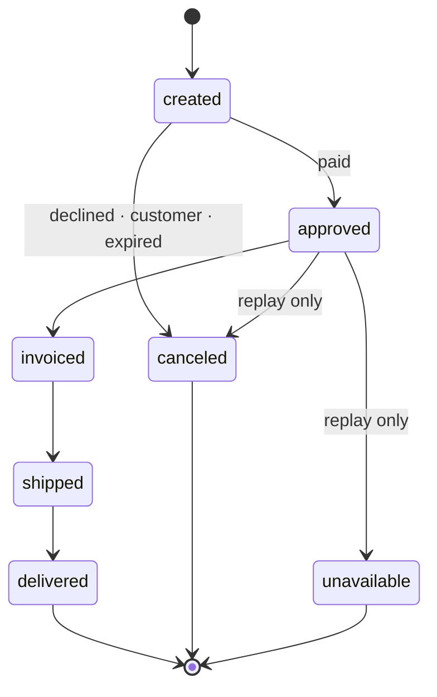

# State machines

## What it is

A **state machine** describes something that is always in exactly one of a fixed set of
**states**, and moves between them only by **allowed transitions**. An order is `created`, then
`approved`, then `shipped`; it is never "approved and canceled", and it never goes from `delivered`
back to `created`.

Writing it down as an explicit table gives four things:
- **One answer to "can this happen?"** Every rule lives in one place instead of in `if` statements
  scattered across views and tasks.
- **Illegal moves become errors, not data.** A bug can't quietly put an order in an impossible
  state.
- **Terminal states are visible.** States with no way out (delivered, canceled) are where
  cleanup, emails and "is it final?" checks can rely on stability.
- **Transitions are natural events.** "Created → approved" *is* "the order was paid", which makes
  a transition the obvious place to record history and emit a domain event
  ([transactional-outbox.md](transactional-outbox.md)).

Real-world example: Stripe's PaymentIntent moves through `requires_payment_method`,
`requires_confirmation`, `requires_action`, `processing`, optionally `requires_capture`, then
`succeeded`, or it can be canceled
([PaymentIntent lifecycle](https://docs.stripe.com/payments/paymentintents/lifecycle)).

## The problem it solves

### Implicit states

```python
order.status = "shipped"     # in a view
order.save()
...
if order.status == "paid":   # in a task; "paid" isn't even a status
    ...
```

Nothing stops shipping an unpaid order, or canceling a delivered one. Each call site re-decides the
rules, and they drift. An explicit machine replaces every assignment with one function:

```python
TRANSITIONS = {
    "created":  {"approved", "canceled"},
    "approved": {"shipped", "canceled"},
    "shipped":  {"delivered"},
}                                      # delivered, canceled: terminal

def transition(order, to):
    if to not in TRANSITIONS.get(order.status, set()):
        raise InvalidTransition(order.status, to)
    order.status = to
    ...                                # history row, event: same transaction
```

### Two transitions at once

The check ("is it still `created`?") and the change must happen with nobody in between. Otherwise
a payment and a cancellation that arrive together can both see `created` and both "succeed". Two
standard ways:

1. **Lock, then check:** `SELECT … FOR UPDATE` the order, check the status, transition, commit
   ([row-locks-and-skip-locked.md](row-locks-and-skip-locked.md)).
2. **Compare-and-set:** `UPDATE orders SET status = 'approved' WHERE id = 7 AND status = 'created'`,
   where 0 rows updated means "someone else moved it first".



A database `CHECK` can restrict *which values* a status may have, but not *which moves* are
allowed: a `CHECK` sees only the row's own new values, not the old ones
([check constraints](https://www.postgresql.org/docs/17/ddl-constraints.html#DDL-CONSTRAINTS-CHECK-CONSTRAINTS)).
Transitions are enforced in code, under the lock, or by a trigger.

## In this project

The order state machine is [backend/apps/orders/state.py](../../backend/apps/orders/state.py)
([data-model.md](../data-model.md#order-state-machine)):



- **The table is data:** `TRANSITIONS` maps each status to the set it may move to. Statuses with no
  entry are terminal. Olist's `processing` exists in imported data only; nothing moves into or out
  of it.
- **One function moves orders:** `transition(order, to_status, reason)`.
  - It refuses to run outside `transaction.atomic()`, and its docstring requires the caller to hold
    the order's row lock.
  - An illegal move raises `InvalidTransition`, which the API returns as `409` with
    `"code": "invalid_transition"` and `current_status` ([errors.py](../../backend/apps/core/errors.py)).
  - Each move writes an `OrderStatusHistory` row (from, to, reason, `occurred_at`) and stamps
    `approved_at`, `delivered_carrier_at` or `delivered_customer_at` on entry.
- **Lock, then check, in every caller.** `pay()`, `cancel()` and the fulfilment services
  (`_advance()`) in [services.py](../../backend/apps/orders/services.py) lock the order
  (`lock_order()`), check, transition and record the domain event in one transaction. The event
  is recorded by the service, next to the transition, because the service knows the business
  meaning: "canceled" can be a decline, an expiry or a customer.
- **Guards beyond the table.** `pay()` and `cancel()` accept only `created` orders, and
  `cancel_paid()` and `mark_unavailable()` refuse non-replay orders, even though the table allows
  `approved → canceled`. The table says what's possible; the services add who may do it.
- **Repeat-safety for free.** Because every step is "only from state X, under the lock", a repeated
  or concurrent step fails with `InvalidTransition` instead of applying twice. The replay relies on
  this when two runners overlap ([replay.md](../flows/replay.md#idempotent-and-resumable)).
- **Tests:** [test_state_machine.py](../../backend/tests/test_state_machine.py).
  - `test_table_matches_the_spec` pins the table.
  - `test_every_pair` tries all 64 (from, to) pairs of the 8 statuses.
  - `test_transition_outside_a_transaction_is_refused`.
- **A second, smaller lifecycle:** `PaymentIntent` (`requires_payment → processing →
  succeeded/failed`, plus `needs_refund`) is managed in
  [payments/services.py](../../backend/apps/payments/services.py) without a transition table
  ([payments.md](../flows/payments.md#two-models-two-jobs)).

## Pitfalls

- **Assigning `status` directly** anywhere but the transition function: the table is bypassed.
- **Checking without the lock.** "Read status, decide, write" without `FOR UPDATE` (or a conditional
  `UPDATE`) lets two transitions both pass the check.
- **Encoding meaning only in the target state.** "Canceled" because of a decline, an expiry or the
  customer are different facts; keep a reason (here the history row and the event).
- **Statuses that mix dimensions.** "Paid and shipped" as one status multiplies states; payment and
  fulfilment may be separate machines (as `PaymentIntent` and `Order` are here).
- **Forgetting historical states.** Imported data may contain states your new code never creates
  (`processing`); the code must read them without trying to move them.

## Interview follow-ups

- **Why model a state machine explicitly?** One place for the rules, illegal moves become errors,
  terminal states are explicit, and each transition is a natural point for history and events.
- **How do you make transitions safe under concurrency?** Lock the row and check under the lock, or
  use a compare-and-set `UPDATE … WHERE status = 'from'` and treat 0 rows as "lost the race".
- **Can the database enforce the state machine?** It can restrict values with a `CHECK` or an enum,
  but a transition rule needs the old value: code under a lock, or a trigger.
- **Where do side effects of a transition go?** In the same transaction as a durable record (a
  history row, an outbox event); external effects (emails) happen after commit, driven by that
  record.
- **How would you add a new state?** Add it to the table and the spec test, decide which transitions
  enter and leave it, and handle historical data and the consumers that switch on status.

Project-specific questions: [interview-guide.md](../interview-guide.md#checkout-and-concurrency).

## Exercises

### 1. Cancel an order twice

**Runs on: A** (lab stack; the API through curl, see
[lab.md](lab.md#calling-the-lab-api-with-curl)).

1. Log in with the `api` helper, add one unit of an in-stock offer to the cart, and check out:
   `api POST /api/checkout/ "$SHIPPING" -H 'Idempotency-Key: lab-cancel-0001'`. Note the order
   `id` (32 hex characters).
2. `api POST /api/orders/<id>/cancel/ '' -i`
3. Send the same request again.
4. `api GET /api/orders/<id>/` and look at `status` and `status_history`.

**Expected:** step 2 answers `200` with `"status":"canceled"`. Step 3 answers `409` with
`"code":"invalid_transition"`, `"current_status":"canceled"`. The history shows `created` (reason
`checkout`), then `canceled` (reason `customer_canceled`).

<details><summary>Solution</summary>

The second cancel reached `cancel()`, which locked the order, found `canceled` (not `created`), and
raised `InvalidTransition` before touching anything: no second history row, no second event, no
stock returned twice. The API turned the domain error into a `409` with the current status, so a
client can show the real state instead of a generic error.
</details>

### 2. Every recorded move is a legal one

**Runs on: B** (dev database, read-only).

```sql
SELECT from_status, to_status, reason, count(*)
FROM orders_orderstatushistory
GROUP BY 1, 2, 3
ORDER BY 1, 2, 3;
```

Compare each `(from_status, to_status)` with the table in
[state.py](../../backend/apps/orders/state.py) (an empty `from_status` is the order's creation).

**Expected:** every pair is one of the table's seven transitions, or `'' → created`. On 2026-11-12
the dev database had five kinds: `'' → created` (checkout, 58), `created → approved` (46), and
`created → canceled` for `customer_canceled` (7), `payment_failed` (3) and `reservation_expired`
(2). Yours depends on what you did on the dev stack (a replay adds the fulfilment moves).

<details><summary>Solution</summary>

Every row was written by `transition()` (or by checkout and the replay's copy creation, for the
first `→ created`), which refuses anything not in the table. So the history can only contain legal
moves. Imported orders have **no** history rows: the importer writes their final status directly
([olist-import.md](../flows/olist-import.md#transformations)), which is why their `processing` never
appears here.
</details>

### 3. Check without the lock

**Runs on: C** ([mutation protocol](lab.md#c-the-test-suite-mutation-exercises)).

0. Check the file is unmodified, or stop and commit or stash first:
   `git diff --quiet -- backend/apps/orders/services.py && git diff --cached --quiet -- backend/apps/orders/services.py && echo clean`
1. In [backend/apps/orders/services.py](../../backend/apps/orders/services.py), in `pay()`, replace
   `order = lock_order(order_id)` with `order = Order.objects.get(pk=order_id)` (a plain read, no
   row lock).
2. `docker compose exec backend pytest tests/test_replay.py -k same_step_applied_concurrently`
3. Restore and prove it: `git checkout -- backend/apps/orders/services.py`, then
   `git diff --quiet -- backend/apps/orders/services.py && echo restored` and `git status --short`.
   Never commit the mutated file.

**Expected:** the test fails: both concurrent approvals succeed (`[None, None]`) instead of one
success and one `InvalidTransition`.

<details><summary>Solution</summary>

The test applies the same "approve" step twice at the same instant. With the lock, the second
caller waits, then sees `approved` and raises `InvalidTransition`. Without it, both read `created`,
and both pass the check: the state machine's table was consulted, but on stale data.

The test stops at that first assertion. What the second approval then does follows from the code
(not observed by the test): its `UPDATE` of the order waits for the first transaction's row lock,
then proceeds under Read Committed. Its ledger insert counts the payments *after* the first
committed, so it writes payment number 2 instead of colliding with number 1. The result is one
order with a second history row "created → approved", two ledger rows and two `OrderPaid` events.
Nothing failed loudly, which is exactly why the check has to happen under the lock.
</details>

**Run status:** all three run on 2026-11-12, and every result matched. Venue A with the
[lab.md curl helper](lab.md#calling-the-lab-api-with-curl), venue B read-only, venue C with the
[mutation protocol](lab.md#c-the-test-suite-mutation-exercises). One fix came out of the run:
step 2 needs `''` as the body argument before `-i` (the helper's third argument is the body), and
`lab.md` now says so.

## Further reading

- [Stripe: the PaymentIntent lifecycle](https://docs.stripe.com/payments/paymentintents/lifecycle): a production payment state machine
- PostgreSQL 17: [check constraints](https://www.postgresql.org/docs/17/ddl-constraints.html#DDL-CONSTRAINTS-CHECK-CONSTRAINTS) (why a `CHECK` can't express transitions)
- Project: [data-model.md: order state machine](../data-model.md#order-state-machine), [cart-checkout-stock.md](../flows/cart-checkout-stock.md), [payments.md](../flows/payments.md#late-and-out-of-order-webhooks)

**Verified** 2026-11-12 against the Stripe and PostgreSQL 17 pages linked above.
