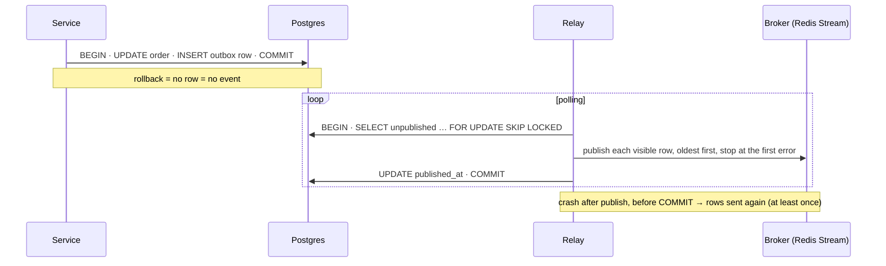

# The transactional outbox

## What it is

A service often has to do two things together: **change its database** and **tell other parts of
the system** (publish an event to a broker). These are two different systems, with no shared
transaction. Writing to both is the **dual-write problem**, in the transactional outbox pattern's
own words: how to atomically update the database and send messages to a message broker
([Transactional outbox, microservices.io](https://microservices.io/patterns/data/transactional-outbox.html)).

The **transactional outbox** solves it by not writing to two systems at once:
1. In the same database transaction as the change, insert the event into an **outbox table**.
   The change and its event commit together, or roll back together.
2. A separate **relay** (also called a message relay or outbox processor) reads committed outbox
   rows, publishes them to the broker, and marks them published.

The broker may now receive an event twice (the relay can crash after publishing, before marking),
so the pattern is at-least-once and consumers must be idempotent
([delivery-guarantees.md](delivery-guarantees.md)).

The relay can work two ways:
- **Polling:** a loop that selects unpublished rows. Simple, and needs nothing beyond the database.
- **Change data capture (CDC):** read the database's own change stream. Postgres exposes it as
  **logical decoding**, infrastructure to stream the modifications made via SQL to external
  consumers ([logical decoding](https://www.postgresql.org/docs/17/logicaldecoding.html)). Tools
  such as Debezium read it and route outbox rows to Kafka, with a ready-made
  [outbox event router](https://debezium.io/documentation/reference/stable/transformations/outbox-event-router.html).
  This means lower latency and no polling, at the price of more infrastructure.

## The problem it solves

The two naive orders of the dual write each fail in one direction:

```python
# A: publish, then commit
with transaction.atomic():
    order.status = "paid"; order.save()
    broker.publish("OrderPaid", order.id)   # sent…
    raise SomeError                         # …but the change rolls back: an event about nothing

# B: commit, then publish
with transaction.atomic():
    order.status = "paid"; order.save()
broker.publish("OrderPaid", order.id)       # the process dies before this line: event lost forever
```

`transaction.on_commit(publish)` is option B in a nicer shape: the callback runs only after a
commit, but if the process dies between the commit and the callback, nothing records that the
event was owed ([transactions-and-isolation.md](transactions-and-isolation.md#transactions-in-django)).

With an outbox, the event is just another row:



## In this project

Code: [outbox.py](../../backend/apps/events/outbox.py), [relay.py](../../backend/apps/events/relay.py),
[events/models.py](../../backend/apps/events/models.py). Flow:
[event-pipeline.md](../flows/event-pipeline.md#1-writing-the-transactional-outbox). Decision:
[ADR 0002](../adr/0002-transactional-outbox-and-relay.md).

**Writing.** `record_event(event_type, aggregate_type, aggregate_id, payload)` inserts an
`OutboxEvent`:
- **It refuses to run outside a transaction.** It raises `RuntimeError` unless `in_atomic_block`
  is true, so an event can't be committed on its own
  (`test_record_event_refuses_to_run_outside_a_transaction`). A rollback leaves no event
  (`test_rollback_after_the_write_leaves_no_event`, `test_rejected_changes_leave_no_event`).
- **The row.** A UUID `id` (the event id everywhere downstream), the type, the aggregate (which
  stream, and which order), `schema_version`, and a JSON payload round-tripped through
  `DjangoJSONEncoder`, so money is `"75.01"`, as in the API.
- **Only services record events.** `record_order_event()` is called next to each transition in
  [orders/services.py](../../backend/apps/orders/services.py); the payment webhook records
  `PaymentRefundDue`; the `product_stats` consumer records `ProductsChanged`. Never from views or
  model signals: a view would miss the webhook, the sweeper and the replay; signals fire on row
  saves, not on business meaning, and not at all for the `F()` stock update.
- **The payload is self-contained.** Lines, totals and the user travel with the event, so most
  consumers don't need to query the order again (`order_payload()` in
  [orders/events.py](../../backend/apps/orders/events.py)).

**Relaying,** `publish_batch()` inside `run_relay()` (the compose service `relay`):
1. In one transaction, select up to `RELAY_BATCH_SIZE` (100) rows `WHERE published_at IS NULL`,
   ordered by `occurred_at, id`, with `FOR UPDATE SKIP LOCKED`, so a second relay takes different
   rows ([row locks](row-locks-and-skip-locked.md)). The partial index `outbox_unpublished_idx`
   covers only unpublished rows.
2. `XADD` each row to `events:<aggregate_type>`, trimmed to about 100,000 entries.
3. **Stop at the first Redis error.** The failed row gets `attempts + 1` and `last_error`; rows
   after it aren't tried, so a hiccup can't reorder the selected rows
   (`test_stops_at_the_first_redis_error_and_records_it`).
4. Stamp `published_at` on the rows that went out, and commit.

**Which order that is.** `occurred_at` is set when `record_event()` builds the row, inside the
business transaction: it's the **recording** time, not the commit time. And the relay only sees
rows that have **committed**. So a transaction that records its event early but commits late (say
it waits on a lock first) has its row published **after** rows that committed before it, even
though its `occurred_at` is older: it simply wasn't there when those were selected. The stream's
order is therefore visibility order, batch by batch, and `occurred_at` order only within the rows
one poll could see. Consumers don't rely on order anyway
([state-based-vs-delta-handlers.md](state-based-vs-delta-handlers.md)).

The loop polls every 0.5 s when idle, goes straight on after a full batch, and backs off on errors
(0.5 s doubling, capped at 30 s, with ±20 % jitter). The Redis client has a 2 s connect and a 5 s
socket timeout, so a hung Redis can't keep the outbox rows locked
(`test_a_hung_redis_times_out_instead_of_holding_the_locks`).

**Afterwards.** Beat purges published rows after 7 days (`EVENTS_RETENTION_DAYS`): the outbox is a
delivery buffer, not history. History is `EventLog`, written by its own consumer
([staff-tools.md](../flows/staff-tools.md#event-explorer)). `/api/health` reports the unpublished
count and the age of the oldest unpublished row.

**What isn't an outbox event.** The importer writes no events: it isn't the order flow, and its
derived data is rebuilt in bulk ([olist-import.md](../flows/olist-import.md)).

## Pitfalls

- **Publishing from `on_commit`, or straight after the commit.** Correct while nothing crashes;
  loses events when something does.
- **An outbox in a different database** from the data it describes. Then it's a dual write again.
- **A relay that tracks a high-water mark** ("last id or timestamp published, continue after it").
  A row inserted by a transaction that commits late can carry an id or time *below* the mark when it
  finally becomes visible, so the relay never selects it: silently lost. This relay keeps no
  watermark. It selects `WHERE published_at IS NULL` on every poll, so a late commit is simply picked
  up by the next poll. No test covers that case yet (the relay tests in
  [test_events_relay.py](../../backend/tests/test_events_relay.py) create their rows up front and
  commit them together).
- **A relay that skips a failing row.** Later events overtake it. With one relay, stopping at the
  first error keeps order; with several, order is lost anyway, so consumers must not rely on it
  ([state-based-vs-delta-handlers.md](state-based-vs-delta-handlers.md)).
- **An outbox that only grows.** Purge published rows, and keep the relay's query on an index that
  doesn't include them.
- **Events recorded from signals or views.** They miss callers, or fire for row saves that aren't
  business events.
- **Thin payloads.** An event that says only "order 7 changed" forces every consumer to query the
  order back. That's fine for signals, costly for data consumers.

## Interview follow-ups

- **What's the dual-write problem?** Updating a database and publishing a message can't be one
  atomic step across two systems; either order of the two writes can leave one without the other.
- **How does the outbox solve it, and what does it not solve?** The event becomes a row in the same
  transaction as the change, so it exists if and only if the change committed. It doesn't give
  exactly-once delivery: the relay is at-least-once, so consumers dedupe.
- **Polling relay or CDC?** Polling is simple and needs no new infrastructure, at the cost of
  sub-second latency and polling load. CDC (logical decoding, Debezium) streams changes with low
  latency, but adds a connector to run and operate.
- **Why not `transaction.on_commit` to publish?** A crash between the commit and the callback loses
  the event, and nothing knows it's missing.
- **How do you keep events in order?** You mostly don't, and design for that. A polling relay
  publishes in the order rows become visible to it (roughly commit order, and here by recording time
  within a batch), and stopping at the first failure avoids adding reorderings of its own. Across
  relays, redeliveries and late commits, order is lost, so consumers are state-based instead of
  order-dependent. Where strict per-entity order matters, partition by entity and use a log that
  preserves order per partition.

Project-specific questions: [interview-guide.md](../interview-guide.md#event-pipeline).

## Exercises

### 1. An event can't outlive its transaction

**Runs on: A** (lab stack; the Django shell, `lab exec backend python manage.py shell`).

```python
from django.db import transaction
from apps.events.models import OutboxEvent
from apps.events.outbox import record_event

before = OutboxEvent.objects.count()
try:
    record_event("LabTest", "lab", "x", {"n": 1})
except RuntimeError as exc:
    print("outside a transaction:", exc)

try:
    with transaction.atomic():
        record_event("LabTest", "lab", "x", {"n": 1})
        print("inside, before rollback:", OutboxEvent.objects.count() - before)
        raise ValueError("the change failed")
except ValueError:
    pass
print("after rollback:", OutboxEvent.objects.count() - before)
```

**Expected:** the first call raises `RuntimeError` ("must run inside the transaction that makes the
change"). Inside the block the count is up by 1; after the rollback it's back to 0.

<details><summary>Solution</summary>

The outbox row is an ordinary insert, so it shares the transaction's fate: visible inside it,
gone with the rollback. The relay never saw it, because it only reads committed rows. The guard
makes the dangerous use (an event committed on its own, apart from the change) impossible rather
than merely discouraged.
</details>

### 2. Stop the relay, then let it catch up

**Runs on: A** (lab stack; the curl helper from [lab.md](lab.md#calling-the-lab-api-with-curl)).

1. `lab stop relay`
2. Place an order: add one unit of an in-stock offer to the cart, then
   `api POST /api/checkout/ "$SHIPPING" -H 'Idempotency-Key: lab-outbox-0001'`
3. `curl -s $LAB/api/health/`, then in `psql`:
   `SELECT event_type, published_at FROM events_outboxevent WHERE published_at IS NULL;`
4. `lab start relay`, wait a few seconds, and repeat step 3.

**Expected:** with the relay stopped, the checkout still succeeds; health shows
`"unpublished": 1` with a growing age, and the `OrderPlaced` row has no `published_at`. After the
restart the backlog drops to 0 and the row has a `published_at`.

<details><summary>Solution</summary>

The order flow doesn't depend on the broker or the relay: it only writes to Postgres. The event
waits in the outbox, durable, until a relay publishes it. That's the difference from publishing
inside the request: a Redis or relay outage delays events, it doesn't lose them or fail
checkouts. The consumers (emails, stats, the live page) catch up once the relay is back.
</details>

### 3. What's in the dev outbox?

**Runs on: B** (dev database, read-only).

```sql
SELECT event_type, count(*) AS total,
       count(*) FILTER (WHERE published_at IS NULL) AS unpublished,
       max(attempts) AS max_attempts
FROM events_outboxevent
GROUP BY 1 ORDER BY 2 DESC;
```

**Expected:** one row per event type, with `unpublished` 0 and max_attempts 0 while the relay
and Redis are healthy. The rows are those published in the last 7 days, **if** the daily purge has
run. On 2026-11-12 the dev outbox held 167 rows across 7 types (88 `ProductsChanged`, 39
`OrderPlaced`, 34 `OrderPaid`, …), all published, max_attempts 0. But 97 of them had been
published more than 7 days earlier: see the solution.

<details><summary>Solution</summary>

`attempts` counts failed `XADD`s for a row. It stays 0 unless Redis errored while the relay was
publishing that row. Any `unpublished` row older than a second or two means the relay is down or
failing, which `/api/health` and `/staff/health` also show.

Rows older than `EVENTS_RETENTION_DAYS` (7) survive until beat's `purge_old_events` runs. When this
exercise was first run (2026-11-12), that task was a 24 h *interval*, which counts from beat's
start, and beat kept its state in `/tmp` inside its container. Every recreation of the container
reset the clock, so a dev stack recreated more often than daily never purged. That's why 97 old
rows were still there: beat had been up for under an hour.

The run exposed a bug, since fixed: the daily purges are now crontabs at a fixed time (03:00 and
03:15 UTC), and beat's state lives on the `beatstate` volume
([architecture.md](../architecture.md#processes)). A purge missed while beat was down now runs
once when beat starts again. The lesson generalises: a "periodic" job whose period counts from
process start is only as periodic as the process is long-lived.
</details>

### 4. Let the relay skip a failure

**Runs on: C** ([mutation protocol](lab.md#c-the-test-suite-mutation-exercises)).

0. Check the file is unmodified, or stop and commit or stash first:
   `git diff --quiet -- backend/apps/events/relay.py && git diff --cached --quiet -- backend/apps/events/relay.py && echo clean`
1. In [backend/apps/events/relay.py](../../backend/apps/events/relay.py), in `publish_batch()`,
   replace the `break` after recording the error with `continue`.
2. `docker compose exec backend pytest tests/test_events_relay.py -k first_redis_error`
3. Restore and prove it: `git checkout -- backend/apps/events/relay.py`, then
   `git diff --quiet -- backend/apps/events/relay.py && echo restored` and `git status --short`.
   Never commit the mutated file.

**Expected:** the test fails at its first assertion, `(3, ConnectionError) == (2, ConnectionError)`:
the relay publishes row 4 after row 3 failed, so 3 rows go out instead of 2, and row 4 overtakes
row 3 on the stream.

<details><summary>Solution</summary>

The test's client fails on the third `XADD`. Stopping there leaves rows 3 and 4 for the next batch,
which publishes them in order once Redis is back. Skipping row 3 publishes 4 first, and 3 only
later: consumers see the events out of order. With state-based consumers that's survivable, but
it's still a needless reordering. Within one relay, the pattern can preserve order cheaply.
</details>

**Run status:** all four run on 2026-11-12. Venue A on the lab stack (`make lab-up`): exercise 1 in
the Django shell, exercise 2 with `lab stop relay` / `lab start relay` and the
[curl helper](lab.md#calling-the-lab-api-with-curl) (health showed `"unpublished": 1`, then `0`).
Venue B read-only, venue C with the [mutation protocol](lab.md#c-the-test-suite-mutation-exercises).
Exercises 1, 2 and 4 matched. **One correction:** exercise 3 assumed published rows older than 7
days were gone. 97 weren't, because the daily purge hadn't run since beat's container was
recreated (see its solution).

## Further reading

- Chris Richardson, [Pattern: Transactional outbox](https://microservices.io/patterns/data/transactional-outbox.html) (microservices.io)
- PostgreSQL 17: [Logical decoding](https://www.postgresql.org/docs/17/logicaldecoding.html), the CDC alternative
- Debezium: [Outbox event router](https://debezium.io/documentation/reference/stable/transformations/outbox-event-router.html)
- Project: [ADR 0002](../adr/0002-transactional-outbox-and-relay.md), [event-pipeline.md](../flows/event-pipeline.md)

**Verified** 2026-11-12 against the microservices.io, PostgreSQL 17 and Debezium pages linked above.
