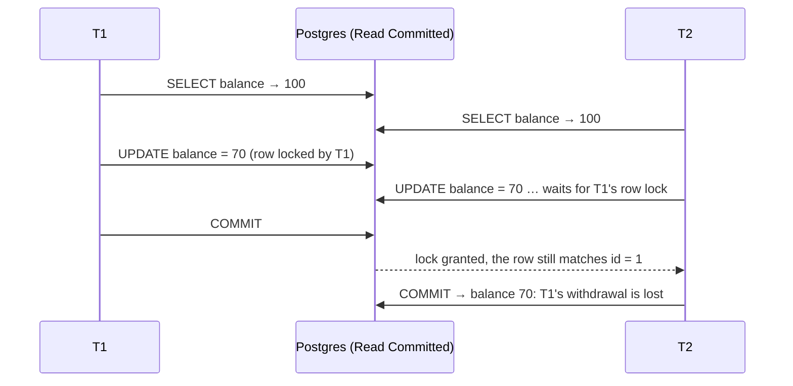

# Transactions and isolation levels

## What it is

A **transaction** groups statements so that they take effect together or not at all. Postgres
gives every transaction the usual guarantees:
- **Atomicity:** all of its changes commit, or none do.
- **Consistency:** constraints hold at commit.
- **Isolation:** concurrent transactions don't see each other's half-done work.
- **Durability:** once committed, it survives a crash.

**Isolation** is the subtle part. It isn't on or off; it's a *level*, a trade between how much
concurrent transactions can interfere with each other and how often the database must make one of
them wait or fail.

Postgres implements isolation with **MVCC** (multi-version concurrency control). Each transaction
reads a *snapshot* of committed data, and a writer creates a new version of a row instead of
overwriting it in place. Its summary of the consequence: reading never blocks writing, and writing
never blocks reading ([MVCC introduction](https://www.postgresql.org/docs/17/mvcc-intro.html)).
Writers still wait for writers: two transactions that update the same row are serialised by the
row lock the first one takes.

### The levels in Postgres 17

| Level | Snapshot | What it means in Postgres |
|---|---|---|
| Read Uncommitted | — | Behaves exactly like Read Committed |
| **Read Committed** (default) | A new snapshot **per statement** | Each statement sees what was committed before it started. An `UPDATE` (or `SELECT … FOR UPDATE`) that finds its row changed by a transaction that has since committed **re-evaluates its `WHERE` clause against the new version** and proceeds only if the row still matches |
| Repeatable Read | One snapshot **per transaction** | Every statement sees the same data. No phantom reads in Postgres (stricter than the SQL standard requires). Updating a row someone else changed since your snapshot fails: "could not serialize access due to concurrent update" |
| Serializable | One snapshot, plus conflict tracking (SSI) | Concurrent transactions behave as if they ran one at a time. Conflicts fail with SQLSTATE `40001`, and the application must retry the whole transaction |

Source: [Transaction Isolation](https://www.postgresql.org/docs/17/transaction-iso.html)
([Read Committed](https://www.postgresql.org/docs/17/transaction-iso.html#XACT-READ-COMMITTED),
[Repeatable Read](https://www.postgresql.org/docs/17/transaction-iso.html#XACT-REPEATABLE-READ),
[Serializable](https://www.postgresql.org/docs/17/transaction-iso.html#XACT-SERIALIZABLE)).
**Django uses Postgres's default, Read Committed**, and lets you choose another in `OPTIONS`
([Django: isolation level](https://docs.djangoproject.com/en/6.1/ref/databases/#isolation-level)).

## The problem it solves: the lost update

Two people withdraw 30 from an account that holds 100, at the same moment. Each request reads the
balance, subtracts in application code, and writes the result:

```sql
-- both transactions run this, concurrently
SELECT balance FROM account WHERE id = 1;          -- both read 100
UPDATE account SET balance = 70 WHERE id = 1;      -- both write 100 - 30
COMMIT;                                            -- final balance 70, not 40
```



Read Committed didn't prevent this: each statement was correct on its own, but the decision
("70") was made from a value that was stale by the time it was written. There are three standard
fixes:

1. **Let the database do the arithmetic:** `UPDATE account SET balance = balance - 30 WHERE id = 1`.
   T2's update waits for T1's lock, then re-reads the new version (70) and writes 40. This is the
   Read Committed re-evaluation described above.
2. **Lock before you read:** `SELECT … FOR UPDATE`. T2 then waits at the read, not the write, and
   sees 70 ([row locks](row-locks-and-skip-locked.md)). This is needed when the decision involves
   more than one expression, for example "check every line of a cart, then decrement".
3. **Use Repeatable Read or Serializable, and retry.** T2's update fails with a serialization
   error, and the application retries the whole transaction from the beginning.

## Transactions in Django

[Django's transaction docs](https://docs.djangoproject.com/en/6.1/topics/db/transactions/):

- **Autocommit by default.** Each query commits on its own unless it runs inside
  `transaction.atomic()`.
- **Nested `atomic()` blocks become savepoints.** An exception inside an inner block rolls back
  to the savepoint, and the outer transaction carries on.
- **Don't catch a database error inside `atomic()` without an inner `atomic()`.** After an error,
  Postgres rejects every further statement in that transaction ("current transaction is aborted,
  queries ignored until end of transaction block"), and Django raises an error if you try to query
  before the rollback. The correct shape is to wrap the statement that may fail in its own
  `atomic()` (a savepoint), and catch the exception **outside** it
  ([controlling transactions explicitly](https://docs.djangoproject.com/en/6.1/topics/db/transactions/#controlling-transactions-explicitly)).
- **`transaction.on_commit(fn)`** runs `fn` after the outermost transaction commits, and discards
  it on rollback. With `robust=True`, an exception in `fn` no longer stops the callbacks
  registered after it
  ([performing actions after commit](https://docs.djangoproject.com/en/6.1/topics/db/transactions/#performing-actions-after-commit)).

## In this project

All of these are in [architecture.md](../architecture.md#write-path-and-read-side) and the
[flow docs](../flows/).

- **Every service has the same shape:** `BEGIN` → lock → check → change → record an event →
  `COMMIT`. The isolation level is Django's default (Read Committed): `DATABASES` in
  [base.py](../../backend/config/settings/base.py) sets no `OPTIONS`.
- **Fix 1 (database arithmetic) for stock.** Checkout decrements with
  `UPDATE … SET stock = stock - qty` via `F()`, and releases add it back the same way
  ([services.py](../../backend/apps/orders/services.py)).
- **Fix 2 (lock first) for the decision.** Checkout locks the offers first, so "is there enough
  for every line?" is decided on locked rows ([row locks](row-locks-and-skip-locked.md)).
- **Some functions refuse to run outside a transaction.** `record_event()`
  ([outbox.py](../../backend/apps/events/outbox.py)) and `transition()`
  ([state.py](../../backend/apps/orders/state.py)) raise `RuntimeError` unless
  `in_atomic_block` is true, so an event or a status change can't be committed apart from the
  change it belongs to (`test_record_event_refuses_to_run_outside_a_transaction`,
  `test_rollback_after_the_write_leaves_no_event`).
- **Savepoints around inserts that may lose a race.** A unique constraint decides who wins; the
  loser's `IntegrityError` is caught outside an inner `atomic()`, and the outer transaction
  carries on:
  - `run_idempotent()` in [idempotency.py](../../backend/apps/core/idempotency.py): the
    checkout's idempotency key;
  - `_record_once()` in [payments/services.py](../../backend/apps/payments/services.py): webhook
    dedupe;
  - `start_payment()`: two concurrent Pay clicks;
  - `start_run()` in [replay/services.py](../../backend/apps/replay/services.py): one running
    replay.
- **A service inside a caller's transaction becomes a savepoint.** `pay()` opens its own
  `atomic()`. Called from a test, that's a real transaction; called from the payment webhook, it's
  a savepoint inside the webhook's transaction. The cancel-on-expiry and the refund flag then
  commit, or roll back, together ([cart-checkout-stock.md](../flows/cart-checkout-stock.md#payment-after-expiry)).
- **`on_commit(…, robust=True)`** for side effects that must only follow a committed change, and
  must never turn it into an error:
  - the `min_price` refresh (`refresh_product_stats_on_commit` in
    [stats.py](../../backend/apps/catalog/stats.py));
  - the Celery enqueue of an email ([notifications consumer](../../backend/apps/events/consumers/notifications.py));
  - the live-update signal when a payment returns.
- **No network calls inside a transaction.** `create_payment()` runs **before** the short
  transaction that saves the intent ([payments.md](../flows/payments.md#1-starting-a-payment)), so
  a slow provider can't hold row locks open.

## Pitfalls

- **Read-modify-write in application code** (the lost update above). Under Read Committed, use
  SQL arithmetic or lock first.
- **Catching `IntegrityError` without a savepoint.** The transaction is already aborted, and the
  next query fails.
- **Treating Repeatable Read as "locks everything I read".** It gives a stable snapshot, not
  locks. Two transactions can still both read the same row; one of them fails at write time and
  must retry.
- **Side effects inside the transaction:** an email, an HTTP call, a message publish. If the
  transaction rolls back, the side effect has still happened. Use `on_commit`, or an
  [outbox](../flows/event-pipeline.md#1-writing-the-transactional-outbox).
- **Long transactions.** They hold locks and keep old row versions alive for longer. Postgres has
  timeouts for statements stuck waiting on locks and for idle open transactions, but both are off
  by default
  ([client connection defaults](https://www.postgresql.org/docs/17/runtime-config-client.html#GUC-LOCK-TIMEOUT)).
- **Expecting sequences to roll back.** A value taken by `nextval` is not reused if the
  transaction aborts ([sequence functions](https://www.postgresql.org/docs/17/functions-sequence.html)),
  so gaps in ids are normal.

## Interview follow-ups

- **What's the default isolation level in Postgres, and what does it allow?** Read Committed: each
  statement sees data committed before it began. It allows non-repeatable reads and lost updates
  in read-modify-write code. An `UPDATE` re-checks its `WHERE` against a concurrently committed row
  version.
- **How would you prevent a lost update?** Do the arithmetic in SQL, lock the row before reading
  it, or use a stronger isolation level and retry on serialization failures. The choice depends on
  whether the decision fits in one statement.
- **What is a savepoint, and when do you need one?** A point inside a transaction you can roll
  back to without abandoning the whole transaction. You need one when a statement may fail on
  purpose, such as an insert that loses a uniqueness race, and the transaction must continue.
- **Why not run everything at Serializable?** Every write path then needs a retry loop, and
  conflicts become errors under load. It's a fine choice when retries are cheap and centralised.
- **What does `on_commit` guarantee, and what doesn't it?** It runs only after a commit, never
  after a rollback. It doesn't guarantee the callback runs at all: if the process dies right after
  the commit, the callback is lost. That's why durable work goes in the database itself (an outbox
  row, a pending email row).

Project-specific questions (why pessimistic locks for checkout, why `pay()` relies on a
savepoint): [interview-guide.md](../interview-guide.md#checkout-and-concurrency).

## Exercises

### 1. Lose an update, then fix it

**Runs on: A** (lab stack, two `psql` sessions; see [lab.md](lab.md#two-sessions)).

1. In S1, create a scratch table:
   ```sql
   CREATE TABLE lab_account (id int PRIMARY KEY, balance numeric NOT NULL);
   INSERT INTO lab_account VALUES (1, 100);
   ```
2. Run the read-modify-write in both sessions, interleaved:
   - S1: `BEGIN; SELECT balance FROM lab_account WHERE id = 1;`
   - S2: `BEGIN; SELECT balance FROM lab_account WHERE id = 1;`
   - S1: `UPDATE lab_account SET balance = 70 WHERE id = 1;`
   - S2: `UPDATE lab_account SET balance = 70 WHERE id = 1;` (what happens?)
   - S1: `COMMIT;` (and now in S2?)
   - S2: `COMMIT;`
3. Reset with `UPDATE lab_account SET balance = 100;`, then repeat step 2, but have both sessions
   run `UPDATE lab_account SET balance = balance - 30 WHERE id = 1;` without the `SELECT`.

**Expected:** in step 2, S2's `UPDATE` hangs until S1 commits, then completes; the final balance
is 70. In step 3, S2 also waits, but the final balance is 40.

<details><summary>Solution</summary>

In step 2 both sessions computed "70" from the same stale read. S2's `UPDATE` waited for S1's row
lock; under Read Committed it then re-checked `WHERE id = 1` against S1's committed version. The
row still matched, so S2 overwrote it with its own constant 70. S1's withdrawal is lost.

In step 3 the new value is an expression, evaluated against the row version S2 finally locks
(70), so S2 writes 40. That's the same mechanism as the project's `F("stock") - quantity`.
`SELECT balance FROM lab_account;` → 40.
</details>

### 2. The same race under Repeatable Read

**Runs on: A**.

1. `UPDATE lab_account SET balance = 100;`
2. S1: `BEGIN ISOLATION LEVEL REPEATABLE READ; SELECT balance FROM lab_account WHERE id = 1;`
3. S2: the same.
4. S1: `UPDATE lab_account SET balance = balance - 30 WHERE id = 1; COMMIT;`
5. S2: `UPDATE lab_account SET balance = balance - 30 WHERE id = 1;`

**Expected:** S2's update fails with "could not serialize access due to concurrent update", and
S2's transaction is aborted.

<details><summary>Solution</summary>

S2's snapshot was taken at its first statement, before S1 committed. Under Repeatable Read,
Postgres refuses to update a row that changed after that snapshot, rather than re-evaluating as
Read Committed does. S2 must `ROLLBACK` and retry the whole transaction. Its new snapshot then
includes S1's commit, and the result is 40. Any further statement in S2 before `ROLLBACK` fails
with "current transaction is aborted".
</details>

### 3. Remove a savepoint

**Runs on: C** (the test suite; follow the [mutation protocol](lab.md#c-the-test-suite-mutation-exercises)).

0. Check the file is unmodified, or stop and commit or stash first ([lab.md, step 1](lab.md#c-the-test-suite-mutation-exercises)):
   `git diff --quiet -- backend/apps/core/idempotency.py && git diff --cached --quiet -- backend/apps/core/idempotency.py && echo clean`
1. In [backend/apps/core/idempotency.py](../../backend/apps/core/idempotency.py), in
   `run_idempotent()`, remove the inner `with transaction.atomic():` around the key insert (dedent
   the `create` call, keep the `try`/`except IntegrityError`).
2. `docker compose exec backend pytest tests/test_checkout.py -k same_key_replays`
3. Restore and prove it: `git checkout -- backend/apps/core/idempotency.py`, then `git diff --quiet -- backend/apps/core/idempotency.py && echo restored`
   and `git status --short` (the same as before step 1). Never commit the mutated file.

**Expected:** the test fails. The second request with the same key doesn't replay the first
order; it errors.

<details><summary>Solution</summary>

The second request's insert violates `uniq_idempotency_user_key`, and Postgres aborts the
transaction. Without the savepoint there's nothing to roll back to, so the `except` branch's next
query (loading the stored key to replay it) runs inside an aborted transaction, and Django raises
an error instead of replaying. With the savepoint, only the failed insert is undone, and the
lookup works. This is why every "insert, and if it loses the race, read the winner" in the project
has its own inner `atomic()`.
</details>

### 4. Which level is the dev database running?

**Runs on: B** (dev database, read-only).

1. `SHOW default_transaction_isolation;`
2. `BEGIN; SHOW transaction_isolation; ROLLBACK;`

**Expected:** `read committed` twice.

<details><summary>Solution</summary>

Neither Postgres nor Django was configured otherwise: `DATABASES` sets no isolation level, and
Postgres's default is Read Committed. (In this session `default_transaction_read_only` is also
`on`, because of the lab's `PGOPTIONS` guard; `SHOW default_transaction_read_only;` confirms it.)
</details>

**Run status:** all four run on 2026-11-12; every result matched the expected one. Venue A ran on the lab stack (`make lab-up`); its SQL was issued in the stated order by two connections from a script inside the lab backend container, not typed into `psql`. Venue B ran on the dev database with the read-only guard, venue C with the [mutation protocol](lab.md#c-the-test-suite-mutation-exercises). Observed: exercise 1 ended at 70, then 40; exercise 2's error was SQLSTATE `40001`; exercise 3's test failed with `TransactionManagementError`; exercise 4 showed `read committed`.

## Further reading

- PostgreSQL 17: [Transaction Isolation](https://www.postgresql.org/docs/17/transaction-iso.html), [MVCC introduction](https://www.postgresql.org/docs/17/mvcc-intro.html), [sequence functions](https://www.postgresql.org/docs/17/functions-sequence.html) (the caution on `nextval`), [error codes](https://www.postgresql.org/docs/17/errcodes-appendix.html#ERRCODES-TABLE) (`40001` serialization_failure)
- Django 6.1: [Database transactions](https://docs.djangoproject.com/en/6.1/topics/db/transactions/), [isolation level on PostgreSQL](https://docs.djangoproject.com/en/6.1/ref/databases/#isolation-level)
- Original sources:
  - Berenson, Bernstein, Gray, Melton, O'Neil and O'Neil, [A Critique of ANSI SQL Isolation Levels](https://arxiv.org/abs/cs/0701157) (SIGMOD 1995): why the standard's levels, defined by anomalies, don't describe snapshot isolation.
  - Ports and Grittner, [Serializable Snapshot Isolation in PostgreSQL](https://arxiv.org/abs/1208.4179) (VLDB 2012): how Postgres's Serializable works.

**Verified** 2026-11-12 against the PostgreSQL 17 and Django 6.1 pages linked above.
