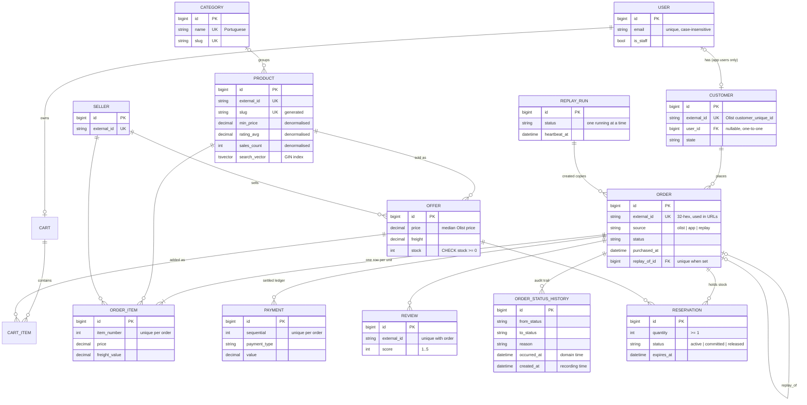
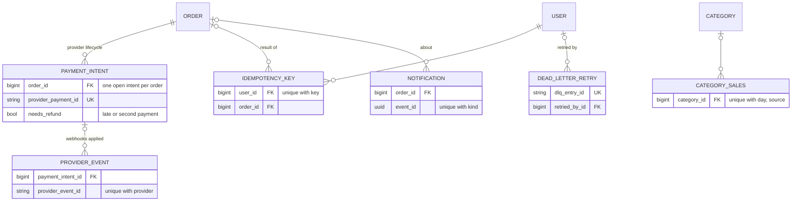
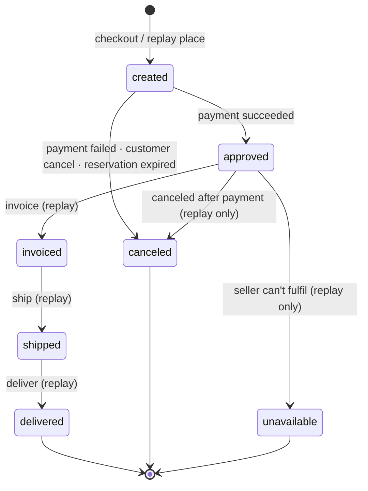

# Data model

The schema follows the shape of the
[Olist Brazilian E-Commerce dataset](https://www.kaggle.com/datasets/olistbr/brazilian-ecommerce)
so the shop has realistic data from day one. On top of that come the tables the app needs to
sell things itself: carts, reservations, payments, events and projections.

This page has two ER diagrams (commerce, then infrastructure), the constraints that carry
business rules, the order state machine, and the conventions every table follows.

## Commerce

Notes on the commerce tables:

- **`Customer` is the real person, `User` is the login.** Olist customers have no account.
  An app user gets a `Customer` at their first checkout.
  ([backend/apps/customers/models.py](../backend/apps/customers/models.py))
- **Olist issues a new `customer_id` for every order.** That ID lives on
  `Order.olist_customer_id`. `Customer.external_id` is Olist's `customer_unique_id`.
- **`Offer` is one seller selling one product.** It's derived from the order items at import:
  price and freight are the median for that (product, seller) pair. Stock is synthetic and set
  only when the offer is created. See [flows/olist-import.md](flows/olist-import.md).
- **`Product` carries denormalised stats** (`min_price`, `rating_avg`, `rating_count`, `sales_count`,
  `first_sold_at`, `search_vector`). They're recomputed by
  [backend/apps/catalog/stats.py](../backend/apps/catalog/stats.py), so the listing can filter
  and sort on indexed columns instead of aggregating per request.
- **Two payment tables with two jobs.** `orders.Payment` is the settled ledger, in Olist's
  shape. `payments.PaymentIntent` (below) is the provider lifecycle, and it carries the refund
  flag (`needs_refund`, `refund_reason`) for money that arrived for an order that can't take
  it. See [flows/payments.md](flows/payments.md).

## Infrastructure and events

Only a few infrastructure tables have foreign keys. These are their keys and relationships:

The rest have no foreign keys:

| Table | Unique key | Purpose |
|---|---|---|
| `OutboxEvent` | `id` (UUID = the event id) | An event written in the business transaction; `published_at` is null until the relay has sent it |
| `ProcessedEvent` | (`consumer`, `event_id`) | "This consumer has applied this event" (the dedupe record) |
| `EventLog` | `event_id` | Every event once, for the staff explorer |
| `DailySales`, `DeliveryStats` | (`day`, `source`) | Analytics projections |
| `StateSales` | (`day`, `source`, `state`) | Analytics projection |
| `FakeIntent`, `FakeEvent` | `id` (`pi_…`, `evt_…`) | The fake provider's own side, including the exact signed webhook bytes |

The event tables have no foreign keys to the things they describe, on purpose. An event refers
to its aggregate by `aggregate_type` + `aggregate_id` (an order's `external_id`). An event is a
fact about the past, and shouldn't block, or cascade from, a later delete. The staff explorer
still renders an event whose order no longer exists, for example one logged after a forced
`replay_reset`. `ProcessedEvent` and `EventLog` are keyed by the outbox event's UUID, which
travels through Redis with the stream entry.

The fake provider's tables are the provider's side. They're linked to `PaymentIntent` only by the
provider's payment id, as a real third party would be.

## Constraints that carry business rules

Most rules are enforced in the service layer under row locks. The constraints below are the
backstop, or they *are* the mechanism.

| Constraint | Table | What it guarantees |
|---|---|---|
| `CHECK (stock >= 0)` (from `PositiveIntegerField`) | `Offer` | Stock can never go negative, even if service code were wrong |
| `uniq_offer_product_seller` | `Offer` | One offer per (product, seller) |
| `uniq_cart_offer`, `cart_item_quantity_1_to_10` | `CartItem` | One line per offer, 1–10 units |
| `uniq_reservation_order_offer`, `reservation_quantity_positive` | `Reservation` | One hold per order and offer |
| `reservation_active_expiry_idx` (partial, `status='active'`) | `Reservation` | The sweeper's index stays small |
| `uniq_order_item_number`, `uniq_payment_sequential` | `OrderItem`, `Payment` | Olist natural keys, so re-imports upsert instead of duplicating |
| `uniq_review_per_order`, `review_score_1_to_5` | `Review` | One Olist review can cover several orders: unique on (review, order) |
| `uniq_user_email_ci` (on `Lower(email)`, blank allowed) | `User` | Case-insensitive unique login email |
| `uniq_open_intent_per_order` (partial: open statuses) | `PaymentIntent` | Two "Pay" clicks reuse one open intent, so no double charge |
| `uniq_provider_event` | `ProviderEvent` | A webhook delivered twice is applied once |
| `uniq_idempotency_user_key` | `IdempotencyKey` | A retried checkout replays the stored response |
| `uniq_processed_event` | `ProcessedEvent` | Each consumer applies each event at most once |
| `event_id` unique | `EventLog` | The event log stores each event once |
| `dlq_entry_id` unique | `DeadLetterRetry` | A dead letter is retried at most once |
| `uniq_notification_event_kind` | `Notification` | An event produces each email at most once |
| `uniq_daily_sales`, `uniq_category_sales` (`NULLS NOT DISTINCT`), `uniq_state_sales`, `uniq_delivery_stats` | analytics | One projection row per key; a race fails loudly instead of double counting |
| `outbox_unpublished_idx` (partial, `published_at IS NULL`) | `OutboxEvent` | The relay's query stays an index scan however many rows are published |
| `uniq_replay_copy` (partial, `replay_of` set) | `Order` | At most one replay copy per imported order |
| `one_running_replay` (partial, `status='running'`) | `ReplayRun` | At most one replay running at a time |

Several of these are **partial unique indexes**. They express "at most one *X* in state *Y*" in
the database: one open payment intent per order, one running replay. Two concurrent requests
can't both pass a check-then-insert this way. The loser gets an `IntegrityError`, which the code
turns into "reuse the existing one" or a clear refusal.

## Order state machine

Statuses follow Olist. Transitions go only through `transition()` in
[backend/apps/orders/state.py](../backend/apps/orders/state.py), with an explicit table. The
caller must hold the order's row lock inside a transaction. Every transition writes an
`OrderStatusHistory` row, and the calling service records a domain event in the same transaction.
An illegal move raises `InvalidTransition`, which the API returns as 409.

| Move | Reason (`OrderStatusHistory.reason`) | Triggered by | Event |
|---|---|---|---|
| → created | `checkout` / `replay_placed` | `services.checkout()` / the replay | `OrderPlaced` |
| created → approved | `payment_succeeded` | `pay()` from the payment webhook, or the replay | `OrderPaid` |
| created → canceled | `payment_failed` | `pay()` on a declined webhook | `PaymentFailed` |
| created → canceled | `customer_canceled` | `POST /api/orders/{id}/cancel/` | `OrderCanceled` |
| created → canceled | `reservation_expired` | The beat sweeper, or `pay()` arriving after the hold expired | `ReservationExpired` |
| created → canceled | `canceled_before_payment` | The replay (`cancel()`) | `OrderCanceled` |
| approved → invoiced → shipped → delivered | `invoiced`, `shipped`, `delivered` | `invoice()` / `ship()` / `deliver()`, called only by the replay so far | `OrderInvoiced`, `OrderShipped`, `OrderDelivered` |
| approved → canceled | `canceled_after_payment` | `cancel_paid()`, **refuses non-replay orders** | `OrderCanceled` |
| approved → unavailable | `unavailable` | `mark_unavailable()`, **refuses non-replay orders** | `OrderUnavailable` |

Notes:

- **`processing`** exists in Olist's data but not in the table. Imported orders can have it;
  nothing transitions into or out of it.
- **Stock moves happen only on the `created → …` edges.** Checkout decrements stock and creates
  reservations. A cancel or expiry returns the stock, and payment keeps it sold. The fulfilment
  moves after `approved` don't touch stock.
- **Replay orders never take or return stock.** Copies skip checkout, so they have no
  reservations: their approval commits none, and their cancellation releases none.
- **`cancel_paid` and `mark_unavailable` are replay-only.** A real paid cancellation needs a
  refund and restock design that doesn't exist yet
  ([limitations-and-roadmap.md](limitations-and-roadmap.md)).
- **`transition()` stamps timestamp columns** on entry: `approved_at`, `delivered_carrier_at`
  (shipped) and `delivered_customer_at` (delivered).
- **Imported orders have no `OrderStatusHistory` rows.** The importer writes their final status
  directly; history is written only by the app's services.
- **A late payment success never revives an order.** When a success webhook arrives for an order
  that can't take it, `_flag_refund()` in
  [apps/payments/services.py](../backend/apps/payments/services.py) sets
  `PaymentIntent.needs_refund = True` (and `refund_reason`). In the same transaction it records a
  `PaymentRefundDue` event, which the `notifications` consumer turns into the refund-due email.
  `ProviderEvent.outcome` is `refund_flagged`. There are three cases:

  | Order state when the success arrives | Transition | Refund reason |
  |---|---|---|
  | `canceled` (customer, decline or expiry) | none | "paid after the order was canceled" |
  | already `approved` or later (a second successful payment) | none | "order already <status>" |
  | still `created`, but the payment came after the stock hold expired | created → canceled (`reservation_expired`, `ReservationExpired` event), then flagged | "paid after the stock hold expired" |

  There is no refund logic yet: the flag (filterable in the admin's PaymentIntent list) and the
  event are the hand-off. The full story is in [flows/payments.md](flows/payments.md).

## Conventions

- **Money** is `DecimalField(max_digits=12, decimal_places=2)` everywhere, and is serialised as
  a decimal string (`"75.01"`) in the API and in event payloads. Never floats.
- **Time** is stored in UTC (`USE_TZ = True`).
  - Olist timestamps are Brazilian local time and are converted from `America/Sao_Paulo` on
    import.
  - Analytics groups by purchase *day* in São Paulo time (`ANALYTICS_TIMEZONE`).
- **IDs.** Every table has its own `bigint` primary key. Olist's 32-character hex IDs are kept as
  `external_id`. App-created orders get a fresh 32-hex `external_id` too, so every order URL
  looks the same.
- **One item row per unit.** An order of 3 units of one offer has 3 `OrderItem` rows, like Olist.
  The APIs group them into lines.
- **`Order.source` has no default.** It is `olist` (the importer), `app` (`checkout()`) or
  `replay` (the replay's copies). Every creation path must choose one. Analytics reports every
  metric per source, and replay copies are excluded from everything the shop shows: prices,
  `sales_count`, public counts.
- **Two times on history rows.**
  - `OrderStatusHistory.occurred_at` is the domain time, the same value as the event payload's
    `occurred_at`.
  - `created_at` is when the row was written.
  - They match for app orders; for replay copies, `occurred_at` is the historical Olist time.

## Migration pattern for populated tables

A required column added to a table that already has rows takes three migrations:

1. Add the column as nullable.
2. Backfill it with a frozen `RunPython`: raw SQL with no app imports, so later model changes
   can't break an old migration.
3. Make it required in a follow-up migration.

There are two worked examples in [backend/apps/orders/migrations/](../backend/apps/orders/migrations/):

| Column | Add nullable | Backfill | Enforce |
|---|---|---|---|
| `Order.source` | `0003_order_source_nullable` | `0004_backfill_order_source` (`app` if the customer has a user, else `olist`) | `0005_order_source_required` (+ index `(source, purchased_at)`) |
| `OrderStatusHistory.occurred_at` | `0007_history_occurred_at_nullable` | `0008_backfill_history_occurred_at` (replay rows from their logged event's payload, the rest from `created_at`) | `0009_history_occurred_at_required` |

## Sources

- Models: [accounts](../backend/apps/accounts/models.py), [customers](../backend/apps/customers/models.py), [catalog](../backend/apps/catalog/models.py), [cart](../backend/apps/cart/models.py), [orders](../backend/apps/orders/models.py), [payments](../backend/apps/payments/models.py), [fake_provider](../backend/apps/fake_provider/models.py), [events](../backend/apps/events/models.py), [notifications](../backend/apps/notifications/models.py), [core](../backend/apps/core/models.py), [analytics](../backend/apps/analytics/models.py), [replay](../backend/apps/replay/models.py)
- State machine: [backend/apps/orders/state.py](../backend/apps/orders/state.py); callers in [backend/apps/orders/services.py](../backend/apps/orders/services.py), [backend/apps/payments/services.py](../backend/apps/payments/services.py), [backend/apps/replay/services.py](../backend/apps/replay/services.py)
- Migrations: [backend/apps/orders/migrations/](../backend/apps/orders/migrations/)
