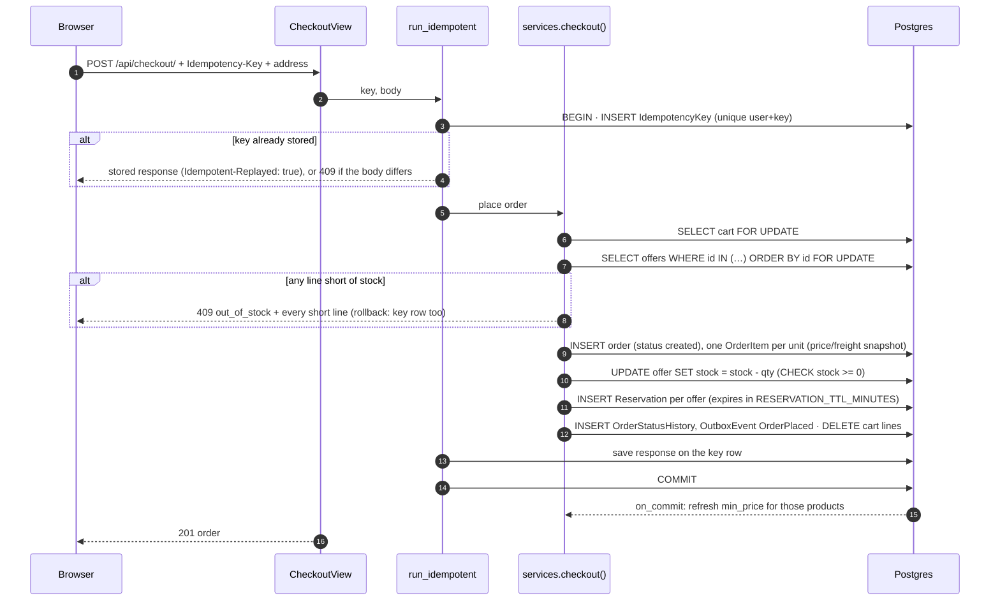

# Cart, checkout and stock

This is the flow where correctness matters most: two people must never buy the last unit, a
retried request must never place two orders, and stock that was held must come back exactly
once. Every change to `Offer.stock` after the import happens in one module,
[backend/apps/orders/services.py](../../backend/apps/orders/services.py).

## The cart never reserves stock

`/api/cart/` stores lines (offer + quantity, at most 10 per line) and nothing else
([backend/apps/cart/](../../backend/apps/cart/)). Reading the cart computes current prices and
availability on the fly:

- **A warning per line.** `out_of_stock` when the offer has none left; `insufficient_stock` when
  the line asks for more than there is.
- **`can_checkout`** is false while any line has a warning.

**Why carts don't reserve.** A cart is an intention, not a commitment. Reserving at
add-to-cart would let abandoned carts lock stock away from people ready to pay. Stock is taken
at checkout, the moment someone commits to buy, and held only for a short payment window.

## Checkout



Step by step, in `checkout()`:

1. **Lock the cart** (`select_for_update`). Two tabs checking out the same cart are serialised.
   The second one waits, then finds the cart empty, which is an `empty_cart` error.
2. **Lock the offers in ascending id order** (`lock_offers`). Every code path that locks offers
   does so in the same order (see [Lock order](#lock-order)).
3. **Check every line.**
   - If any line wants more than the locked stock, raise `OutOfStock`, listing **every** short
     line with what was requested and what's available.
   - The transaction rolls back, so nothing changes.
   - The UI shows all the problems at once, so the buyer doesn't have to fix them one at a time.
4. **Create the order** (`source='app'`, status `created`). Items are created **one row per
   unit**, like Olist, with `price` and `freight_value` **copied** from the offer. A later price
   change doesn't alter a placed order (`test_price_and_freight_are_snapshotted`).
5. **Decrement stock in SQL**: `UPDATE … SET stock = stock - qty` via `F()`. That isn't a
   Python read-modify-write, and `CHECK (stock >= 0)` is the backstop.
6. **Create a `Reservation` per offer**, with `expires_at = now + RESERVATION_TTL_MINUTES`
   (default 15).
7. **Write the history row and the `OrderPlaced` event**, then empty the cart. All of steps 1–7
   are one transaction.
8. **After commit, refresh `min_price`** for the affected products
   (`refresh_product_stats_on_commit`). If an offer just sold out, the listing's price and
   in-stock filter are right on the next request.

### After the order is placed: a full page load

On a 201, the checkout form navigates to `/orders/<id>` with a **full page load**
(`window.location.assign`), not a client-side navigation:

- **The header must change.** The cart was just emptied, and the header's cart badge is a Server
  Component in the root layout. A client-side navigation reuses the root layout unchanged, so
  after a soft `router.push` the order page would still show "Cart, 1 item".
- **The alternative raced.** The form used to call `router.push()` and then immediately
  `router.refresh()`. On 2026-11-09 a Playwright trace caught that refresh's request pending for
  more than 20 s while the URL stayed on `/checkout` (the order had been created: `POST` 201).
- **A full load costs little.** The order page is dynamic anyway (per-visitor data, a live
  stream).
- **Regression checks.** The e2e `placeOrder()` helper asserts the header shows a plain "Cart"
  (empty) on the order page. With the fix undone (a soft navigation, no refresh), that assertion
  failed on "Cart, 1 item".

"Place order" stays disabled until the form has hydrated, and the form is `method="post"`. An early
submit used to do a native GET with the shipping address in the URL
([auth-and-sessions.md](auth-and-sessions.md#before-hydration-disabled-controls-and-post-forms)).

### Retries can't place two orders

The checkout request carries an `Idempotency-Key`. The browser generates it per attempt in
[frontend/src/lib/checkout-attempt.ts](../../frontend/src/lib/checkout-attempt.ts):

- **One key per attempt.** The key is tied to a fingerprint of the cart lines and the address,
  and kept in `sessionStorage`.
- **Uncertain failures reuse the key.** A network error, timeout or 5xx means the first request
  may have reached the server, so the retry sends the same key.
- **A definitive answer ends the attempt.** That's a 2xx, or a 4xx such as out of stock.
- **Changing the cart or address starts a new attempt.**

On the server, `run_idempotent` inserts the key row **in the same transaction** as the checkout:
- **Success:** the response is stored, and a retry with the same key gets it back without placing
  anything.
- **Failure:** a domain error rolls back the key row with everything else, so a retry runs fresh.
- **Two simultaneous requests with one key:** the second blocks on the unique index until the
  first commits, then replays it (`test_concurrent_retries_with_the_same_key_create_one_order`).

Full semantics: [api.md](../api.md#idempotency-key-checkout).

## After checkout: commit, release, expire

A reservation ends in exactly one of two ways:

| Outcome | Triggered by | Reservation | Stock | Order |
|---|---|---|---|---|
| **Committed** | `pay(success)`, from the payment webhook | `active → committed` | stays sold | `created → approved` + `OrderPaid` |
| **Released** | `pay(fail)` (decline) | `active → released` | returned | `created → canceled` + `PaymentFailed` |
| **Released** | customer `POST /api/orders/{id}/cancel/` | `active → released` | returned | `created → canceled` + `OrderCanceled` |
| **Released** | the expiry sweeper, or a payment arriving after expiry | `active → released` | returned | `created → canceled` + `ReservationExpired` |

### Exactly once, even under races

`_resolve_reservations()` flips each reservation with a **conditional update**:

```sql
UPDATE orders_reservation SET status = 'released', resolved_at = now()
WHERE id = %s AND status = 'active'
```

Stock is returned **only if that update changed a row**. If two code paths race, say a late
cancel and the sweeper, only one of them can flip `active`. The other changes nothing, so stock
can't come back twice. On top of that, both paths lock the order first and re-check its status
under the lock.

### The expiry sweeper

The Celery beat task `release_expired_reservations` runs every 60 s and calls
`release_expired()`:

- **Candidates:** unpaid (`created`) orders with an active reservation past `expires_at`,
  oldest first, 100 per batch. The task loops until none are left. A partial index on
  `expires_at WHERE status='active'` keeps the lookup small.
- **One transaction per order**, locked with `SELECT … FOR UPDATE SKIP LOCKED`. If an order is
  locked by a concurrent sweeper, or by a payment or cancel in progress, it's **skipped, not
  waited on**. Its state is re-checked under the lock, so running two sweepers at once is safe
  (`test_concurrent_sweepers_release_each_order_once`).
- **Replay copies are excluded** explicitly. They never hold reservations anyway.

### Payment after expiry

`pay()` checks expiry under the order lock. If the hold has expired, it cancels the order
(stock returned, `ReservationExpired` with `source: payment_attempt`), closes its own
`transaction.atomic()` block, and **then** raises `ReservationExpired`. So the error doesn't
undo the cancel inside `pay()`. Whether that cancel is committed depends on the caller:

- **When `pay()` is the outermost transaction**, the cancel commits before the error is raised.
  That's the case when tests call it directly (`test_pay_after_expiry_raises_and_cancels`).
- **In the real flow, `pay()` runs inside the payment webhook's transaction** (`handle_webhook`).
  - Its block is then a savepoint, and nothing is committed yet.
  - The webhook catches `ReservationExpired` and flags the refund in the same transaction.
  - The cancel and the refund flag **commit together**. If anything fails later in that
    transaction, **both roll back**, and the provider's retry runs the whole thing again.
- **Tests.**
  - `test_success_paid_after_expiry_cancels_and_needs_a_refund` covers the cancel and refund
    flag landing together.
  - The rollback-on-failure behaviour is tested for the success path, in
    `test_a_webhook_that_fails_partway_rolls_back_and_applies_once_on_retry`. No test makes the
    expiry path itself fail partway.

The replay is the only other caller of `pay()`. Its copies hold no reservations, so this branch
never runs there. What the webhook does with the money is in
[payments.md](payments.md#late-and-out-of-order-webhooks).

### Fulfilment doesn't touch stock

Once an order is approved, its stock stays sold. The fulfilment steps don't move stock: invoice,
ship, deliver, and the replay-only unavailable and paid-cancel. A real "cancel after payment"
would need a refund and restock design, which doesn't exist yet. See
[data-model.md](../data-model.md#order-state-machine).

## Lock order

Deadlocks happen when two transactions take the same locks in different orders. The project
has one fixed order, and every path follows it:

```
Cart (owner) → Order → PaymentIntent → Offers (ascending id)
      … commit …
Products (ascending id), in their own transaction
```

- **Checkout:** cart → offers.
- **`pay` / `cancel` / the sweeper:** order → offers.
- **The payment webhook:** order → payment intent → (inside `pay`) offers.
- **Product stats refreshes** lock products in id order, after the order transaction has
  committed. They retry on a deadlock or serialization error as a second line of defence.

`test_opposite_cart_order_does_not_deadlock` puts the same two offers in two carts in opposite
orders and checks them out simultaneously.

## Concurrency tests

[backend/tests/test_concurrency.py](../../backend/tests/test_concurrency.py) runs real
concurrent transactions:
- separate threads, each with its own database connection;
- a `threading.Barrier`, so the threads start at the same instant;
- `transaction=True`, so commits are real and visible across connections.

| Test | Proves |
|---|---|
| `test_two_buyers_one_last_unit` | One checkout succeeds, the other gets `out_of_stock`; stock ends at 0, never negative |
| `test_opposite_cart_order_does_not_deadlock` | The ascending-id lock order holds |
| `test_concurrent_retries_with_the_same_key_create_one_order` | Idempotency under concurrency |
| `test_concurrent_sweepers_release_each_order_once` | Conditional release + `SKIP LOCKED` |
| `test_concurrent_stats_refreshes_over_overlapping_products` | Product locks in id order |

`test_stock_check_constraint_blocks_negative_stock` shows that the database itself rejects
negative stock, even if service code were wrong.

## In the UI

- The cart page shows each line's warning, and offers Checkout only when `can_checkout` is true.
  The checkout page itself redirects back to the cart otherwise.
- The checkout form shows all `out_of_stock` lines from a 409 at once, with a link back to the
  cart.
- The order page shows a countdown to `reservation_expires_at`. When it reaches zero, the page
  refreshes. The sweeper runs every minute, so the order shows as canceled within about a
  minute of expiry. The live stream ([live-tracking.md](live-tracking.md)) delivers that change
  without a reload.

## Sources

- [backend/apps/orders/services.py](../../backend/apps/orders/services.py), [backend/apps/orders/tasks.py](../../backend/apps/orders/tasks.py), [backend/apps/orders/models.py](../../backend/apps/orders/models.py) (`Reservation`)
- [backend/apps/cart/services.py](../../backend/apps/cart/services.py), [backend/apps/core/idempotency.py](../../backend/apps/core/idempotency.py), [backend/apps/catalog/stats.py](../../backend/apps/catalog/stats.py)
- [frontend/src/lib/checkout-attempt.ts](../../frontend/src/lib/checkout-attempt.ts), [frontend/src/components/checkout/](../../frontend/src/components/checkout/), [frontend/src/components/orders/reservation-countdown.tsx](../../frontend/src/components/orders/reservation-countdown.tsx)
- Tests: [test_checkout.py](../../backend/tests/test_checkout.py), [test_concurrency.py](../../backend/tests/test_concurrency.py), [test_cart_api.py](../../backend/tests/test_cart_api.py)
