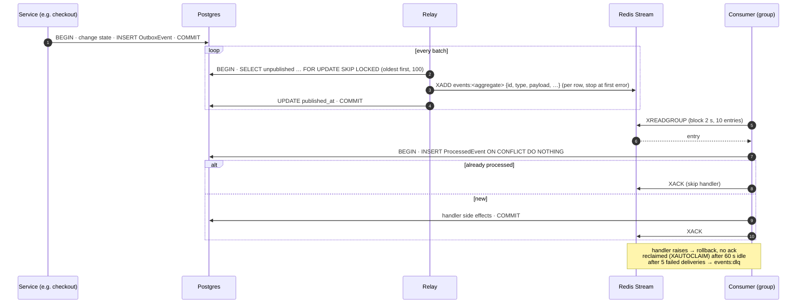

# Event pipeline

Every order state change, and every product-stats change, produces a **domain event**. Events
are what decouple the order flow from everything that reacts to it: stats, cache invalidation,
emails, live updates, the event log and analytics. The order flow doesn't know these exist.

The pipeline has three parts:

```
service transaction ──▶ OutboxEvent row ──relay──▶ Redis Stream ──consumer groups──▶ handlers
   (Postgres)             (same commit)            events:order, events:product
```

The guarantees: an event exists **if and only if** its change committed. It is delivered **at
least once**, and each consumer applies it **effectively once**.



## 1. Writing: the transactional outbox

`record_event()` in [backend/apps/events/outbox.py](../../backend/apps/events/outbox.py) inserts
an `OutboxEvent` row. It **refuses to run outside a transaction**: it raises `RuntimeError` if
there's no atomic block (`test_record_event_refuses_to_run_outside_a_transaction`). So it always
commits or rolls back together with the change it describes.

**Where it's called.** Only from the service layer: order services, the payment webhook's
refund flag, the `product_stats` consumer. Never from views or model signals.
- **Not views.** A view would miss every caller that isn't an HTTP request: the webhook-driven
  `pay()`, the Celery sweeper, management commands, and the replay.
- **Not model signals.**
  - Signals fire on **row saves**, not on business meaning: a save doesn't know whether it was a
    payment, a cancel or an expiry.
  - They don't fire for queryset `update()` calls, and the `F()` stock decrement is one.
  - They hide side effects inside `save()`.
- **The service has both the meaning and the transaction.** So it's the one place where "the
  event exists if and only if the change does" can be guaranteed.

**Why an outbox, instead of publishing to Redis directly from the service:**
- **Publishing before commit** could announce a change that then rolls back.
- **Publishing after commit** could be lost if the process dies in between.

With the outbox, the event is just another row in the same transaction. A rollback means no
event (`test_rollback_after_the_write_leaves_no_event`, `test_rejected_changes_leave_no_event`).

**The row** holds:
- `id`: a UUID, which is the event id everywhere downstream;
- `event_type`, `aggregate_type` (which stream) and `aggregate_id` (an order's `external_id`);
- `schema_version`, and the JSON `payload`.

The payload is round-tripped through `DjangoJSONEncoder`, so `Decimal` becomes `"75.01"` and
datetimes become ISO 8601, exactly as in the API.

### Order event payloads

`order_payload()` in [backend/apps/orders/events.py](../../backend/apps/orders/events.py) builds
everything a consumer needs **without re-querying**:
- the order id and `user_id`;
- `order_source` (plus `replay_run`), the status, the reason, and `occurred_at`;
- the lines grouped by (product, seller), with offer id, product id and slug, seller, quantity,
  and unit price and freight;
- the totals.

`ReservationExpired` adds `source` (`sweeper` or `payment_attempt`).

| Stream | Events |
|---|---|
| `events:order` | `OrderPlaced`, `OrderPaid`, `PaymentFailed`, `OrderCanceled`, `ReservationExpired`, `OrderInvoiced`, `OrderShipped`, `OrderDelivered`, `OrderUnavailable`, `PaymentRefundDue` |
| `events:product` | `ProductsChanged` (from the `product_stats` consumer) |

Additive payload fields don't change `schema_version`. `order_source` and `replay_run` were
added that way. A breaking change would bump it.

## 2. Relaying: outbox → Redis Streams

The relay ([backend/apps/events/relay.py](../../backend/apps/events/relay.py), compose service
`relay`, command `run_relay`) loops over **batches**, each batch one transaction:

1. **Select** up to `RELAY_BATCH_SIZE` (100) unpublished rows, oldest first, with
   `FOR UPDATE SKIP LOCKED`. A partial index on unpublished rows keeps this an index scan.
2. **`XADD` each row** to `events:<aggregate_type>`. The entry carries the event id. Streams are
   trimmed to about `EVENTS_STREAM_MAXLEN` (100,000) entries.
3. **Stop at the first Redis error.**
   - The failed row gets `attempts + 1` and `last_error`.
   - The relay never skips past a failed row, so within one relay a Redis hiccup can't reorder
     events.
4. **Stamp `published_at`** on the rows that were sent, and commit.

**Loop behaviour:**
- A full batch loops again immediately; an empty outbox polls every 0.5 s.
- Errors back off exponentially with jitter: 0.5 s doubling, capped at 30 s.

**Safe to scale.** A second relay skips the rows the first one holds, and takes the next ones
(`test_two_relays_never_publish_the_same_row`).

**A hung Redis can't hold row locks.** The Redis client has connect and socket timeouts (2 s and
5 s), so a hung Redis surfaces as an error within seconds. It doesn't hold the outbox row locks
open (`test_a_hung_redis_times_out_instead_of_holding_the_locks`).

**At least once.** A crash after `XADD` but before the commit leaves the rows unpublished, so
they're sent again. That's a duplicate entry with the same event id, which consumers dedupe.

## 3. Consuming: consumer groups + `ProcessedEvent`

Each consumer is a class with a `name` (its Redis consumer group, and its `ProcessedEvent.consumer`
value), the `streams` it reads, and the `event_types` it handles
([backend/apps/events/consumer.py](../../backend/apps/events/consumer.py)). `run_consumers`,
the compose service `consumers`, runs one thread per consumer, each with its own database
connection.

**Processing one entry:**

```
BEGIN
  INSERT INTO events_processedevent (consumer, event_id) … ON CONFLICT DO NOTHING RETURNING id
  -- no row returned: this consumer already applied it → skip the handler
  handler(event)                       -- side effects, same transaction
COMMIT
XACK                                   -- only after the commit
```

- **A crash after commit, before `XACK`.** The entry is redelivered. The insert then finds the
  row, and the handler isn't run again
  (`test_crash_after_commit_before_ack_does_not_apply_twice`).
- **A handler that raises.** The transaction rolls back, including the `ProcessedEvent` row, and
  the entry stays pending.
- **Event types the consumer doesn't handle** are acknowledged without a transaction.
- **A new consumer group starts from id 0.** It processes the stream's whole remaining history,
  and `ProcessedEvent` makes that safe.

### Recovery and dead letters

- **Reclaim.** Every 30 s a consumer runs `XAUTOCLAIM` for entries pending longer than
  `EVENTS_CLAIM_IDLE_MS` (60 s). This recovers both a failed handler and a crashed consumer's
  entries, and the idle time acts as a natural backoff.
- **Dead letter.** After `EVENTS_MAX_DELIVERIES` (5) attempts, the next delivery copies the entry
  to **`events:dlq`** and acknowledges it, so one poison event can't block the group
  (`test_a_poison_event_is_dead_lettered_and_the_group_keeps_moving`).
  - The DLQ entry keeps the original fields, plus `dlq_consumer`, `dlq_stream`, `dlq_entry_id`,
    `dlq_deliveries` and `dlq_error`.
  - Staff can retry it from `/staff/health` ([staff-tools.md](staff-tools.md)).
- **Dead consumer names.** Consumer names are `hostname-pid`, so a restart leaves the old name
  in the group. On start, a consumer removes names with **no pending entries** that have been
  idle longer than `EVENTS_CONSUMER_PRUNE_IDLE_MS` (10 min). It never removes one with pending
  entries: `XAUTOCLAIM` recovers those.
- **Redis errors.** The consumer loop backs off, 0.5 s doubling up to 30 s, and recreates its
  groups. That covers a Redis restart that lost them.

### No ordering guarantee: handlers are state-based

Entries can arrive out of order:
- a reclaimed entry is processed after newer ones;
- two relays interleave their batches.

So handlers never apply deltas such as "`sales_count += 3`". They **recompute from the database**
the state the event points at. Then the result is the same whatever the arrival order, and
however often an event is replayed. `product_stats` recomputes the products' `sales_count` and
`min_price`; `analytics` recomputes the order's purchase day.

## The six consumers

| Consumer | Reads | Does | Writes |
|---|---|---|---|
| `product_stats` | order events | Recomputes `sales_count` + `min_price` for the order's products. Skips replay | Product columns + a `ProductsChanged` event, same transaction |
| `cache_invalidation` | `ProductsChanged` | POSTs `product:<slug>` tags to Next's `/internal/revalidate` | — ([catalog-and-search.md](catalog-and-search.md#invalidation-when-stock-or-sales-change)) |
| `notifications` | order events + `PaymentRefundDue` | Writes a pending email row. Skips replay | `Notification` ([notifications.md](notifications.md)) |
| `order_live` | order events + `PaymentRefundDue` | Publishes a Redis Pub/Sub signal | — ([live-tracking.md](live-tracking.md)) |
| `event_log` | **all** types, both streams (`event_types = ALL`) | Stores each event once | `EventLog` ([staff-tools.md](staff-tools.md)) |
| `analytics` | order events | Recomputes the order's purchase day for its source | Projection tables ([analytics.md](analytics.md)) |

The `product_stats → ProductsChanged → cache_invalidation` chain is deliberate. Recording
`ProductsChanged` in the same transaction as the recompute guarantees the cache is dropped only
after the new values are committed.

## Why some things are *not* events

- **No inventory consumer.** Overselling is prevented synchronously, inside `checkout()`, under
  row locks. `min_price` is refreshed right after commit, because the in-stock filter must be
  correct immediately. Stock-driven cache refreshes already flow through `product_stats`. A
  stock event, such as "StockLow" or "OutOfStock", would have no reader yet. When a feature needs
  one, such as back-in-stock alerts, the plan is a new "OfferStockChanged" event (not in the code
  yet), emitted from `services.py`, where every stock change already happens.
- **The importer emits no events.** It isn't the order flow. After an import, stats are
  recomputed in bulk ([olist-import.md](olist-import.md)).
- **The home page's counts stay `COUNT(*)` queries.** Products and sellers come from the
  importer, which emits no events, so event-maintained counters would need a backfill and could
  drift.

## Operating it

- **Startup gate.** The relay and consumers wait for `make migrate` instead of crashing
  ([readiness.py](../../backend/apps/events/readiness.py)). They log one "waiting for the events
  tables" line, and wait again if `make reset` drops the schema under them. A consumer must
  never run without its tables: it would fail, and dead-letter, every event it read.
- **Retention.** Beat purges published outbox rows after `EVENTS_RETENTION_DAYS` (7). The outbox
  is a delivery buffer, not history. `EventLog` and `ProcessedEvent` are kept for
  `EVENT_LOG_RETENTION_DAYS` (90), because the explorer shows which consumers processed each
  logged event.
- **`make reset`** also runs `clear_event_streams`. It deletes only the `events:*` stream keys,
  with their groups and the DLQ; Celery shares the Redis database. Otherwise consumers would
  replay old events against a fresh database.
- **Health.** `/api/health` reports the outbox backlog: the unpublished count and the oldest
  row's age. `/staff/health` shows per-group pending and lag, active consumers, and dead letters.
- **Durability.** Redis persists streams with AOF `appendfsync everysec`. A hard crash can lose
  up to about 1 s of entries the outbox already marked published. This is listed in
  [limitations-and-roadmap.md](../limitations-and-roadmap.md).
- **Throughput.** For measured throughput (dated, with what each figure means), see
  [replay.md](replay.md#throughput).

## Sources

- [backend/apps/events/](../../backend/apps/events/) (outbox, relay, streams, consumer, readiness, consumers/, management/commands/, tasks)
- [backend/apps/orders/events.py](../../backend/apps/orders/events.py), [backend/config/settings/base.py](../../backend/config/settings/base.py) (`EVENTS_*`, `RELAY_BATCH_SIZE`)
- Tests: [test_events_outbox.py](../../backend/tests/test_events_outbox.py), [test_events_relay.py](../../backend/tests/test_events_relay.py), [test_events_consumer.py](../../backend/tests/test_events_consumer.py), [test_events_consumers.py](../../backend/tests/test_events_consumers.py), [test_events_readiness.py](../../backend/tests/test_events_readiness.py)
