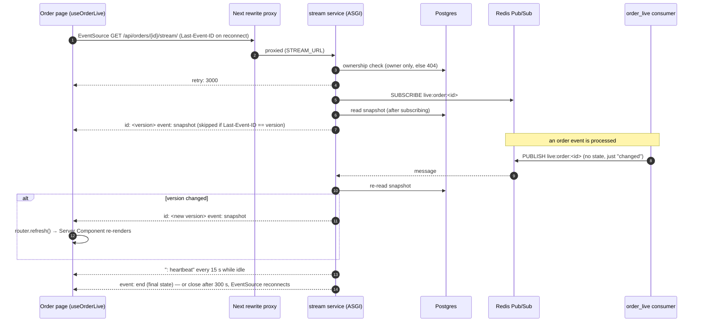

# Live order tracking (SSE)

An open order page updates by itself as the order changes. Payment confirmed, expired, refund
due, shipped during a replay: the page re-renders within seconds, with no reload and no
polling. This uses **Server-Sent Events** (SSE) from a dedicated ASGI service. A Redis Pub/Sub
signal wakes the stream, and the database supplies the state.

## Signal vs state

**The signal carries no state.**
- The `order_live` consumer
  ([backend/apps/events/consumers/order_live.py](../../backend/apps/events/consumers/order_live.py))
  publishes to `live:order:<external_id>` for every order event and for `PaymentRefundDue`.
- The payment return view publishes too, when it marks a payment "processing".
- The message only means "this order changed".

**The state always comes from the database.**
- On every signal, the stream re-reads a **snapshot** with `read_snapshot()` in
  [backend/apps/orders/live.py](../../backend/apps/orders/live.py).
- The snapshot holds `status`, `status_history`, `payment`, `can_pay`, `can_cancel` and
  `reservation_expires_at`.
- It's built with the same query and serializer as `GET /api/orders/{id}/`, so the live rules
  and the page's rules can't drift.

**Why not put the state in the message.** Pub/Sub is fire-and-forget: a subscriber that's away
for a moment misses messages. Because the stream always sends the current database state:
- a dropped signal is corrected by the next signal, by a reconnect, or by the fallback poll;
- a duplicate or out-of-order signal costs one extra read.

## Versions: never send the same state twice

`live_version` is a content hash (sha256, first 16 hex characters) of the snapshot fields. It's
also returned by the order detail API, so the page knows which version it rendered.

- **Each snapshot is sent as `id: <version>`.** EventSource stores that id and sends it back as
  `Last-Event-ID` when it reconnects. If it equals the current version, the stream doesn't
  re-send the state (`test_a_reconnect_with_the_current_version_does_not_replay_it`).
- **A signal that doesn't change the version sends nothing.** Examples: a duplicate signal for an
  event that was redelivered, or a signal for an event whose change is already in the snapshot
  the client has.
- **The frontend refreshes only on a new version.** `useOrderLive` in
  [frontend/src/lib/use-order-live.ts](../../frontend/src/lib/use-order-live.ts) calls
  `router.refresh()` only when a snapshot's version differs from the version the page was
  rendered with.
  - The page stays a Server Component with **one render path**. The stream never patches the
    page from the client side.
  - Changes are rare (a few per order), so a refresh per change is cheap.

## Stream lifecycle

`order_stream` and `event_stream` are in
[backend/apps/orders/stream.py](../../backend/apps/orders/stream.py).

1. **Access is owner-only.** Anonymous gets a 401, and another user's order a 404, the same as
   the order API (`test_other_users_get_404_and_anonymous_401`).
2. **The first message** is `retry: 3000` (the reconnect delay).
3. **Subscribe, then read.** The stream subscribes to `live:order:<id>` **before** it reads and
   sends the snapshot.
   - A change committed before the subscription is already in that read. A change committed
     after it sends a signal.
   - The other order would leave a gap. A change committed between an earlier read and the
     subscription would produce a signal nobody hears, and the page would show stale state until
     the next signal, a reconnect or the fallback
     (`test_a_change_committed_while_subscribing_is_not_missed`).
   - A signal for a change the first read already includes costs one re-read, and the version
     check absorbs it.
   - If the order is already final, the stream sends `event: end` and closes. "Final" means
     delivered, canceled or unavailable, with no payment still processing: a canceled order can
     still receive a late refund-due event while one is.
4. **The loop:**
   - **Wait** for a Pub/Sub message, at most 15 s (`ORDER_STREAM_HEARTBEAT_SECONDS`).
   - **On a signal:** re-read, and send if the version changed.
   - **On a timeout:** send `: heartbeat`, an SSE comment the client ignores. It keeps proxies
     from closing an idle connection.
   - **Payment overdue.** A "processing" payment turns overdue after 180 s **without any event**.
     So the stream sets its timeout to wake at `overdue_at`, and sends the state in which Pay is
     offered again (`test_processing_turns_overdue_without_a_signal`).
5. **Close after 300 s** (`ORDER_STREAM_MAX_SECONDS`). EventSource reconnects by itself with
   `Last-Event-ID`. A periodic close bounds how long any one connection lives.
6. **Cleanup.** The `finally` block unsubscribes and closes the Redis connection **on every
   exit**: final state, timeout, error, or the browser going away. Django cancels the response
   task when uvicorn reports `http.disconnect` (`test_disconnect_unsubscribes`).

## Why a separate ASGI service

**An open SSE connection lasts minutes.**
- **Under WSGI** each one would hold a worker thread for its whole life.
- **Under ASGI** (uvicorn, [config/asgi.py](../../backend/config/asgi.py)) it's a suspended
  coroutine.

**Why not move the whole API to ASGI.** The API is synchronous Django code. Under ASGI, sync
views run through one thread-sensitive executor and would queue behind each other. So:
- **Only this path runs on ASGI.** It's the compose service `stream`, port 8001 internally.
- **Everything else stays on WSGI.** The view **refuses under WSGI** with a 404 instead of
  letting Django buffer the whole stream
  (`test_the_wsgi_backend_refuses_to_stream`).

Snapshot reads run with `sync_to_async(..., thread_sensitive=False)`, so concurrent streams
don't queue on Django's single thread-sensitive thread. Each read **closes its database
connection** afterwards, or long-lived streams would leave pool threads holding connections
(`test_many_streams_leave_the_db_connection_count_stable`).

## Getting through the proxy

**Routing.** The browser opens `/api/orders/<id>/stream/` on the frontend origin, for the same
first-party session cookie as every other API call.
[frontend/next.config.ts](../../frontend/next.config.ts) rewrites exactly that path to
`STREAM_URL`, **before** the general `/api/*` rule.

**Two headers keep the stream unbuffered:**
- **`Cache-Control: no-cache, no-transform`.** Next's rewrite proxy compresses responses, and
  compression buffers an SSE stream completely. During Step 6, recorded in CLAUDE.md, only 10
  bytes arrived in 35 s without this header. `no-transform` tells it not to touch the body.
- **`X-Accel-Buffering: no`.** This does the same for nginx-style proxies that might sit in
  front in production.

**Heartbeats** every 15 s stay under the rewrite proxy's 30 s idle timeout.

## Failure modes

| Failure | What happens |
|---|---|
| Redis is down when the stream starts, or drops mid-stream | The stream re-reads the database every 5 s (`ORDER_STREAM_FALLBACK_POLL_SECONDS`) (`test_without_redis_it_polls_the_database`) |
| The `stream` service restarts | EventSource reconnects with `Last-Event-ID`, and gets only what changed |
| The consumers are down | No signals arrive. Events wait in the durable stream, and signals catch up when the consumers restart |
| A signal is lost (Pub/Sub) | The next signal, a reconnect within 300 s, or the fallback corrects it |
| EventSource gives up (a non-200 response, e.g. the stream service is unreachable) | The page falls back to `router.refresh()` every 15 s (`FALLBACK_POLL_MS`) |

**What the visitor sees.** `OrderLive` renders nothing while connected. A small "reconnecting"
badge appears only after 5 s of disconnection (`SHOW_DISCONNECTED_AFTER_MS`), so a routine
reconnect doesn't flash a warning. There is **no short-interval polling** anywhere.

## Limits

- **One Redis connection per open stream.** That's fine at this scale. At scale, the design
  would be one shared subscriber per `stream` process (pattern-subscribing to `live:order:*`),
  fanning out to per-connection queues.
- **Only the order detail page is live.** The `/orders` list has no live status badges yet. That
  would need a per-user channel.

Both are listed in [limitations-and-roadmap.md](../limitations-and-roadmap.md).

## Sources

- [backend/apps/orders/live.py](../../backend/apps/orders/live.py), [backend/apps/orders/stream.py](../../backend/apps/orders/stream.py), [backend/apps/events/consumers/order_live.py](../../backend/apps/events/consumers/order_live.py), [backend/apps/payments/services.py](../../backend/apps/payments/services.py) (`mark_returned`)
- [backend/config/asgi.py](../../backend/config/asgi.py), [docker-compose.yml](../../docker-compose.yml) (`stream`), [frontend/next.config.ts](../../frontend/next.config.ts)
- [frontend/src/lib/use-order-live.ts](../../frontend/src/lib/use-order-live.ts), [frontend/src/components/orders/order-live.tsx](../../frontend/src/components/orders/order-live.tsx)
- Tests: [test_order_stream.py](../../backend/tests/test_order_stream.py), [test_order_live_consumer.py](../../backend/tests/test_order_live_consumer.py), [use-order-live.test.tsx](../../frontend/src/lib/use-order-live.test.tsx)
