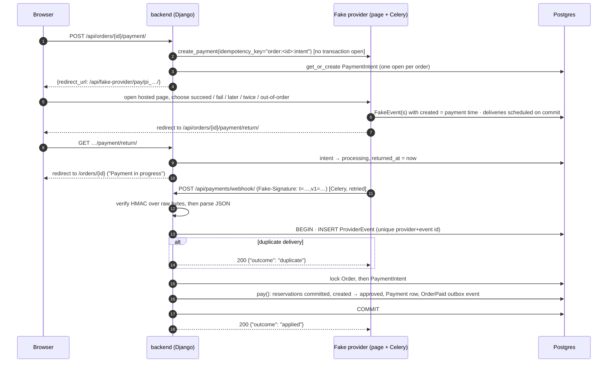

# Payments

Payments work like Stripe Checkout:
1. The shop creates a payment at the provider.
2. The customer pays on the provider's own hosted page, and is redirected back.
3. The result arrives later, as a **signed webhook**.

The provider here is fake. It's a dev/test-only Django app that behaves like a real one,
including slow, duplicated and out-of-order webhooks. So all the merchant-side code is real, and
its edge cases are tested.

**Why a fake provider instead of Stripe test mode.**
- **Stripe is invite-only in India.** An Indian business must request an invite, and the account
  must belong to a registered business, not an individual.
- **The currency doesn't fit an Indian gateway.** The Olist data is in BRL, which an Indian
  payment gateway wouldn't handle.
- **The fake makes the hard cases testable.** Late, duplicate and out-of-order webhooks happen
  deterministically, in tests and on demand from the hosted page.
- **A real provider stays pluggable.** The `PaymentGateway` interface keeps the swap to one
  class.

## Two models, two jobs

| Model | Job |
|---|---|
| `payments.PaymentIntent` | The provider lifecycle of one payment attempt: `requires_payment → processing → succeeded / failed`, plus `needs_refund` |
| `orders.Payment` | The settled ledger, in Olist's shape (sequential, type, installments, value). Written by `services.pay()` when an order is actually paid |

Keeping them apart means the ledger contains only money that settled against an order. The
messy provider states (abandoned, failed, duplicate, late) stay in `PaymentIntent` and
`ProviderEvent`.

## The provider interface

[backend/apps/payments/gateway.py](../../backend/apps/payments/gateway.py) defines
`PaymentGateway`, a `Protocol` with two methods:

- **`create_payment(amount, currency, reference, return_url, expires_at, idempotency_key)`**
  returns the provider's payment id and the URL of its hosted page. It may do network I/O, so it
  is **never called inside a database transaction**.
- **`parse_webhook(raw_body, headers)`** verifies the signature, then returns a normalised
  `WebhookEvent`: id, type, the provider's `created` time, and the payment id.

`get_gateway()` picks the implementation from `PAYMENT_PROVIDER`. `fake` additionally requires
`ALLOW_FAKE_PAYMENTS`, which only the dev and test settings set. Adding a real provider means
adding one class. The rest of the app only sees these types.

## The flow



### 1. Starting a payment

`POST /api/orders/{id}/payment/` calls `start_payment()` in
[backend/apps/payments/services.py](../../backend/apps/payments/services.py):

- **Payable check.** The order must be unpaid (`invalid_transition` otherwise), and its stock
  hold must not have expired (`reservation_expired`).
- **An open intent is reused.** If one exists (`requires_payment` or `processing`), it's returned
  as is. Clicking Pay again, or retrying after "processing" went overdue, reaches the **same**
  provider payment, so nobody can be charged twice.
- **Otherwise, a new payment at the provider.** `create_payment()` is called **outside any
  transaction**, with the idempotency key `order:<external_id>:intent`. Then a short transaction
  locks the order and inserts the intent.
- **Two concurrent clicks.** They get the same provider payment, because the key is the same.
  The insert is guarded by a savepoint and the unique `provider_payment_id`, and the partial
  unique index `uniq_open_intent_per_order` allows only one open intent per order
  (`test_two_concurrent_pay_clicks_get_one_intent`).

Starting a payment needs no `Idempotency-Key` header. These constraints make it idempotent by
construction.

### 2. The hosted page

`/api/fake-provider/pay/<pi_id>/` is the provider's page, served through the Next proxy, so one
relative URL works in every browser. It offers:

| Choice | What the provider does |
|---|---|
| Succeed | A `payment_intent.succeeded` event, delivered immediately |
| Fail | A `payment_intent.payment_failed` event, delivered immediately |
| Succeed after a delay (10 s, 30 s, 1 min, or "after the stock hold expires") | The payment **happens now** (the event's `created` time is now), but the delivery is delayed |
| Deliver each webhook twice | Every delivery is scheduled a second time, 1 s later |
| Declined then succeeded, delivered out of order | A decline (created 1 s earlier) and a success; the success is delivered first, the decline 3 s later |

- **`FAKE_PROVIDER_DUPLICATE_DELIVERY`** makes "twice" the default.
- **The page refuses once the stock hold has expired**, as a real checkout session would.
- **Delivery.** It's done by the Celery task `deliver_event`
  ([backend/apps/fake_provider/tasks.py](../../backend/apps/fake_provider/tasks.py)). A non-2xx
  response is retried with backoff (5 s doubling, at most 5 min, up to 6 retries), and each
  attempt is signed with a fresh timestamp. Retries are another way the merchant sees the same
  event twice.

### 3. Returning: `processing` is UI state only

`GET /api/orders/{id}/payment/return/` is where the provider sends the customer back. It marks
the open intent `processing` and sets `returned_at`, then redirects to `/orders/{id}`.

**Why store "processing" at all.** The webhook may not have arrived yet. Without a stored
state, the page would offer Pay again, and a reload would lose the "in progress" message. So:

- `processing` is stored server-side, and it survives reloads. No URL parameter carries
  payment state.
- **It decides nothing.** Only the webhook moves the order.
- **It hides Pay** for `PAYMENT_CONFIRMATION_TIMEOUT_SECONDS` (180 s) after `returned_at`.
  - Past that, `confirmation_overdue` is true and Pay is offered again, because a webhook may
    never come.
  - Paying again reuses the same intent, so this can't double-charge.
- **It's a GET with a side effect, on purpose.** It's a redirect target, and it only changes UI
  state.
- **The page updates live.** The view publishes a live-update signal on commit, so an open
  order page refreshes at once ([live-tracking.md](live-tracking.md)).

### 4. The webhook

`POST /api/payments/webhook/` is a **plain Django view, not DRF**
([backend/apps/payments/views.py](../../backend/apps/payments/views.py)). The signature
covers the raw request bytes, and DRF's parsing would hand over re-serialised data that no
longer matches them.

**The signature**
([backend/apps/payments/signature.py](../../backend/apps/payments/signature.py)) follows
Stripe's scheme:

```
Fake-Signature: t=<unix seconds>,v1=<hex>[,v1=<hex>…]
v1 = HMAC-SHA256(PAYMENT_WEBHOOK_SECRET, "<t>." + raw_body)
```

- **The timestamp is signed with the body.** A captured request can't be re-sent later with a
  new `t`.
- **Freshness.** `t` must be within `PAYMENT_WEBHOOK_TOLERANCE_SECONDS` (300 s) of now. That
  bounds how long a captured request stays usable.
- **Constant-time comparison.** Each candidate is compared with `hmac.compare_digest`, so the
  response time doesn't reveal how much of a guess matched.
- **Secret rotation.** Several `v1` values are accepted, so a secret can be rotated without
  downtime.
- **A vague failure.** Any failure is a `400 {"detail": "Invalid webhook"}`, with nothing that
  would help forge a signature.
- **Parsing order.** The JSON is parsed only **after** the signature checks out.

**Applying the event** is `handle_webhook()`, all in **one transaction**:

1. **Record the event.** Insert `ProviderEvent(provider, provider_event_id)`. The unique key
   makes this the idempotency guard. A duplicate delivery hits the constraint, inside a
   savepoint, and returns `"duplicate"` with a 200. The provider must stop retrying events
   we've already seen.
2. **Ignore what we don't act on.** An unknown payment id or an event type we don't use is
   recorded with outcome `no_change`, and acknowledged.
3. **Lock order first, then the intent** (the project lock order), and apply the success or
   failure.
4. **Store the outcome** on the `ProviderEvent`: `applied`, `ignored_stale`, `refund_flagged`
   or `no_change`.

If anything fails, the whole transaction rolls back, including the `ProviderEvent` row. The
endpoint answers 500, the provider retries, and the retry is processed from scratch.
`test_a_webhook_that_fails_partway_rolls_back_and_applies_once_on_retry` makes the handler crash
**after** `pay()` has applied everything, then checks that:
- the response is a 500;
- no order, ledger, event, reservation or stock change survived;
- the retry is applied exactly once.

## Late and out-of-order webhooks

Webhooks can arrive late, twice, or in the wrong order. The rules below decide every case from
the event's **own `created` time** and the order's state under its lock, never from the arrival
order.

| Situation | Result | Test |
|---|---|---|
| Success, order still unpaid, hold still active at the event's `created` time | `pay(now=event.created)`: approved, `OrderPaid`. Approved **however late the delivery**, as long as the stock wasn't released | `test_success_delivered_late_but_paid_in_time_is_approved` |
| Success delivered twice | The second is a `duplicate` | `test_success_approves_once_even_when_delivered_twice` |
| Decline, order unpaid | `pay(fail)`: canceled, stock returned, `PaymentFailed` | `test_decline_cancels_once` |
| Decline older than an applied success (out of order) | `ignored_stale`: nothing changes | `test_a_stale_decline_after_the_success_is_ignored` |
| Decline, then success, delivered in that order | The decline cancels; the success then finds the order canceled and flags a refund | `test_decline_then_success_in_order_cancels_and_flags_a_refund` |
| Success after the sweeper already canceled the order | No transition; refund flagged | `test_success_after_the_sweeper_released_the_order_needs_a_refund` |
| Success whose payment happened after the hold expired (order still `created`) | `pay()` cancels it (`ReservationExpired`), then the refund is flagged | `test_success_paid_after_expiry_cancels_and_needs_a_refund` |
| Success for an order that's already approved (a second payment, a defensive path: `start_payment` never opens one) | No transition, stock and ledger unchanged; refund flagged, with the email explaining a second payment | `test_a_second_payment_for_a_paid_order_flags_a_refund_and_one_email` |

**Why a decline cancels the order** instead of leaving it open for another attempt:
`TODO(why)`. Neither CLAUDE.md nor the code records the reason; the test only says "Our rule: a
decline cancels the order". The effect is that a declined customer's stock is returned
immediately and they place a new order to try again. A later success for the canceled order is
refunded, as described below.

### Refund due

A successful payment for an order that can no longer take it **never revives the order**.
`_flag_refund()` does three things in the same transaction:

1. Sets `PaymentIntent.needs_refund = True` and `refund_reason`. The admin's PaymentIntent list
   can be filtered by `needs_refund`.
2. Records a **`PaymentRefundDue`** event on the `events:order` stream. Its payload is the order
   plus the payment details.
3. Stores outcome `refund_flagged` on the `ProviderEvent`.

The `notifications` consumer turns `PaymentRefundDue` into the refund-due email
([notifications.md](notifications.md)), and `order_live` refreshes an open order page.

**The email never shows the stored reason.** `refund_reason` is an internal string, kept
unchanged on the intent and in the payload. The email maps it to customer-facing text
([rendering.py](../../backend/apps/notifications/rendering.py)):

| Order state, stored `refund_reason` | Email says |
|---|---|
| canceled, `paid after the order was canceled` | "We received your payment of R$ X, but the order had already been canceled, so we couldn't accept it." |
| canceled, `paid after the stock hold expired` | "…, but your payment arrived after the stock hold expired, so we couldn't accept it." |
| canceled, any other reason | "…, but the order could no longer take a payment, so we couldn't accept it." |
| still paid, `order already <status>` | "We're sorry: a second payment of R$ X was received for an order that was already paid." |

Every email continues: "We owe you a refund of R$ X; you don't need to do anything." The tests
are `test_refund_reasons_are_shown_in_customer_terms`, `test_a_refund_due_for_a_canceled_order_says_so`
and `test_a_second_payment_for_a_paid_order_flags_a_refund_and_one_email`.

There is no refund logic yet: the flag and the event are the hand-off. See
[limitations-and-roadmap.md](../limitations-and-roadmap.md).

### The sweeper and a success webhook race

The expiry sweeper and a success webhook can arrive at the same moment. Both lock the order
first, so exactly one wins:
- **If the webhook gets the lock first** and the payment was in time, the order is approved.
  The sweeper then skips it: it uses `SKIP LOCKED`, and re-checks the status under the lock.
- **If the sweeper gets the lock first**, the order is canceled, and the webhook then flags a
  refund.

`test_sweeper_and_success_webhook_race_has_exactly_one_winner` and
`test_race_outcome_is_decided_by_who_holds_the_order_lock` cover both orders.

## In production

- **A real provider.** `PAYMENT_PROVIDER` would name a real gateway class. `ALLOW_FAKE_PAYMENTS`
  must be off, so the fake provider's URLs aren't mounted, and `PAYMENT_WEBHOOK_SECRET` must be a
  real secret.
- **The raw body.** If the webhook is routed through the Next `/api` rewrite, the bytes must
  arrive unchanged (no re-encoding or decompression). Otherwise, point the provider directly at
  Django.

These items are in CLAUDE.md's "Before deploying" list.

## Sources

- [backend/apps/payments/](../../backend/apps/payments/) (gateway, signature, services, views, models)
- [backend/apps/fake_provider/](../../backend/apps/fake_provider/) (gateway, provider, tasks, views, models)
- [backend/apps/orders/services.py](../../backend/apps/orders/services.py) (`pay`), [backend/apps/orders/serializers.py](../../backend/apps/orders/serializers.py) (`can_pay`, payment state)
- Tests: [test_payments_flow.py](../../backend/tests/test_payments_flow.py), [test_payments_webhook.py](../../backend/tests/test_payments_webhook.py), [test_payments_signature.py](../../backend/tests/test_payments_signature.py)
