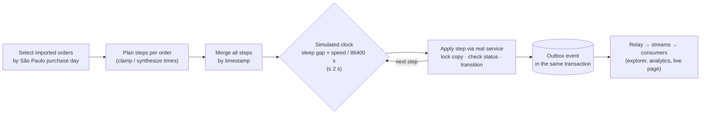

# Replay: historical orders as live events

The imported Olist orders are history: the importer writes them directly and emits no events.
The replay re-enacts a date range of that history **through the real order lifecycle**:
1. Each order is placed, paid, invoiced, shipped and delivered (or canceled) at its historical
   time, on a simulated clock.
2. Every step is a real service call, which records a real event.

So the relay, every consumer, the live order page, the event explorer and the analytics
dashboard all see a realistic flow of traffic. It's a demo, a load test and a consistency
check in one.

```
make replay                                  # Black Friday week 2017, --speed 10
make replay ARGS="--from 2017-11-20 --to 2017-11-30 --speed 0 --limit 500"
make replay ARGS="… --dry-run"               # print the plan, write nothing
make replay-reset                            # remove everything the replays created
```

The command is `replay_orders --from --to [--limit] [--speed S] [--dry-run]`. It's dev/test only:
it refuses to run without `ALLOW_DEV_SEED`. Code:
[backend/apps/replay/services.py](../../backend/apps/replay/services.py) and its
[management commands](../../backend/apps/replay/management/commands/).



## Copies, not the originals

Each imported order gets **one copy**: a new `Order` with `source='replay'`.
- **Links.** It has `replay_of` (the original) and `replay_run` (the `ReplayRun`).
- **Owner.** It belongs to `replay@example.com`. Log in as that user to watch a copy's order page
  update live.
- **What's copied:** the buyer's city, state and ZIP, the items, the purchase time and the
  estimated delivery date.
- **One copy per original.** The partial unique index `uniq_replay_copy` on `replay_of`
  guarantees it.
- **The originals are never modified.**

## Steps

`plan_order()` turns an order's Olist history into steps with timestamps:

| Olist final status | Steps |
|---|---|
| delivered | place → approve → invoice → ship → deliver |
| shipped | place → approve → invoice → ship |
| invoiced | place → approve → invoice |
| approved, processing | place → approve (`processing` is historical only, so the copy stays approved) |
| unavailable | place → approve → unavailable |
| canceled, never approved | place → cancel (unpaid) |
| canceled after approval | place → approve → cancel (paid) |
| created | place |

**Times.** Olist records purchase, approval, carrier pickup, delivery and estimated delivery. It
has **no** invoiced, canceled or unavailable times, so those are synthesized:
- **Invoice:** approval + 1 h, but before the carrier pickup (at most halfway between approval and
  pickup).
- **Cancel or unavailable:** the previous step + 1 h.
- **Out-of-order Olist dates** are clamped, so time never goes backwards.

**One exception.** One imported order in the small seed was canceled **after shipping**, and
`shipped → canceled` isn't a legal transition. It's replayed as canceled right after approval,
and the command reports it.

**Each step is a real service call** in [apps/orders/services.py](../../backend/apps/orders/services.py):

| Step | Service | Event |
|---|---|---|
| place | `create_copy()` (order + items + history in one transaction) | `OrderPlaced` |
| approve | `pay(success, now=approved_at)`: the real payment service, which writes the ledger row | `OrderPaid` |
| invoice / ship / deliver | `invoice()`, `ship()`, `deliver()` | `OrderInvoiced`, `OrderShipped`, `OrderDelivered` |
| unavailable | `mark_unavailable()` | `OrderUnavailable` |
| cancel (unpaid / paid) | `cancel(reason="canceled_before_payment")` / `cancel_paid()` | `OrderCanceled` |

**Historical times go into:**
- the order's timestamp columns;
- the event payload's `occurred_at`;
- `OrderStatusHistory.occurred_at`, which the customer order page shows, with the year, for
  replay copies.

The outbox and event-log row times stay real, because they describe when the system processed
the event.

### The simulated clock

All selected orders' steps are **merged by timestamp** and applied in that order. Between two
steps the runner sleeps `gap × speed / 86400` seconds, capped at **2 s** per gap.
- `--speed` is the number of real seconds per simulated day. The default is 10.
- `--speed 0` doesn't wait at all.
- The cap stops quiet nights from stalling the replay. A gap longer than about 5 simulated hours
  would otherwise wait more than 2 s at the default speed.

**How long the default replay takes.** The range selects orders by **purchase** day, but each
order's later steps (invoice, ship, deliver) happen days or weeks afterwards.
- **The steps run on well past the purchase window.** The default range is 20–30 Nov 2017 (11
  purchase days). Its 85 orders produce 423 steps, which run from 20 Nov 2017 until the last
  delivery on 15 Jan 2018: about 8 weeks of simulated time.
- **Duration.** At `--speed 10`, a whole simulated day would take 10 s. In practice most gaps
  between consecutive steps are capped at 2 s, so the duration follows the number of steps more
  than the calendar span.
  - The command's dry run (`--dry-run`, 2026-11-09) estimates **200 s plus processing**.
  - In browser QA on 2026-11-09, deliveries were arriving about 3 minutes in.

## What's bypassed, and why

| Bypassed | Why |
|---|---|
| Cart, checkout, reservations | Reserving would **drain real offer stock**, and these orders were fulfilled years ago. Stock never moves during a replay |
| The payment provider, webhooks, `PaymentIntent` | There's no customer to pay. Approval goes straight through the real `pay()` |
| Emails | The `notifications` consumer skips replay events; there would be thousands of emails to one dev account |

**The shop is unaffected:**
- `OFFERS_SQL` (prices) and `SALES_SQL` (`sales_count`) exclude `source='replay'`, as does the
  public orders count.
- The `product_stats` consumer skips replay events.
- Replay events still flow through the event log, analytics (as source `replay`) and live
  tracking.

**Only the replay moves a replay order:**
- **The sweeper** excludes `source='replay'`. Copies hold no reservations anyway, so it couldn't
  match them, but the guarantee shouldn't depend on that.
- **The owner can watch but not act.** `can_pay` and `can_cancel` are false, and the cancel,
  payment and return endpoints answer `409 replay_read_only`. The order page shows a "Replayed
  historical order" note.
- **`cancel_paid` and `mark_unavailable` refuse non-replay orders.** A real paid cancellation
  needs refund and restock logic that doesn't exist yet.

## Idempotent and resumable

- **A step applies only while the copy is in that step's from-status.**
  - Each service locks the copy (`select_for_update`) and re-checks the status in the
    transaction that transitions it.
  - Re-running a range (after Ctrl-C, or an overlapping range) advances existing copies, and
    duplicates nothing (`test_rerun_resumes_and_adds_nothing`).
- **Even two runners over the same orders apply every step once:** one `Payment` and one
  `OrderPaid` per copy (`test_two_runners_over_the_same_orders_apply_every_step_exactly_once`,
  run concurrently).
- **Ctrl-C** (SIGINT or SIGTERM) sets a stop flag. The current step finishes, the run is saved as
  `interrupted`, and the command prints how to resume
  (`test_ctrl_c_stops_after_a_step_and_the_next_run_completes_without_duplicates`).

## One running replay at a time

Each invocation is a `ReplayRun` ([models.py](../../backend/apps/replay/models.py)). It records:
the range, speed and limit; the status (`running`, `completed`, `interrupted`, `failed`); counts;
the simulated cursor; and `heartbeat_at`.

- **Start.** `start_run()` relies on the **partial unique index `one_running_replay`** (status =
  `running`), not on read-then-insert. When two processes start at once, one insert wins and the
  other gets `IntegrityError`, which becomes "one replay at a time"
  (`test_two_runs_starting_at_once_cannot_both_start`).
- **Heartbeat.** A running replay saves `heartbeat_at` at least every 30 s.
- **Takeover.** A `running` run that's been silent for **5 min** (`STALE_AFTER`) is treated as
  dead: its process crashed or was killed. The next `replay_orders` or `replay_reset` marks it
  `failed` ("Abandoned: no heartbeat since …") and takes over
  (`test_a_dead_run_is_taken_over_after_its_heartbeat_goes_stale`). A live run is refused.
- **Self-abort.** Every runner write (heartbeat, progress, final status) is
  `UPDATE … WHERE id = ? AND status = 'running'`. Zero rows updated means another process has
  taken this run over.
  - The runner stops before its next step, because the heartbeat check runs at the top of the
    loop. It never overwrites `failed`.
  - The command exits with a clear message.
  - This protects against a process that was frozen (say, a suspended laptop) and resumes after
    being taken over (`test_a_taken_over_run_stops_without_writing_further_steps`).

## Reset

`replay_reset [--run N] [--force]` (`make replay-reset`) removes every trace:
- **Deleted:** the copies (cascading to their items, ledger rows and history), their outbox,
  `EventLog`, `ProcessedEvent` and `Notification` rows, and the runs.
- **Rebuilt:** the affected `(day, 'replay')` projections. Product stats are refreshed.

`test_replay_leaves_the_shop_alone_and_reset_removes_every_trace` checks that projections and
product stats equal their pre-replay values afterwards, and that stock and the imported orders
are unchanged.

**It refuses to run while:**
- **a live run is `running`** (a dead one is taken over as above);
- **the order stream has unprocessed entries.** Events still in flight would be logged again
  after their orders are gone.

`--force` skips both checks, as a last resort. Redis stream entries aren't deleted: they're
already acknowledged, and they're trimmed eventually.

`Order.replay_of` is `PROTECT`, so deleting an imported order that has a copy fails loudly.
Nothing deletes orders today:
- the importer only upserts. During Step 7c, re-importing with copies present created 0 new rows
  and changed no offers or stats;
- `make reset` drops the whole schema.

## Throughput

**Measured on 2026-11-09:** replay #3 at `--speed 0`, 2,000 orders, 9,896 events, on a dev
laptop with the full compose stack running.

| Figure | Value | What exactly it measures |
|---|---|---|
| Write rate | ~90 events/s | The replay command's own output: 9,896 steps applied in 110.2 s, one transaction per step |
| `event_log`, `order_live`, `product_stats` latency | p95 0.87 s, 1.06 s, 0.78 s (all < 1.1 s) | Per consumer, `ProcessedEvent.processed_at − OutboxEvent.occurred_at`: from the outbox write (real time) to that consumer's commit, **including the relay hop** |
| `notifications` latency | p95 0.63 s (4,002 events) | The same measure; it acknowledges replay events without writing anything |
| `analytics` latency | p50 31.65 s, p95 74.67 s, max 76.1 s | The same measure |
| `analytics` rate | ~64 events/s | Processed count ÷ the span of its `processed_at` times |
| `analytics` backlog peak | 3,979 entries | `XINFO GROUPS` pending + lag for the analytics group, sampled every 2 s |
| `analytics` drain | ~45–50 s after the replay ended | The last non-zero analytics sample (~159 s) minus the replay's end (110.2 s), in sampler time |
| Outbox | unpublished count ≤ 65 throughout | Sampled every 2 s. The relay hop has no separate latency figure |
| Consistency | equal | The replay source's orders, paid orders and GMV totals equalled the imported (`olist`) ones: 2,000 / 1,976 / R$ 316.909,40 |

**Browser QA, 2026-11-09.**
- The default replay (85 orders, 20–30 Nov 2017) matched the imported Olist orders for the same
  days on all six dashboard KPIs: 85 orders, 84 paid, GMV R$ 16.550,08, 1.2% canceled,
  18.8 days average delivery, 25.0% late.
- `replay_reset` then restored every baseline figure: the home count, analytics for every source,
  product stock flags and sales counts.

**The bottleneck is `analytics`.** It re-aggregates the whole purchase day on every event. The
planned fix is to coalesce each read batch to its distinct days ([analytics.md](analytics.md#performance)).

## Sources

- [backend/apps/replay/](../../backend/apps/replay/) (models, services, management/commands/replay_orders.py and replay_reset.py)
- [backend/apps/orders/services.py](../../backend/apps/orders/services.py) (fulfilment services, `replay_only`), [backend/apps/orders/views.py](../../backend/apps/orders/views.py) (`refuse_replay`), [backend/apps/catalog/stats.py](../../backend/apps/catalog/stats.py) (replay exclusions)
- Tests: [test_replay.py](../../backend/tests/test_replay.py)
